# 00 - Cybersecurity Foundations: The Definitive Beginner-to-Analyst Roadmap

> **Target Audience**: Complete beginners with zero prior background in information technology, computer science, or networking.  
> **Mission**: Build an unshakeable conceptual and technical foundation across computer architecture, operating systems, networking, command-line operations, scripting, virtualization, cryptography, and core security frameworks.  
> **Progression**: Mastering this foundation directly unlocks the defensive operations in [01-CompTIA-Security-Plus.md](01-CompTIA-Security-Plus.md) and the offensive methodologies in [02-CEH.md](02-CEH.md).

---


## Master Table of Contents
- [1. Pedagogical Blueprint & Orientation](#1-pedagogical-blueprint--orientation)
- [2. Introduction to Computers and Operating Systems](#2-introduction-to-computers-and-operating-systems)
  - [2.1 Hardware Architecture Fundamentals](#21-hardware-architecture-fundamentals)
  - [2.2 Software Hierarchy and the Kernel](#22-software-hierarchy-and-the-kernel)
  - [2.3 Operating System Resource Management](#23-operating-system-resource-management)
- [3. How the Internet and Data Communication Work](#3-how-the-internet-and-data-communication-work)
  - [3.1 Circuit Switching vs. Packet Switching](#31-circuit-switching-vs-packet-switching)
  - [3.2 The Global Network Fabric (ISPs, IXPs, and Backbones)](#32-the-global-network-fabric-isps-ixps-and-backbones)
  - [3.3 Anatomy of a Data Packet & Encapsulation Lifecycle](#33-anatomy-of-a-data-packet--encapsulation-lifecycle)
  - [3.4 Cyberspace Dimensions, Internet Physical Infrastructure & Global Governance](#34-cyberspace-dimensions-internet-physical-infrastructure--global-governance)
- [4. Networking Fundamentals & Architectural Reference Models](#4-networking-fundamentals--architectural-reference-models)
  - [4.1 Network Topologies and Physical Hardware](#41-network-topologies-and-physical-hardware)
  - [4.2 The OSI 7-Layer Reference Model (In-Depth)](#42-the-osi-7-layer-reference-model-in-depth)
  - [4.3 The TCP/IP 4-Layer / 5-Layer Suite Comparison](#43-the-tcpip-4-layer--5-layer-suite-comparison)
- [5. IP Addressing, Subnetting, and CIDR](#5-ip-addressing-subnetting-and-cidr)
  - [5.1 IPv4 Addressing Architecture & Classes](#51-ipv4-addressing-architecture--classes)
  - [5.2 Public vs. Private Addressing (RFC 1918)](#52-public-vs-private-addressing-rfc-1918)
  - [5.3 Subnetting Demystified: The Beginner's Calculation Engine](#53-subnetting-demystified-the-beginners-calculation-engine)
  - [5.4 IPv6 Addressing & Architecture](#54-ipv6-addressing--architecture)
- [6. Essential Network Protocols & Master Port Directory](#6-essential-network-protocols--master-port-directory)
  - [6.1 Demystifying Network Ports](#61-demystifying-network-ports)
  - [6.2 Core Network Protocols (ARP, DHCP, DNS, TCP, UDP, ICMP, NAT)](#62-core-network-protocols-arp-dhcp-dns-tcp-udp-icmp-nat)
  - [6.3 Application & Administrative Protocols](#63-application--administrative-protocols)
  - [6.4 Master Network Port Reference Table](#64-master-network-port-reference-table)
- [7. Linux Operating System Fundamentals for Security](#7-linux-operating-system-fundamentals-for-security)
  - [7.1 Why Linux Dominates Cybersecurity](#71-why-linux-dominates-cybersecurity)
  - [7.2 The Filesystem Hierarchy Standard (FHS)](#72-the-filesystem-hierarchy-standard-fhs)
  - [7.3 Shells, Streams, Pipes, and Redirection](#73-shells-streams-pipes-and-redirection)
  - [7.4 Linux Permissions, Ownership, and SUID/SGID](#74-linux-permissions-ownership-and-suidsgid)
  - [7.5 Essential Linux Commands Directory](#75-essential-linux-commands-directory)
- [8. Windows Operating System Fundamentals for Security](#8-windows-operating-system-fundamentals-for-security)
  - [8.1 Windows Architecture: User Mode vs. Kernel Mode](#81-windows-architecture-user-mode-vs-kernel-mode)
  - [8.2 File Systems: NTFS, Permissions, and Alternate Data Streams](#82-file-systems-ntfs-permissions-and-alternate-data-streams)
  - [8.3 The Windows Registry Architecture](#83-the-windows-registry-architecture)
  - [8.4 Active Directory, SAM, and Authentication Protocols (NTLM & Kerberos)](#84-active-directory-sam-and-authentication-protocols-ntlm--kerberos)
  - [8.5 Essential Windows CLI and PowerShell Commands](#85-essential-windows-cli-and-powershell-commands)
- [9. Command-Line, Automation, and Scripting Fundamentals](#9-command-line-automation-and-scripting-fundamentals)
  - [9.1 CLI vs. GUI: The Operational Superiority of the Terminal](#91-cli-vs-gui-the-operational-superiority-of-the-terminal)
  - [9.2 Practical Bash Scripting for Analysts](#92-practical-bash-scripting-for-analysts)
  - [9.3 Practical Python Scripting for Security](#93-practical-python-scripting-for-security)
  - [9.4 SQL Relational Querying vs. Linux Pipeline Filtering](#94-sql-relational-querying-vs-linux-pipeline-filtering)
- [10. Virtualization and Cloud Computing Fundamentals](#10-virtualization-and-cloud-computing-fundamentals)
  - [10.1 Virtualization & Hypervisors (Type 1 vs. Type 2)](#101-virtualization--hypervisors-type-1-vs-type-2)
  - [10.2 Virtual Machines vs. Containers](#102-virtual-machines-vs-containers)
  - [10.3 Cloud Computing Models (IaaS, PaaS, SaaS, FaaS)](#103-cloud-computing-models-iaas-paas-saas-faas)
  - [10.4 The Shared Responsibility Model & Software-Defined Networking](#104-the-shared-responsibility-model--software-defined-networking)
- [11. Introduction to Cybersecurity Core Concepts](#11-introduction-to-cybersecurity-core-concepts)
  - [11.1 The CIA Triad, DAD Triad, and Parkerian Hexad](#111-the-cia-triad-dad-triad-and-parkerian-hexad)
  - [11.2 The Core Security Equations: Assets, Threats, Vulnerabilities, and Risks](#112-the-core-security-equations-assets-threats-vulnerabilities-and-risks)
  - [11.3 Attack Surfaces and Attack Vectors](#113-attack-surfaces-and-attack-vectors)
  - [11.4 Personal Data Taxonomy: PII vs. SPII](#114-personal-data-taxonomy-pii-vs-spii)
  - [11.5 The Four Formal Risk Responses](#115-the-four-formal-risk-responses)
  - [11.6 Aggregate Risk Evaluation: Likelihood × Impact Matrix](#116-aggregate-risk-evaluation-likelihood--impact-matrix)
- [12. Malware Fundamentals & Historical Case Studies](#12-malware-fundamentals--historical-case-studies)
  - [12.1 Exhaustive Malware Taxonomy](#121-exhaustive-malware-taxonomy)
  - [12.2 Historical Attacks That Shaped Modern Cybersecurity](#122-historical-attacks-that-shaped-modern-cybersecurity)
- [13. Identity, Authentication, and Access Management (AAA)](#13-identity-authentication-and-access-management-aaa)
  - [13.1 The AAA Framework](#131-the-aaa-framework)
  - [13.2 The Five Authentication Factors](#132-the-five-authentication-factors)
  - [13.3 MFA, Passkeys, and Single Sign-On (SSO)](#133-mfa-passkeys-and-single-sign-on-sso)
  - [13.4 Access Control Models (DAC, MAC, RBAC, ABAC)](#134-access-control-models-dac-mac-rbac-abac)
- [14. Cryptography Fundamentals](#14-cryptography-fundamentals)
  - [14.1 Kerckhoffs's Principle and Ciphers](#141-kerckhoffs-principle-and-ciphers)
  - [14.2 Symmetric vs. Asymmetric Encryption](#142-symmetric-vs-asymmetric-encryption)
  - [14.3 Cryptographic Hash Functions & Rainbow Tables](#143-cryptographic-hash-functions--rainbow-tables)
  - [14.4 Digital Signatures and Public Key Infrastructure (PKI)](#144-digital-signatures-and-public-key-infrastructure-pki)
- [15. Security Controls Architecture & Taxonomy](#15-security-controls-architecture--taxonomy)
  - [15.1 Categories and Functional Types of Controls](#151-categories-and-functional-types-of-controls)
  - [15.2 Core Defensive Architectures: Defense-in-Depth and Zero Trust](#152-core-defensive-architectures-defense-in-depth-and-zero-trust)
  - [15.3 Security Audits and Compliance Assessments](#153-security-audits-and-compliance-assessments)
- [16. Cyber Law, Regulatory Frameworks, and Compliance (Indian & Global Context)](#16-cyber-law-regulatory-frameworks-and-compliance-indian--global-context)
  - [16.1 Why Legal Compliance and Cyber Law Matter to Technical Analysts](#161-why-legal-compliance-and-cyber-law-matter-to-technical-analysts)
  - [16.2 The Information Technology Act, 2000 & 2008 Amendment](#162-the-information-technology-act-2000--2008-amendment)
  - [16.3 CERT-In Directions (April 2022): Mandatory Incident Reporting & Log Hygiene](#163-cert-in-directions-april-2022-mandatory-incident-reporting--log-hygiene)
  - [16.4 The Digital Personal Data Protection Act, 2023 (DPDP Act)](#164-the-digital-personal-data-protection-act-2023-dpdp-act)
  - [16.5 Sectoral Cybersecurity Regulations in India](#165-sectoral-cybersecurity-regulations-in-india)
  - [16.6 Global Comparative Regulatory Framework: DPDP Act vs. GDPR vs. HIPAA](#166-global-comparative-regulatory-framework-dpdp-act-vs-gdpr-vs-hipaa)
  - [16.7 Ethics and the Legal Boundaries of Defensive Operations](#167-ethics-and-the-legal-boundaries-of-defensive-operations)
- [17. Detection, Logging, Network Traffic Analysis, and Incident Response Operations](#17-detection-logging-network-traffic-analysis-and-incident-response-operations)
  - [17.1 Logs and Log Management](#171-logs-and-log-management)
  - [17.2 Network Packet Analysis with tcpdump and Wireshark](#172-network-packet-analysis-with-tcpdump-and-wireshark)
  - [17.3 Intrusion Detection & Prevention Systems (IDS/IPS), Suricata, and EDR](#173-intrusion-detection--prevention-systems-idsips-suricata-and-edr)
  - [17.4 Security Information and Event Management (SIEM) & SOAR](#174-security-information-and-event-management-siem--soar)
  - [17.5 The Incident Response Lifecycle, Triage, Playbooks, and Teams](#175-the-incident-response-lifecycle-triage-playbooks-and-teams)
- [18. Modern and Applied Cybersecurity: AppSec, Threat Modeling, and CI/CD Pipelines](#18-modern-and-applied-cybersecurity-appsec-threat-modeling-and-cicd-pipelines)
  - [18.1 Cloud Security Architecture & Software-Defined Networking (SDN)](#181-cloud-security-architecture--software-defined-networking-sdn)
  - [18.2 Application Security, Threat Modeling & CI/CD Pipelines](#182-application-security-threat-modeling--cicd-pipelines)
  - [18.3 The Analyst's Toolkit, Scripting, and Automation](#183-the-analysts-toolkit-scripting-and-automation)
  - [18.4 Penetration Testing, OSINT, and Security Audits](#184-penetration-testing-osint-and-security-audits)
  - [18.5 Business Continuity, Disaster Recovery, and The Data Lifecycle](#185-business-continuity-disaster-recovery-and-the-data-lifecycle)
- [19. Endpoint, Mobile, and Organizational Security](#19-endpoint-mobile-and-organizational-security)
  - [19.1 Endpoint Security, Next-Gen Antivirus, Host-Based Firewalls & System Hardening](#191-endpoint-security-next-gen-antivirus-host-based-firewalls--system-hardening)
  - [19.2 Mobile Device Security](#192-mobile-device-security)
  - [19.3 Wi-Fi Best Practices, Backups & Disaster Recovery](#193-wi-fi-best-practices-backups--disaster-recovery)
  - [19.4 Organizational Security Policies & Third-Party Risk Management](#194-organizational-security-policies--third-party-risk-management)
- [20. Introductory Security Tools & Building a Home Practice Lab](#20-introductory-security-tools--building-a-home-practice-lab)
  - [20.1 The Entry-Level Analyst's Toolkit](#201-the-entry-level-analysts-toolkit)
  - [20.2 Building an Ethical, Isolated Virtual Lab](#202-building-an-ethical-isolated-virtual-lab)
- [21. Defensive Security vs. Offensive Security: Certification Roadmaps](#21-defensive-security-vs-offensive-security-certification-roadmaps)
  - [21.1 Blue Team vs. Red Team vs. Purple Team](#211-blue-team-vs-red-team-vs-purple-team)
  - [21.2 The Cyber Kill Chain & MITRE ATT&CK](#212-the-cyber-kill-chain--mitre-attck)
  - [21.3 CompTIA Security+ vs. EC-Council CEH Comparative Analysis](#213-comptia-security-vs-ec-council-ceh-comparative-analysis)
- [22. Master Cybersecurity Glossary of Key Terms](#22-master-cybersecurity-glossary-of-key-terms)
- [23. Foundations Master Review & Practice Knowledge Checks](#23-foundations-master-review--practice-knowledge-checks)

## 1. Pedagogical Blueprint & Orientation

Welcome to your cybersecurity journey. If you have never opened a terminal, never looked inside a computer case, or never understood how an email travels across the planet in milliseconds, you are in the exact right place.

The field of cybersecurity suffers from an unfortunate pedagogical paradox: **most textbooks assume you already understand computer science and networking before teaching you how to secure or break them**. When a beginner is told that *"an on-path attacker injects a malicious ARP reply to alter the target's ARP cache and redirect default gateway traffic,"* they are hit with six undefined technical concepts simultaneously.

This foundational document eliminates that barrier. It breaks down every system, abstraction, and mechanism into first principles using a strict **ten-stage pedagogical structure**:


By mastering this foundation, you will not simply memorize exam terms; you will understand the underlying machinery of digital systems. That understanding will make studying [CompTIA Security+ (SY0-801)](01-CompTIA-Security-Plus.md) (defensive operations, risk, compliance) and [EC-Council CEH v13](02-CEH.md) (adversarial tradecraft, reconnaissance, exploitation) intuitive and rewarding.

---


## 2. Introduction to Computers and Operating Systems

### 2.1 Hardware Architecture Fundamentals

#### 1. What is it?
Computer hardware consists of the physical, electronic components that execute calculations, store data, and facilitate input and output operations.

#### 2. Why does it exist?
Software cannot run in an abstract vacuum. Hardware provides the physical transistors, electrical pathways, and storage media required to convert mathematical logic into real-world work.

#### 3. How does it work?
Computers operate on binary logic ($0$ and $1$), represented physically by low and high electrical voltages. At the center of this machine is the **Central Processing Unit (CPU)**, which repeatedly executes the **Fetch-Decode-Execute** cycle:
1. **Fetch**: Retrieve an instruction from memory.
2. **Decode**: Interpret what operation the instruction requires (e.g., add two numbers, move data).
3. **Execute**: Carry out the operation using internal logic circuits.

#### 4. Real-world Analogy
Think of a computer as a professional chef's kitchen:
- **The CPU** is the **Executive Chef**: Fast, highly capable, but can only focus on one instruction at any single split-second.
- **CPU Registers** are the **Chef's Hands**: Instantly accessible, holds whatever single ingredient or knife is being used right now.
- **RAM (Random Access Memory)** is the **Prep Countertop**: Wide, flat, holds everything being cooked for the current order. If the power cuts out, the countertop is wiped clean (volatile).
- **Secondary Storage (SSD / Hard Drive)** is the **Walk-in Freezer**: Deep storage across the room. It takes longer to walk in and grab an item, but items remain intact even when the kitchen is closed overnight (non-volatile).
- **The Motherboard** is the **Kitchen Floor and Utilities**: The physical building and wiring connecting the counter, the stove, the chef, and the freezer.
- **The System Bus** is the **Conveyor Belt**: The high-speed pathways carrying data between the CPU, RAM, and peripheral devices.

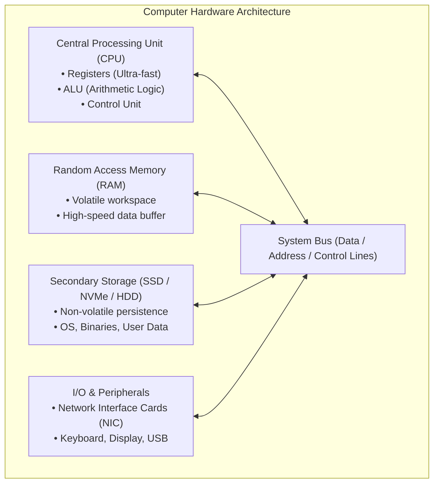

#### 5. Technical Explanation
- **CPU (Central Processing Unit)**: Executes machine code instructions. Modern CPUs possess multiple physical **cores**, allowing simultaneous parallel processing.
- **Registers**: Small, extremely fast storage cells located inside the CPU silicon (e.g., `EAX`, `EBX`, `ESP`, `EIP` in x86 architecture; `RAX`, `RSP`, `RIP` in x64). The **Instruction Pointer** (`EIP`/`RIP`) tracks the exact memory address of the next instruction to be executed—a primary target during buffer overflow attacks.
- **RAM (Random Access Memory)**: Fast, volatile semiconductor memory directly addressable by the CPU. Operating systems load programs from disk into RAM for execution.
- **Solid-State Drives (SSD) and Hard Disk Drives (HDD)**: Persistent block-storage devices. SSDs utilize NAND flash memory chips with zero moving parts, while legacy HDDs utilize spinning magnetic platters.
- **Network Interface Card (NIC)**: A physical hardware component (integrated into the motherboard or plugged into a PCIe slot) that translates digital system data into electrical, optical, or radio signals for network transmission. Every NIC has a factory-burned physical identifier called a **Media Access Control (MAC) Address**.

---

### 2.2 Software Hierarchy and the Kernel

#### 1. What is it?
The software hierarchy is the layered architecture of instructions running on hardware, beginning at low-level firmware, transitioning through the operating system kernel, and ending at end-user applications.

#### 2. Why does it exist?
Writing code that directly manipulates raw hardware transistors for every application would be impossibly difficult and dangerous. The software hierarchy creates layers of abstraction and security isolation, preventing a malfunctioning game or browser from corrupting the entire physical computer.

#### 3. How does it work?
CPUs enforce hardware-level privilege rings. The modern x86 architecture defines **Ring 0** (most privileged) through **Ring 3** (least privileged):

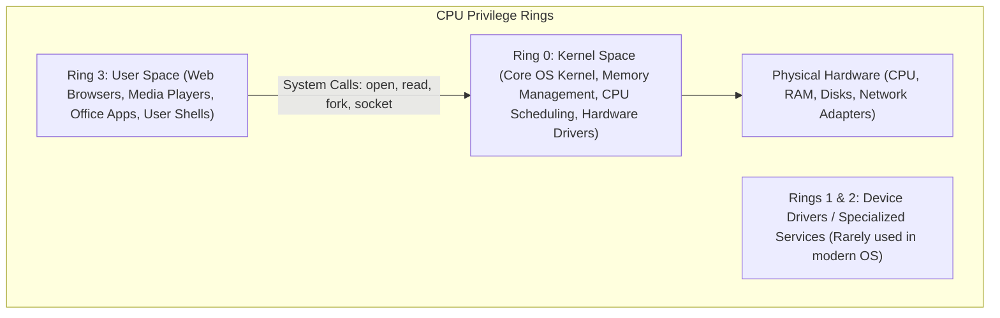

- **Ring 0 (Kernel Space)**: Has unrestricted, direct access to all hardware, physical memory addresses, and CPU instructions. If code crashes in Ring 0, the entire machine experiences a Kernel Panic (Linux) or a Blue Screen of Death (Windows).
- **Ring 3 (User Space)**: Where normal programs run. Applications in User Space have isolated virtual memory spaces. They are physically barred by the CPU from directly writing to hardware or reading memory belonging to other programs.
- **System Calls (Syscalls)**: When a User Space program needs to perform a hardware-level task (such as reading a file from disk or sending a packet out the network card), it must execute a controlled transition into Kernel Space called a system call (e.g., `sys_read`, `sys_write`, `sys_socket`).

#### 4. Real-world Analogy
Imagine a secure government facility:
- **Ring 3 (User Space)** is the **Public Lobby**: Citizens can fill out forms, talk to each other, and drink water. They cannot walk into the vault or touch the secure filing cabinets.
- **System Calls** are the **Teller Windows**: If a citizen needs a document from the vault, they slide a standard request form through the bulletproof window.
- **Ring 0 (Kernel Space)** is the **Secure Vault Staff**: They verify the form, check the citizen's credentials, retrieve the file from the vault, and hand it back through the slot. If a visitor in the lobby misbehaves or passes out, the vault remains completely secure.

#### 5. Technical Explanation
- **Firmware (BIOS / UEFI)**: The first software executed when a computer powers on. **UEFI (Unified Extensible Firmware Interface)** has replaced legacy BIOS. It initializes hardware components, runs power-on self-tests (POST), verifies digital signatures on bootloader files via **Secure Boot**, and loads the OS bootloader into RAM.
- **The Kernel**: The core program of the operating system. It remains permanently in physical RAM from boot to shutdown. Major kernel types include:
  - **Monolithic Kernels** (Linux): The entire OS subsystem (scheduler, file system, network stack, drivers) runs in Ring 0 for maximum speed.
  - **Hybrid Kernels** (Windows NT, macOS XNU): Combines monolithic performance with microkernel modularity, running core services in kernel space and certain subsystems in user space.
- **Device Drivers**: Specialized software programs that teach the kernel how to communicate with specific vendor hardware (e.g., an NVIDIA graphics processor or an Intel Wi-Fi chip). Because many drivers operate in Ring 0, malicious or vulnerable third-party drivers represent a catastrophic security risk (a primary attack surface in modern Windows exploitation known as BYOVD: Bring Your Own Vulnerable Driver).

---

### 2.3 Operating System Resource Management

An operating system is fundamentally a resource manager. It orchestrates three vital resources:

1. **Process Management**:
   - A **program** is passive code resting on a disk (e.g., `/usr/bin/nmap` or `calc.exe`).
   - A **process** is an active, running instance of a program loaded into RAM, assigned its own Process Identifier (**PID**), user context, and resource allocations.
   - A **thread** is the smallest unit of execution within a process. A single process can spawn multiple concurrent threads (e.g., a web browser running one thread for network downloads and another for rendering UI).
2. **Memory Management & Virtual Memory**:
   - To prevent processes from viewing or overwriting each other's memory, the OS kernel and CPU **Memory Management Unit (MMU)** implement **Virtual Memory**.
   - Each process is given an illusion that it possesses a vast, contiguous address space (e.g., $4\text{ GB}$ on 32-bit systems, $128\text{ TB}$ on 64-bit systems).
   - Physical memory is split into fixed-size chunks called **pages** (typically $4\text{ KB}$). The MMU translates virtual page addresses into physical RAM addresses using **Page Tables**.
3. **File Systems**:
   - Software structures that dictate how raw bytes on persistent storage are labeled, organized, indexed, and retrieved.
   - Common file systems:
     - **Ext4** (Linux standard): Journaled file system supporting POSIX permissions and inodes.
     - **NTFS** (Windows standard): Enterprise file system supporting Access Control Lists (ACLs), compression, journaling, and Alternate Data Streams (ADS).
     - **FAT32 / exFAT**: Universal file systems common on flash drives, lacking robust access control permissions.

---


## 3. How the Internet and Data Communication Work

### 3.1 Circuit Switching vs. Packet Switching

#### 1. What is it?
Circuit switching and packet switching are the two fundamental methodologies for transmitting information across electronic networks.

#### 2. Why does it exist?
Early telecommunication networks required continuous, dedicated physical circuits for communication. The modern internet was intentionally designed around packet switching to ensure resilience, dynamic rerouting, and shared bandwidth utilization.

#### 3. How does it work?
- **Circuit Switching (Legacy Telephone Network)**: When Party A calls Party B, physical switches establish a dedicated, unbroken electrical circuit between them. No other caller can utilize that capacity until the call terminates. If a backhoe cuts that physical cable, the call immediately drops.
- **Packet Switching (The Modern Internet)**: Data is chopped into small, discrete chunks called **packets**. Each packet is stamped with a source IP address, destination IP address, and sequence number. Packets travel independently across dozens of intermediary routers, potentially taking completely different geographic routes, and are reassembled in proper order at the destination. If one intermediate link fails, routers automatically route subsequent packets around the outage.

```mermaid
flowchart LR
    subgraph Packet Switching Model
        Source["Sender Device<br>(Chops file into packets)"]
        R1["Router A"]
        R2["Router B"]
        R3["Router C"]
        Dest["Receiver Device<br>(Reassembles packets)"]
    end
    Source -->|Packet 1 (Route 1)| R1 --> Dest
    Source -->|Packet 2 (Route 2)| R2 --> Dest
    Source -->|Packet 3 (Route 3)| R3 --> Dest
```

#### 4. Real-world Analogy
Imagine sending a 500-page book to a friend using two methods:
- **Circuit Switching** is like renting an entire private train track from New York to Chicago. Only your train can use the track until the book arrives. If a bridge breaks anywhere on the track, everything stops.
- **Packet Switching** is like tearing the book into 500 individual postcards, numbering them 1 through 500, putting your friend's address on each, and dropping them into standard postal mailboxes. Some postcards travel on airplanes, some on trucks, and some through regional sorting hubs. They arrive out of order, but your friend simply sorts them by their postcard numbers and reads the complete book.

---

### 3.2 The Global Network Fabric (ISPs, IXPs, and Backbones)

The Internet is not a single giant cloud; it is a **network of networks** connected by economic and physical agreements:

1. **Tier 1 Internet Service Providers (ISPs)**: Global telecommunications giants (e.g., Lumen, AT&T, NTT, Telia) that own intercontinental fiber-optic cables and undersea communication lines. Tier 1 networks connect to each other on equal terms without paying transit fees through **Settlement-Free Peering**.
2. **Internet Exchange Points (IXPs)**: Physical data centers containing massive routing fabrics where different ISPs, cloud providers (Google, AWS, Microsoft), and Content Delivery Networks (Cloudflare, Akamai) directly interconnect to exchange traffic locally at lightning speeds without paying intermediary carrier transit fees.
3. **Tier 2 and Tier 3 ISPs**:
   - **Tier 2 ISPs**: Regional service providers that peer with some networks but purchase transit from Tier 1 providers to reach the global internet.
   - **Tier 3 ISPs**: Local access providers (your home cable or fiber provider) that connect end users (consumers and small businesses) to Tier 2/1 backbones.

---

### 3.3 Anatomy of a Data Packet & Encapsulation Lifecycle

Data does not travel across a wire as bare text. As information descends from an application to physical network pulses, it undergoes **Encapsulation**.

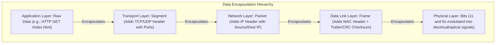

- **Protocol Data Unit (PDU)**: The technical name for data at each specific layer:
  - Application Layer $\rightarrow$ **Data / Payload**
  - Transport Layer $\rightarrow$ **Segment** (TCP) or **Datagram** (UDP)
  - Network Layer $\rightarrow$ **Packet**
  - Data Link Layer $\rightarrow$ **Frame**
  - Physical Layer $\rightarrow$ **Bits**
- **De-encapsulation**: When the receiving host's network card captures bits from the wire, the reverse process occurs: the frame header is checked and stripped, the IP packet header is inspected and stripped, the TCP segment header is reassembled and stripped, and the original raw data payload is delivered to the receiving application.

---


### 3.4 Cyberspace Dimensions, Internet Physical Infrastructure & Global Governance

#### 1. What is Cyberspace?
While the term **cyberspace** is often used conversationally as a synonym for "the web" or "online," in technical cybersecurity doctrine, it has a precise multidimensional definition:
> **Cyberspace** is the global, dynamic, interconnected domain of digital information technology infrastructure. It encompasses all physical computing and networking hardware, logical software and protocol stacks, telecommunications links, and the data, digital personas, and social interactions occurring across them.

Unlike physical domains (land, sea, air, space), cyberspace has unique operational characteristics:
- **No Natural Physical Boundaries**: A threat actor situated in Eastern Europe can probe, exploit, and exfiltrate data from a database server located in Mumbai or California in less than 150 milliseconds.
- **Extreme Asymmetry**: A single individual with an entry-level laptop and open-source automated scanners can challenge multinational corporations or sovereign critical infrastructure.
- **Constant Evolution**: Cyberspace is human-engineered and changes dynamically every second as new devices connect, protocols update, and routes shift.

To defend cyberspace, security professionals conceptualize it across **four distinct architectural layers**:
1. **Physical Layer**: The actual hardware, geographic infrastructure, undersea fiber-optic cables, submarine landing stations, satellite ground links, data centers, server racks, copper cabling, and routers.
2. **Logical / Syntactic Layer**: The logical architecture, operating system kernels, routing algorithms (BGP, OSPF), protocol specifications (TCP/IP, DNS, HTTP/3), IP addresses, and domain names that allow disparate physical devices to establish communication.
3. **Semantic / Cognitive Layer**: The actual data payloads, information content, meaning, software logic, and applications processing that information (e.g., banking transactions, medical records, proprietary code).
4. **Persona / Social Layer**: The digital identities, user accounts, email addresses, social network personas, threat actors, defenders, and human decision-makers operating within the digital environment.

```
+-------------------------------------------------------------------------------+
|                        THE FOUR LAYERS OF CYBERSPACE                          |
+-------------------------------------------------------------------------------+
| [Persona Layer]    | User Accounts, Digital Personas, Human Decision Makers   |
+--------------------+----------------------------------------------------------+
| [Semantic Layer]   | Information Meaning, Application Payloads, Data Files    |
+--------------------+----------------------------------------------------------+
| [Logical Layer]    | IP Addresses, Routing Tables, TCP/IP Stacks, Protocols   |
+--------------------+----------------------------------------------------------+
| [Physical Layer]   | Undersea Cables, Landing Stations, Routers, Servers, Wire |
+-------------------------------------------------------------------------------+
```

---

#### 2. The Evolution of the Internet: From Research Experiment to Global Backbone
The internet was not created overnight; its design choices directly explain both its staggering scalability and its fundamental security vulnerabilities:
- **1969 – ARPANET**: Funded by the U.S. Defense Advanced Research Projects Agency (DARPA). It connected four university mainframe computers (UCLA, Stanford, UC Santa Barbara, University of Utah) using packet switching. Its primary design goal was survivability and peer-to-peer data transmission without a single central point of failure.
- **January 1, 1983 – "Flag Day" & TCP/IP Transition**: ARPANET officially deprecated its legacy Network Control Program (NCP) and mandated the universal adoption of the TCP/IP protocol suite (RFC 791 and RFC 793). This transition created the true architectural foundation of the modern internet.
- **Late 1980s – NSFNET**: The National Science Foundation interconnected supercomputing centers across the United States via high-speed backbones, expanding access to researchers and academic institutions worldwide.
- **1990s – Privatization and the Commercial Web**: NSFNET transitioned commercial network traffic to private telecommunications operators. With the invention of the World Wide Web (HTTP/HTML) by Tim Berners-Lee at CERN, the internet rapidly transformed into a global commercial backbone.
- *The Fundamental Security Flaw of the Internet*: The underlying protocols of the early internet (IP, TCP, UDP, DNS, ARP, BGP, SMTP) were engineered for **open academic collaboration and maximum resilience among trusted research peers**. Mutual trust was assumed; cryptographic authentication, payload encryption, identity validation, and access control were completely absent. Modern cybersecurity consists heavily of engineering defensive wrappers (TLS, IPsec, DNSSEC, BGPsec) around these inherently trusting protocols.

---

#### 3. Global Physical Infrastructure: Cables, Landing Stations, IXPs, and Autonomous Systems
Beneath the abstract concept of the "cloud" lies a massive, concrete physical infrastructure:
- **Submarine Undersea Fiber-Optic Cables**: Over 95% to 99% of all intercontinental internet traffic travels through fiber-optic cables resting on the seabed of the world's oceans. These cables are no thicker than a garden hose, containing glass strands that transmit terabits of data per second via laser light.
- **Submarine Cable Landing Stations**: Coastal facilities where undersea cables emerge from the ocean and connect to terrestrial fiber networks. These landing stations represent critical national infrastructure; physical sabotage or natural disasters at landing hubs can disconnect entire nations.
- **Tier 1, Tier 2, and Tier 3 Internet Service Providers (ISPs)**:
  - **Tier 1 ISPs**: The global network elite (e.g., Lumen, AT&T, NTT, Telia). They own massive global backbone fiber networks and do not pay anyone for transit. Instead, they peer with one another under settlement-free peering agreements.
  - **Tier 2 ISPs**: Regional or national providers that peer with some networks but purchase transit from Tier 1 providers to reach the global internet.
  - **Tier 3 ISPs**: Local access providers (the retail ISPs serving consumers and businesses). They purchase transit upstream from Tier 2 or Tier 1 providers.
- **Internet Exchange Points (IXPs)**: Physical data centers where multiple ISPs, CDNs (Content Delivery Networks like Cloudflare and Akamai), and tech enterprises interconnect directly to exchange traffic locally without routing across costly long-distance transit links.
- **Autonomous Systems (AS) & BGP**:
  - The internet is a "network of networks," organized into over 100,000 **Autonomous Systems (AS)**. An Autonomous System is a collection of connected IP routing prefixes controlled by a single administrative entity (an ISP, university, or corporation) with a clearly defined routing policy.
  - Each AS is assigned a globally unique **Autonomous System Number (ASN)** by IANA/RIRs.
  - Routing between Autonomous Systems relies on the **Border Gateway Protocol (BGP)**. BGP functions like a global postal routing directory. Because BGP was designed without built-in cryptographic authentication, malicious or misconfigured networks can announce unauthorized IP blocks—an attack known as **BGP Hijacking**, allowing threat actors to intercept, inspect, or blackhole global network traffic.
- **The 13 Root DNS Server Clusters**:
  - The Domain Name System is organized hierarchically. At the very top of the hierarchy sit the **13 authoritative root server authorities**, labeled `a.root-servers.net` through `m.root-servers.net`.
  - These 13 logical identities are operated by 12 independent institutions (including ICANN, NASA, the U.S. Army Research Lab, Verisign, and the University of Maryland).
  - Through **Anycast** routing, each of the 13 logical addresses is replicated across thousands of physical server nodes globally, ensuring redundancy, fault tolerance, and resilience against massive DDoS attacks.

---

#### 4. Global Internet Governance: The Multi-Stakeholder Model
No single sovereign government, corporation, or entity owns or governs the internet. Instead, it operates under a decentralized **multi-stakeholder governance model**:
- **ICANN (Internet Corporation for Assigned Names and Numbers)**: A non-profit public-benefit corporation responsible for coordinating the maintenance and procedures of databases related to the namespaces and numerical spaces of the internet, ensuring network stability and interoperability.
- **IANA (Internet Assigned Numbers Authority)**: A department of ICANN that oversees the global allocation of IP address pools, Autonomous System Numbers (ASNs), and root-zone management in DNS.
- **IETF (Internet Engineering Task Force)**: The premier open international community of network designers, operators, vendors, and researchers concerned with the evolution of the internet architecture. The IETF develops open standards published as **Requests for Comments (RFCs)** (e.g., RFC 791 for IPv4, RFC 2616 for HTTP/1.1, RFC 8446 for TLS 1.3).
- **W3C (World Wide Web Consortium)**: Founded by Tim Berners-Lee, the international standards organization for the World Wide Web, developing standards like HTML, CSS, XML, and WebAuthn.
- **Regional Internet Registries (RIRs)**: Five non-profit regional organizations responsible for managing the allocation and registration of internet number resources (IPv4, IPv6, ASNs) within specific world regions:
  1. **ARIN**: North America and parts of the Caribbean.
  2. **RIPE NCC**: Europe, Middle East, and parts of Central Asia.
  3. **APNIC**: Asia and Pacific region.
  4. **LACNIC**: Latin America and the Caribbean.
  5. **AFRINIC**: African continent.


## 4. Networking Fundamentals & Architectural Reference Models

### 4.1 Network Topologies and Physical Hardware

A network is two or more computing devices linked together to share data and resources.

#### Network Classifications by Geography:
- **LAN (Local Area Network)**: High-speed network covering a small geographic area (a home, classroom, or single office floor).
- **WLAN (Wireless Local Area Network)**: A LAN linked via wireless radio signals conforming to IEEE 802.11 standards.
- **MAN (Metropolitan Area Network)**: Spans an entire city or municipal campus.
- **WAN (Wide Area Network)**: Spans large geographic regions, countries, or the globe (the Internet is the ultimate WAN).
- **PAN (Personal Area Network)**: Very short-range network (Bluetooth, NFC) typically within 10 meters around a person.
- **SAN (Storage Area Network)**: High-speed, dedicated sub-network connecting shared pools of storage devices (Fibre Channel, iSCSI) to enterprise servers.

#### Core Network Hardware Devices:
- **Hub (Layer 1 - Physical)**: An obsolete, unmanaged repeating device. When an electrical signal enters one port, the hub blindly duplicates it and broadcasts it out *every other port*. All connected devices share a single **Collision Domain** and **Broadcast Domain**, creating severe security risks (any connected computer can passively sniff all other traffic).
- **Bridge (Layer 2 - Data Link)**: A legacy device with two ports that filters and forwards traffic between two network segments based on MAC addresses, splitting a collision domain into two.
- **Switch (Layer 2 - Data Link)**: The backbone of modern LANs. An intelligent multi-port device that inspects incoming frames, reads the destination MAC address, and forwards the frame *only to the specific physical port* where that target device resides. It maintains a dynamic lookup database called a **MAC Address Table** (or **CAM Table** - Content Addressable Memory). Switches isolate collision domains to every single individual port.
- **Layer 3 Switch**: A high-performance enterprise switch that combines Layer 2 switching with hardware-based Layer 3 IP routing, routing traffic between virtual networks (VLANs) at wire speed.
- **Router (Layer 3 - Network)**: A device that connects different physical or logical networks together (e.g., connecting your private home LAN to the public Internet). Routers inspect destination IP addresses, evaluate routing tables, and determine the optimal path for packets across networks. Routers break up **Broadcast Domains**.
- **Modem (Modulator/Demodulator)**: Converts analog signals from an ISP provider (cable, DSL, telephone line) into digital Ethernet signals that a router can process.
- **Wireless Access Point (WAP)**: A Layer 2 device that bridges wireless radio signals (802.11) with wired Ethernet networks.

---

### 4.2 The OSI 7-Layer Reference Model (In-Depth)

#### 1. What is it?
The **Open Systems Interconnection (OSI)** model is a theoretical, 7-layer architectural framework created by the International Organization for Standardization (ISO) in 1984 to standardize computer network communications.

#### 2. Why does it exist?
Early networking was proprietary: an IBM computer could only talk to an IBM computer, and a DEC computer could only talk to a DEC machine. The OSI model created a vendor-agnostic blueprint dividing complex network operations into distinct, modular layers. A developer building a web browser at Layer 7 does not need to know whether the physical wire at Layer 1 is a copper twisted-pair cable, an optical fiber, or a satellite radio link.

#### 3. How does it work?
Data moves down through all 7 layers on the sending host, travels across physical media, and moves up through all 7 layers on the receiving host.

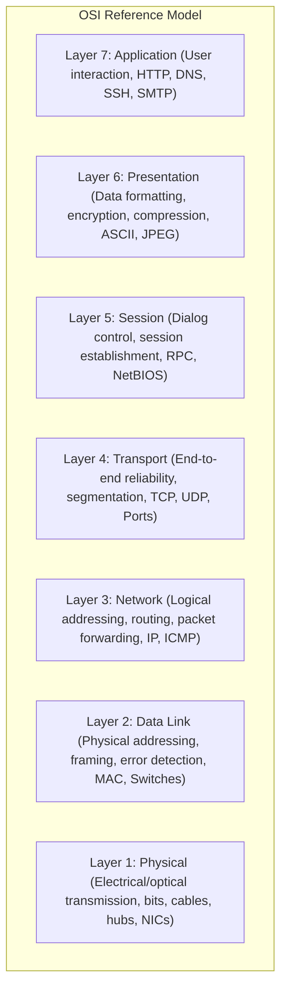

#### Layer-by-Layer Architectural Deep Dive:

| Layer # | Layer Name | PDU | Primary Function | Core Protocols & Hardware | Security Implications & Attacks |
| :--- | :--- | :--- | :--- | :--- | :--- |
| **7** | **Application** | Data | Direct interface with end-user software applications; network API access. | HTTP, HTTPS, DNS, DHCP, FTP, SSH, SMTP | SQL Injection, Cross-Site Scripting (XSS), Application DDoS, Phishing |
| **6** | **Presentation** | Data | Translates, formats, encrypts, and compresses data so receiving systems can read it. | TLS/SSL, ASCII, Unicode, JPEG, GIF, Base64 | Cryptographic degradation attacks, downgrade attacks, SSL stripping |
| **5** | **Session** | Data | Establishes, maintains, coordinates, and terminates persistent communication sessions. | RPC, NetBIOS, PPTP, SOCKS, NFS | Session Hijacking, Session Fixation, Token replay attacks |
| **4** | **Transport** | Segment (TCP) / Datagram (UDP) | Manages end-to-end connection reliability, flow control, error recovery, port multiplexing. | TCP, UDP (Ports 0–65535) | SYN Flood DoS, Port Scanning, Sequence Number Prediction |
| **3** | **Network** | Packet | Logical addressing (IP), route calculation, and multi-network path forwarding. | IPv4, IPv6, ICMP, IPsec, Routers | IP Spoofing, Smurf attacks, Ping of Death, ICMP tunneling |
| **2** | **Data Link** | Frame | Physical addressing (MAC), framing, media access control, link error detection (CRC). | Ethernet (802.3), Wi-Fi (802.11), Switches, Bridges | ARP Poisoning, MAC Flooding, VLAN Hopping, Rogue DHCP |
| **1** | **Physical** | Bits | Transmits raw, unstructured electronic voltages, light pulses, or radio waves. | Copper Cat6, Fiber Optic, Hubs, Repeaters, Antennas | Wiretapping, RF Jamming, Cable cutting, Physical theft |

---

### 4.3 The TCP/IP 4-Layer / 5-Layer Suite Comparison

While the OSI model is the ultimate theoretical framework, the **TCP/IP Model** (also called the Internet Protocol Suite or DoD Model) is the real-world operational architecture of the Internet.

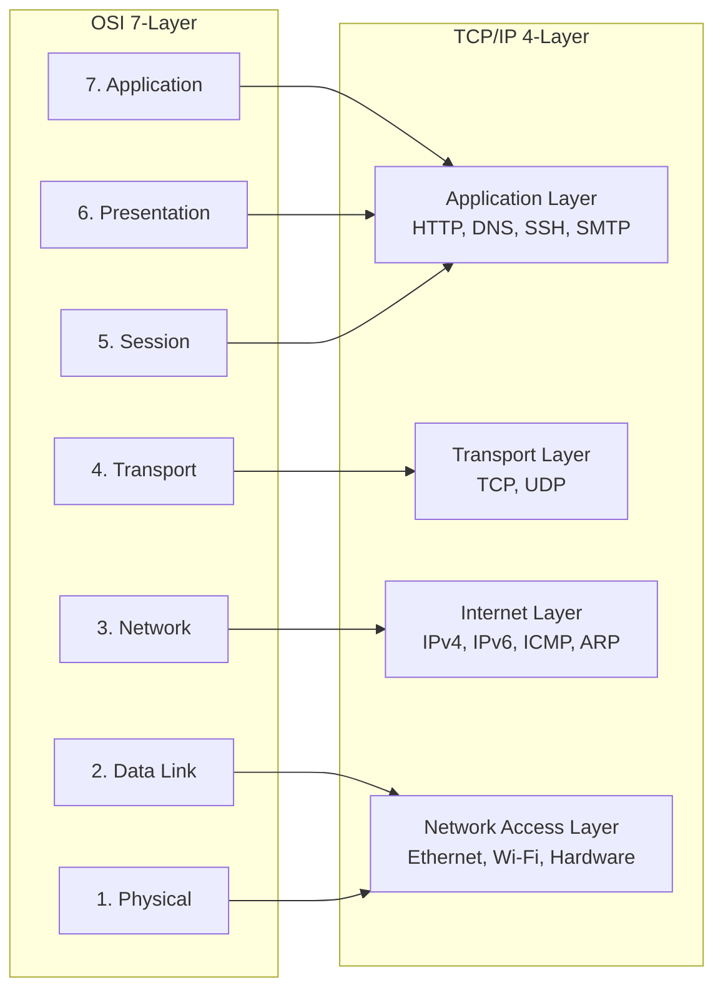

- **Application Layer**: Merges OSI Layers 7, 6, and 5 into a unified application processing boundary. Applications handle their own encoding, session state, and security (e.g., modern web browsers negotiate TLS directly at the application boundary).
- **Transport Layer**: Directly corresponds to OSI Layer 4. Orchestrates host-to-host communications via TCP or UDP.
- **Internet Layer**: Directly corresponds to OSI Layer 3. Defines routing, packet formats, and logical addressing (IP).
- **Network Access / Link Layer**: Merges OSI Layers 2 and 1. Governs how frames are transmitted across physical media. (In modern 5-layer academic models, this is frequently separated into Data Link and Physical layers).
---


## 5. IP Addressing, Subnetting, and CIDR

### 5.1 IPv4 Addressing Architecture & Classes

#### 1. What is it?
An **Internet Protocol version 4 (IPv4)** address is a 32-bit logical numerical identifier assigned to every device participating in an IP-based computer network.

#### 2. Why does it exist?
Physical MAC addresses exist only at Layer 2 to deliver frames across a local wire. Routers cannot store billions of global MAC addresses in memory. IP addresses provide a hierarchical, globally routable logical addressing system analogous to a postal zip code and street address.

#### 3. How does it work?
An IPv4 address consists of exactly 32 binary bits ($0$s and $1$s), divided into four groups of 8 bits called **octets**, separated by dots (**Dotted-Decimal Notation**):
- Binary: `11000000.10101000.00000001.00001010`
- Decimal: `192.168.1.10`

Every IP address is split into two distinct portions:
1. **Network ID**: Identifies the specific network segment where the device lives (the "neighborhood").
2. **Host ID**: Identifies the unique individual device on that network segment (the "house number").

The dividing line between Network ID and Host ID is defined by the **Subnet Mask**.

#### Legacy Classful Addressing Architecture:
Before modern routing existed, the Internet Assigned Numbers Authority (IANA) divided the IPv4 space into five rigid classes:

| Class | First Octet Range | Default Subnet Mask | CIDR | Purpose / Target Audience | Max Networks | Max Hosts per Network |
| :--- | :--- | :--- | :--- | :--- | :--- | :--- |
| **A** | `1.0.0.0` – `126.255.255.255` | `255.0.0.0` | `/8` | Enormous organizations, military, Tier 1 ISPs | 128 | 16,777,214 ($2^{24}-2$) |
| **B** | `128.0.0.0` – `191.255.255.255` | `255.255.0.0` | `/16` | Universities, large global enterprises | 16,384 | 65,534 ($2^{16}-2$) |
| **C** | `192.0.0.0` – `223.255.255.255` | `255.255.255.0` | `/24` | Small businesses, home networks | 2,097,152 | 254 ($2^8-2$) |
| **D** | `224.0.0.0` – `239.255.255.255` | N/A | N/A | **Multicast** routing (streaming to groups) | N/A | N/A |
| **E** | `240.0.0.0` – `255.255.255.255` | N/A | N/A | Experimental and research reservations | N/A | N/A |

> **Special Reserved Address Note**: `127.0.0.0` through `127.255.255.255` is reserved worldwide for **Loopback** testing (`127.0.0.1` represents `localhost`, your own internal software network stack).

---

### 5.2 Public vs. Private Addressing (RFC 1918)

By the early 1990s, the global explosion of computers threatened to completely deplete the 4.29 billion total IPv4 addresses. To prevent the collapse of the Internet, the Internet Engineering Task Force (IETF) issued **RFC 1918**, establishing **Private IP Address Spaces**:

```mermaid
flowchart TD
    subgraph RFC 1918 Private IP Ranges (Non-routable on public internet)
        A["Class A Private:<br>10.0.0.0 to 10.255.255.255 (/8)<br>16.7 Million IPs"]
        B["Class B Private:<br>172.16.0.0 to 172.31.255.255 (/12)<br>1,048,576 IPs"]
        C["Class C Private:<br>192.168.0.0 to 192.168.255.255 (/16)<br>65,536 IPs"]
    end
    subgraph Public Internet (Globally routable)
        PUB["Public IP Addresses assigned by ISPs & IANA"]
    end
    A & B & C -->|Network Address Translation / NAT Router| PUB
```

- **Private Addresses**: Any organization can freely use these address blocks inside their private corporate or home networks without registering them. Public internet routers are programmed to drop RFC 1918 packets instantly.
- **APIPA (Automatic Private IP Addressing)**: If a Windows or Mac computer is configured to receive an IP via DHCP but no DHCP server responds, the operating system automatically assigns itself an address in the range `169.254.0.1` through `169.254.255.254` (`169.254.0.0/16`). Seeing a `169.254.x.x` address is an instant operational indicator of a broken network connection or unreachable DHCP server!

---

### 5.3 Subnetting Demystified: The Beginner's Calculation Engine

#### 1. What is it?
Subnetting is the mathematical process of dividing a single large network into multiple smaller, logically isolated sub-networks (**subnets**).

#### 2. Why does it exist?
- **Security Isolation**: Subnetting allows organizations to isolate sensitive servers (e.g., database servers holding customer credit cards) into a restricted subnet separated from employee desktop machines by a firewall.
- **Broadcast Containment**: Layer 2 broadcast packets (like ARP requests) flood every machine on a subnet. Unchecked broadcasts degrade network performance. Subnetting keeps broadcast traffic localized.
- **Address Conservation**: Classless Inter-Domain Routing (**CIDR**, RFC 1519) eliminated rigid Class A/B/C boundaries, allowing engineers to carve out exact IP blocks (e.g., a `/30` subnet providing exactly 2 usable IPs for a point-to-point router link).

#### 3. The Mathematical Engine
To calculate subnet parameters, use two fundamental formulas:
1. **Total IP Addresses in a Subnet**:
   $$\text{Total IPs} = 2^{(32 - n)}$$
   *(Where $n$ is the CIDR prefix length).*
2. **Usable Host IP Addresses**:
   $$\text{Usable Hosts} = 2^{(32 - n)} - 2$$
   *(Subtracting 2 because the very first address is reserved as the **Network ID** and the very last address is reserved as the **Broadcast Address**).*

#### The Beginner's Subnetting Cheat Matrix:

| CIDR Prefix | Subnet Mask | Total IPs ($2^{32-n}$) | Usable Hosts ($2^{32-n}-2$) | Block Size (Jump Value) |
| :--- | :--- | :--- | :--- | :--- |
| **/24** | `255.255.255.0` | 256 | 254 | 256 |
| **/25** | `255.255.255.128` | 128 | 126 | 128 |
| **/26** | `255.255.255.192` | 64 | 62 | 64 |
| **/27** | `255.255.255.224` | 32 | 30 | 32 |
| **/28** | `255.255.255.240` | 16 | 14 | 16 |
| **/29** | `255.255.255.248` | 8 | 6 | 8 |
| **/30** | `255.255.255.252` | 4 | 2 (Router links) | 4 |
| **/31** | `255.255.255.254` | 2 | 2 (RFC 3021 P2P) | 2 |
| **/32** | `255.255.255.255` | 1 | 1 (Single Host) | 1 |

#### Practical Worked Example: Breaking Down `192.168.10.75/26`
Let's find the Network ID, Broadcast Address, and Usable Host Range for an analyst investigating a host at `192.168.10.75/26`:
1. **Find the Block Size**: $32 - 26 = 6$ host bits. Block size is $2^6 = 64$.
2. **Find the Subnet Boundaries (multiples of 64)**:
   - Subnet 0: `192.168.10.0`
   - Subnet 1: `192.168.10.64`
   - Subnet 2: `192.168.10.128`
   - Subnet 3: `192.168.10.192`
3. **Locate the Target IP (`192.168.10.75`)**: It falls between $64$ and $127$.
   - **Network Address**: `192.168.10.64` (Identifies the subnet).
   - **First Usable Host**: `192.168.10.65` (Usually assigned to the default gateway router).
   - **Last Usable Host**: `192.168.10.126`.
   - **Broadcast Address**: `192.168.10.127` (Packets sent here alert all machines in Subnet 1).

---

### 5.4 IPv6 Addressing & Architecture

#### 1. What is it?
**Internet Protocol version 6 (IPv6)** is the next-generation internet layer protocol designed to permanently replace IPv4.

#### 2. Why does it exist?
IPv4 provides $2^{32} \approx 4.29 \times 10^9$ addresses. IPv6 expands the address space to **128 bits**, providing:
$$2^{128} \approx 3.4 \times 10^{38} \text{ addresses}$$
*(Enough to assign millions of unique IP addresses to every single grain of sand on planet Earth).*

#### 3. How does it work?
IPv6 addresses are written as eight groups of four **hexadecimal** digits separated by colons:
`2001:0db8:85a3:0000:0000:8a2e:0370:7334`

#### Two Standard Compression Rules:
1. **Omit Leading Zeros**: Any leading zeros within a 16-bit group can be dropped:
   `2001:db8:85a3:0:0:8a2e:370:7334`
2. **Double Colon (`::`) Substitution**: A single contiguous sequence of all-zero groups can be replaced with `::` (can only be applied **once** per address to prevent ambiguity):
   `2001:db8:85a3::8a2e:370:7334`

#### IPv6 Address Types:
- **Global Unicast (`2000::/3`)**: Public, globally routable addresses across the Internet (equivalent to IPv4 public IPs).
- **Unique Local (`fc00::/7` or `fd00::/8`)**: Private, non-routable internal corporate addresses (equivalent to RFC 1918 private IPv4).
- **Link-Local (`fe80::/10`)**: Automatically configured on every IPv6-enabled interface for communication within the local physical segment.
- **Loopback (`::1/128`)**: The IPv6 localhost equivalent of `127.0.0.1`.
- **Multicast (`ff00::/8`)**: Replaces IPv4 broadcast entirely. IPv6 **has no broadcast addresses**; all network announcements use targeted multicast groups.

---


## 6. Essential Network Protocols & Master Port Directory

### 6.1 Demystifying Network Ports

#### 1. What is it?
A network **port** is a 16-bit software-defined numerical endpoint (ranging from $0$ to $65,535$) managed by the operating system to direct incoming and outgoing network traffic to specific programs.

#### 2. Why does it exist?
An IP address identifies the *computer*, but an operating system runs hundreds of different programs simultaneously (web browser, email client, Discord, Spotify). Ports provide **Multiplexing**—allowing a single network cable and IP address to juggle hundreds of distinct conversations without mixing them up.

#### 3. Port Categories (IANA Standards):
- **Well-Known Ports ($0$ – $1,023$)**: Reserved for standardized system and server services (HTTP, SSH, DNS). On Linux/Unix systems, binding a process to a well-known port requires root/administrative privileges.
- **Registered Ports ($1,024$ – $49,151$)**: Assigned by IANA to specific vendor applications (e.g., Microsoft RDP on 3389, MySQL on 3306).
- **Dynamic / Private / Ephemeral Ports ($49,152$ – $65,535$)**: Temporary ports randomly selected by client operating systems when initiating an outbound connection. When your laptop requests a website, your laptop opens an ephemeral port (e.g., `52140`) to talk to the web server's port `443`.

---

### 6.2 Core Network Protocols (ARP, DHCP, DNS, TCP, UDP, ICMP, NAT)

#### Protocol 1: ARP (Address Resolution Protocol)
- **Layer**: Layer 2 (Data Link).
- **Purpose**: Maps a known Layer 3 logical IP address to an unknown Layer 2 physical MAC address on a local network.
- **Mechanism**: Machine A broadcasts an **ARP Request**: *"Who has IP 192.168.1.1? Tell 192.168.1.50."* The target machine responds with an unicast **ARP Reply**: *"192.168.1.1 is at MAC aa:bb:cc:dd:ee:ff."* Machine A saves this entry into its local **ARP Cache**.
- **Security Vulnerability**: ARP has zero built-in authentication. Any attacker can send unsolicited **Gratuitous ARP** replies to poison a target's cache (**ARP Spoofing / Poisoning**), hijacking local traffic.

#### Protocol 2: DHCP (Dynamic Host Configuration Protocol)
- **Ports**: UDP 67 (Server), UDP 68 (Client).
- **Purpose**: Automatically leases IP addresses, subnet masks, default gateway routers, and DNS servers to client devices.
- **The DORA Lifecycle**:
  1. **Discover**: Client broadcasts: *"Are there any DHCP servers out there?"*
  2. **Offer**: DHCP Server broadcasts/unicasts: *"I can offer you 192.168.1.100."*
  3. **Request**: Client broadcasts: *"I accept server X's offer of 192.168.1.100."*
  4. **Acknowledge (ACK)**: DHCP Server finalizes the lease timer and confirms configuration.

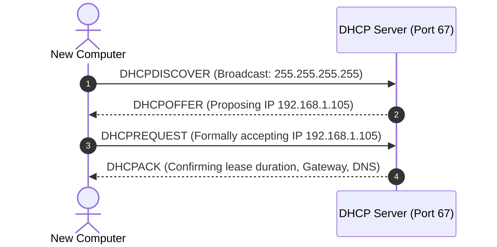

#### Protocol 3: DNS (Domain Name System)
- **Port**: UDP 53 (Standard queries), TCP 53 (Zone transfers and large responses $> 512$ bytes).
- **Purpose**: Translates human-readable domain names (`google.com`) into computer-routable IP addresses (`142.250.190.46`).
- **The Hierarchical Resolution Process**:
  1. **Root Nameservers (`.` )**: 13 worldwide logical root server clusters direct the client to the appropriate TLD.
  2. **Top-Level Domain (TLD) Nameservers**: Manages specific extensions (`.com`, `.org`, `.gov`, `.uk`).
  3. **Authoritative Nameservers**: The final authority hosting the official DNS records for the organization.
- **Essential DNS Record Types**:
  - `A`: Maps a hostname to an **IPv4** address.
  - `AAAA`: Maps a hostname to an **IPv6** address.
  - `CNAME` (Canonical Name): Alias pointing one domain name to another domain name.
  - `MX` (Mail Exchange): Specifies the mail servers responsible for receiving email for the domain.
  - `TXT`: Arbitrary text; crucial for email security frameworks (**SPF**, **DKIM**, **DMARC**) and domain verification.
  - `NS` (Name Server): Specifies the authoritative DNS servers for the domain.
  - `PTR` (Pointer): Reverse DNS lookup; maps an IP address back to a hostname.
  - `SOA` (Start of Authority): Contains administrative info about the DNS zone, serial numbers, and refresh intervals.

#### Protocol 4: TCP (Transmission Control Protocol)
- **Characteristics**: Connection-oriented, highly reliable, guarantees in-order delivery, implements error checking, retransmission of lost packets, and window-based flow control.
- **The TCP 3-Way Handshake**:
  1. **SYN**: Client sends a Synchronize packet with an initial sequence number ($ISN_C$).
  2. **SYN-ACK**: Server acknowledges client's request ($ACK = ISN_C + 1$) and sends its own synchronize ($ISN_S$).
  3. **ACK**: Client acknowledges server's synchronize ($ACK = ISN_S + 1$). The connection is now `ESTABLISHED`.

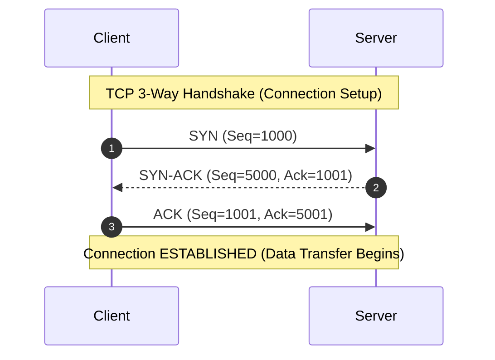

#### Protocol 5: UDP (User Datagram Protocol)
- **Characteristics**: Connectionless, lightweight, zero handshake, fire-and-forget, no retransmission, no flow control.
- **Use Cases**: Real-time voice/video streaming (VoIP, Zoom), online gaming, DNS queries, DHCP, SNMP. In live audio, an old lost audio packet is useless; speed is prioritized over 100% perfection.

| Feature | TCP (Transmission Control Protocol) | UDP (User Datagram Protocol) |
| :--- | :--- | :--- |
| **Connection State** | Connection-oriented (Handshake required) | Connectionless (No setup or teardown) |
| **Reliability** | Guaranteed delivery (Retransmits dropped packets) | Best-effort (Packets may be dropped or arrive out of order) |
| **Header Overhead** | Heavy ($20$ to $60$ bytes) | Extremely light ($8$ bytes) |
| **Speed** | Slower due to acknowledgments and ordering | Blazing fast, minimal latency |
| **Flow Control** | Yes (Sliding window algorithm) | None |

#### Protocol 6: ICMP (Internet Control Message Protocol)
- **Layer**: Layer 3 (Network Layer, encapsulated directly within IP packets).
- **Purpose**: Operational diagnostics, error reporting, and network troubleshooting.
- **Key Message Types**:
  - `Type 8, Code 0`: **Echo Request** (Used by `ping` to test reachability).
  - `Type 0, Code 0`: **Echo Reply** (Returned by target host).
  - `Type 3`: **Destination Unreachable** (Host, network, or port cannot be reached).
  - `Type 11`: **Time Exceeded** (TTL counter decremented to $0$; essential mechanism behind `traceroute`).

#### Protocol 7: NAT (Network Address Translation)
- **Purpose**: Translates private RFC 1918 IP addresses into a single public routable IP address at the firewall/router boundary.
- **Port Address Translation (PAT / NAT Overload)**: Maps thousands of internal private host IP:port combinations to different source ports on a single external public IP address.

---

### 6.3 Application & Administrative Protocols

- **HTTP (Port 80) vs. HTTPS (Port 443)**: Hypertext Transfer Protocol. Plaintext HTTP transmits data (including passwords and session tokens) unencrypted across the wire. HTTPS wraps HTTP inside **TLS (Transport Layer Security)**, providing mutual authentication and end-to-end encryption.
- **Telnet (Port 23) vs. SSH (Port 22)**: Legacy remote terminal protocols. Telnet transmits all keystrokes, usernames, and passwords in cleartext. **Secure Shell (SSH)** encrypts the entire channel using public-key cryptography and strong symmetric session ciphers.
- **File Transfer Protocols**:
  - **FTP (Ports 20 & 21)**: File Transfer Protocol. Port 21 handles control commands; Port 20 transfers data. Transmits credentials in cleartext.
  - **FTPS (Ports 989 & 990)**: FTP wrapped in SSL/TLS.
  - **SFTP (Port 22)**: Secure File Transfer Protocol running over an encrypted SSH tunnel (completely unrelated to legacy FTP).
  - **TFTP (Port 69, UDP)**: Trivial FTP. Simple, unauthenticated, UDP-based file transfer used for booting diskless workstations and backing up network router configs.
- **Email Infrastructure**:
  - **SMTP (Port 25, 587)**: Simple Mail Transfer Protocol. Used to *send* and *relay* mail between servers. Port 587 is the modern encrypted submission port.
  - **POP3 (Port 110, 995 SSL)**: Post Office Protocol v3. Downloads mail from server to client and deletes it from the server.
  - **IMAP (Port 143, 993 SSL)**: Internet Message Access Protocol. Synchronizes mail folders across multiple client devices and preserves mail on the server.
- **Enterprise & Management Protocols**:
  - **NTP (Port 123, UDP)**: Network Time Protocol. Critical for synchronizing clocks across domain controllers, SIEM systems, and forensic logs.
  - **SNMP (Ports 161/162, UDP)**: Simple Network Management Protocol. Monitors device metrics (CPU usage, bandwidth). Legacy SNMP v1/v2c transmits cleartext **Community Strings** (`public`/`private`); SNMP v3 adds encryption and authentication.
  - **LDAP (Port 389) & LDAPS (Port 636)**: Lightweight Directory Access Protocol. Queries directory services (like Active Directory) for user accounts and group memberships.
  - **SMB (Port 445)**: Server Message Block. Windows network file sharing and printer sharing protocol. Infamous target for network worms (e.g., WannaCry exploiting EternalBlue).
  - **RDP (Port 3389)**: Microsoft Remote Desktop Protocol. Provides graphical remote desktop control of Windows systems.

---

### 6.4 Master Network Port Reference Table

| Port | Protocol | Transport | Common Service / Application | Security & Threat Analysis |
| :--- | :--- | :--- | :--- | :--- |
| **20/21** | **FTP** | TCP | File Transfer Protocol | Cleartext credentials; vulnerable to sniffing. Replace with SFTP. |
| **22** | **SSH / SFTP** | TCP | Secure Shell / Secure FTP | Secure remote shell. Target of brute-force and credential stuffing. |
| **23** | **Telnet** | TCP | Unencrypted Remote Terminal | Obsolete; plaintext traffic. Replace immediately with SSH. |
| **25** | **SMTP** | TCP | Simple Mail Transfer Protocol | Mail relaying. Vulnerable to open relay abuse and spam injection. |
| **53** | **DNS** | UDP / TCP | Domain Name System | Target of DNS spoofing, cache poisoning, amplification DDoS. |
| **67/68** | **DHCP** | UDP | Dynamic Host Configuration | Target of DHCP Starvation and Rogue DHCP server attacks. |
| **69** | **TFTP** | UDP | Trivial File Transfer Protocol | No authentication; used in PXE boots and router config transfers. |
| **80** | **HTTP** | TCP | World Wide Web | Unencrypted web traffic; subject to Man-in-the-Middle sniffing. |
| **88** | **Kerberos** | TCP / UDP | Active Directory Authentication | Target of Kerberoasting and Golden Ticket attacks. |
| **110** | **POP3** | TCP | Post Office Protocol v3 | Legacy email retrieval. Cleartext credentials. |
| **123** | **NTP** | UDP | Network Time Protocol | Target of NTP amplification DDoS attacks and time spoofing. |
| **137-139**| **NetBIOS**| UDP / TCP | Windows NetBIOS Name & Session | Legacy Windows networking; leaks usernames and machine shares. |
| **143** | **IMAP** | TCP | Internet Message Access Protocol | Unencrypted email sync. Use IMAPS (Port 993). |
| **161/162**| **SNMP** | UDP | Simple Network Management Protocol| v1/v2c leaks community strings. Enforce SNMP v3. |
| **389** | **LDAP** | TCP / UDP | Lightweight Directory Access | Unencrypted directory queries. Enforce LDAPS (Port 636). |
| **443** | **HTTPS** | TCP | HTTP over TLS/SSL | Encrypted web traffic. Attackers hide C2 traffic inside HTTPS. |
| **445** | **SMB** | TCP | Server Message Block (Direct IP) | File sharing; target of EternalBlue, lateral movement, PsExec. |
| **587** | **SMTP Submission** | TCP | Secure Mail Submission | Modern authenticated SMTP over STARTTLS. |
| **636** | **LDAPS** | TCP | LDAP over TLS/SSL | Encrypted Active Directory directory access. |
| **993** | **IMAPS** | TCP | IMAP over TLS/SSL | Encrypted email synchronization. |
| **995** | **POP3S** | TCP | POP3 over TLS/SSL | Encrypted email retrieval. |
| **1433**| **MSSQL** | TCP | Microsoft SQL Server | Database port; target of SQL injection and brute-force attacks. |
| **3306**| **MySQL** | TCP | MySQL Database Server | Database port; should never be exposed directly to the public web. |
| **3389**| **RDP** | TCP / UDP | Microsoft Remote Desktop | Target of brute-force attacks and BlueKeep exploit. |
| **8080**| **HTTP-Proxy**| TCP | Alternative HTTP / Web Proxies | Frequently used by development web servers, Tomcat, and proxies. |

---


## 7. Linux Operating System Fundamentals for Security

### 7.1 Why Linux Dominates Cybersecurity

Over 90% of the world's top 1 million cloud servers, 100% of the world's top 500 supercomputers, and virtually all enterprise network appliances (firewalls, routers, SIEM collectors) run on the **Linux kernel**. Furthermore, professional penetration testing distributions—such as **Kali Linux** and **Parrot OS**—are built directly on Debian Linux. To be a capable cybersecurity analyst or ethical hacker, navigating Linux via the command-line is mandatory.

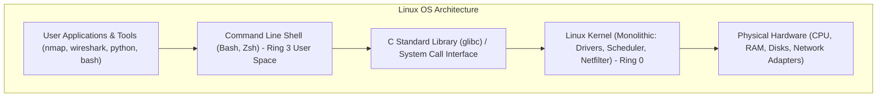

---

### 7.2 The Filesystem Hierarchy Standard (FHS)

Unlike Windows, which assigns letters to separate storage partitions (`C:\`, `D:\`), Linux unifies everything into a single inverted hierarchical tree starting at the root directory: **`/`** (pronounced "slash").

```mermaid
flowchart TD
    ROOT["/ (The Root of the Entire Filesystem)"]
    ROOT --> BIN["/bin (Essential system binaries: ls, cp, bash)"]
    ROOT --> SBIN["/sbin (System admin binaries: iptables, fdisk, reboot)"]
    ROOT --> ETC["/etc (System-wide configuration files: /etc/passwd, /etc/shadow)"]
    ROOT --> HOME["/home (User personal directories: /home/alice, /home/bob)"]
    ROOT --> ROOTUSER["/root (The home directory of the root superuser)"]
    ROOT --> VAR["/var (Variable data, spoolers, logs: /var/log/syslog)"]
    ROOT --> TMP["/tmp (Temporary storage, world-writable; wiped on reboot)"]
    ROOT --> DEV["/dev (Hardware device representations: /dev/sda, /dev/urandom)"]
    ROOT --> PROC["/proc (Virtual pseudo-filesystem representing running kernel & processes)"]
    ROOT --> OPT["/opt (Optional third-party software installations)"]
```

#### Crucial Files for Security Analysts:
- `/etc/passwd`: Publicly readable database of all user accounts on the system (shows username, UID, GID, home directory, and default shell).
- `/etc/shadow`: Restricted file (readable only by root) containing cryptographic hashes of user passwords, salt values, and password expiration policies.
- `/etc/group`: Defines security groups and their associated member accounts.
- `/etc/sudoers`: Rules determining which non-root users are permitted to run commands as root via `sudo`.
- `/var/log/`: Central logging repository:
  - `/var/log/auth.log` (Debian/Ubuntu) or `/var/log/secure` (RHEL/CentOS): Records all authentication attempts, SSH logins, and `sudo` executions.
  - `/var/log/syslog` or `/var/log/messages`: System-wide event logging.

---

### 7.3 Shells, Streams, Pipes, and Redirection

A **shell** is a command-line interpreter that reads text commands typed by a user, interprets them, requests services from the kernel via system calls, and displays the output. Common shells include **Bash** (Bourne Again Shell) and **Zsh** (Z Shell).

#### The Three Standard I/O Streams:
Every process launched in a Linux shell is automatically assigned three standard communication streams:
1. **`stdin` (Standard Input - File Descriptor 0)**: Input supplied by keyboard or another program.
2. **`stdout` (Standard Output - File Descriptor 1)**: Normal output produced by the program.
3. **`stderr` (Standard Error - File Descriptor 2)**: Diagnostic or error messages output by the program.

#### Redirection and Pipeline Operators:
- `>` (Overwrite Redirection): Directs `stdout` to a file, replacing its contents:
  ```bash
  echo "Malicious IP: 192.168.1.50" > blacklist.txt
  ```
- `>>` (Append Redirection): Directs `stdout` to the end of a file without overwriting existing data:
  ```bash
  echo "Malicious IP: 10.0.0.99" >> blacklist.txt
  ```
- `2>` (Error Redirection): Directs only `stderr` (errors) to a file or drops them:
  ```bash
  find / -perm -4000 2>/dev/null
  ```
  *(The command above searches for SUID root files across the entire drive and silently discards all "Permission Denied" errors to the null bit-bucket `/dev/null`).*
- `|` (The Pipe): Connects the `stdout` of one command directly into the `stdin` of another command, enabling powerful chained one-liners:
  ```bash
  cat /var/log/auth.log | grep "Failed password" | awk '{print $11}' | sort | uniq -c | sort -nr
  ```
  *(This single analyst pipeline extracts failed SSH login attempts, parses the attacking IP addresses, deduplicates them, and prints a sorted leaderboard of attacker IPs).*

---

### 7.4 Linux Permissions, Ownership, and SUID/SGID

Linux enforces strict POSIX multi-user access control. Every file and directory is owned by a **User** and a **Group**.

#### Interpreting the Permission String:
Running `ls -l` reveals a 10-character permission block:
`-rwxr-xr-- 1 analyst secops 4096 Nov 11 12:00 incident_report.sh`


- **Character 1**: File type (`-` = normal file, `d` = directory, `l` = symbolic link).
- **Characters 2–4**: Permissions for the **Owner** (`rwx`).
- **Characters 5–7**: Permissions for the **Group** (`r-x`).
- **Characters 8–10**: Permissions for **Others** (`r--`).

#### Binary & Octal Permission Values:
Permissions carry mathematical numerical weights:
- **`r` (Read)** = $4$
- **`w` (Write)** = $2$
- **`x` (Execute)** = $1$

Combine values to form a 3-digit octal permission:
- `chmod 755 script.sh` $\rightarrow$ Owner: $4+2+1=7$ (`rwx`), Group: $4+0+1=5$ (`r-x`), Others: $4+0+1=5$ (`r-x`).
- `chmod 644 file.txt` $\rightarrow$ Owner: $4+2=6$ (`rw-`), Group: $4$ (`r--`), Others: $4$ (`r--`).
- `chmod 700 secret.key` $\rightarrow$ Owner has full rights; nobody else has access.

#### Special Security Permissions (SUID, SGID, Sticky Bit):
- **SUID (Set User ID - Octal 4000)**: Displayed as an `s` in the owner execute position (`-rwsr-xr-x`). When an unprivileged user runs an SUID binary, the program runs **with the permissions of the file owner** (often root!). For example, `/usr/bin/passwd` has SUID root so regular users can temporarily write their new password to `/etc/shadow`. Misconfigured custom SUID binaries are a primary vector for **Linux Privilege Escalation**.
- **SGID (Set Group ID - Octal 2000)**: Binary runs with group permissions; files created in an SGID directory automatically inherit that parent directory's group.
- **Sticky Bit (Octal 1000)**: Displayed as a `t` in the other execute position (`drwxrwxrwt`). Applied to shared directories like `/tmp`. Allows anyone to write files, but users can **only delete their own files**, preventing users from deleting each other's work.

---

### 7.5 Essential Linux Commands Directory

```bash
# ==============================================================================
# 1. NAVIGATION & FILE INSPECTION
# ==============================================================================
pwd                     # Print working directory (shows where you currently are)
ls -lah                 # List all files (including hidden .files) in human-readable long format
cd /var/log             # Change directory to /var/log
file mystery_binary     # Inspect file headers to reveal true file type regardless of extension

# ==============================================================================
# 2. FILE CREATION & MANIPULATION
# ==============================================================================
touch artifact.txt      # Create an empty file or update timestamps
mkdir -p /opt/cases/01  # Create directory tree (including parent folders)
cp -r /etc/nginx/ /tmp/ # Recursively copy entire directory to /tmp
mv old.log /backup/     # Move or rename file
rm -rf /tmp/scratch/    # Forcefully and recursively remove files and directories

# ==============================================================================
# 3. TEXT PROCESSING & LOG INVESTIGATION
# ==============================================================================
cat -n /etc/hosts       # Display entire file contents with line numbers
head -n 20 syslog.log   # View first 20 lines of a file
tail -f /var/log/nginx/access.log # Follow log file in real-time as new events arrive
grep -i "unauthorized" app.log    # Search case-insensitively for a pattern
awk -F':' '{print $1, $3}' /etc/passwd # Parse colon-delimited file, printing columns 1 and 3
sed -i 's/192.168.1.1/10.0.0.1/g' config.conf # In-place search and replace across a file
sort auth.log | uniq -c # Sort lines and count unique duplicate occurrences
wc -l access.log        # Count total lines in a log file

# ==============================================================================
# 4. PROCESS MANAGEMENT & SYSTEM HEALTH
# ==============================================================================
ps aux                  # Snapshot of every running process with PID, CPU, memory, and user
top                     # Interactive real-time process monitoring dashboard
kill -9 1337            # Send SIGKILL (force terminate) to process ID 1337
systemctl status sshd   # Check operational service status of SSH daemon
journalctl -u ufw -n 50 # View the last 50 log messages generated by the firewall service
df -h                   # Display disk filesystem utilization in human-readable gigabytes
free -m                 # Display physical RAM utilization in megabytes
uname -a                # Print kernel version, architecture, and system hostname

# ==============================================================================
# 5. NETWORKING & RECONNAISSANCE
# ==============================================================================
ip addr show            # Display all network interfaces, IP addresses, and MAC addresses
ss -tulpn               # Display all listening TCP/UDP ports with associated process PIDs
ping -c 4 8.8.8.8       # Send 4 ICMP Echo requests to test connectivity
traceroute target.com   # Trace the hop-by-hop router path to a destination
curl -I https://site.com# Send HTTP HEAD request to view web server banners and headers
dig target.com ANY      # Perform DNS queries against root/authoritative nameservers
```
---


## 8. Windows Operating System Fundamentals for Security

### 8.1 Windows Architecture: User Mode vs. Kernel Mode

Microsoft Windows is the predominant enterprise desktop operating system. Enterprise cyber defenders and penetration testers must intimately understand Windows internals.

```mermaid
flowchart TD
    subgraph User Mode (Ring 3 - Isolated Memory)
        APPS["User Applications (Word, Chrome, Slack)"]
        WIN32["Subsystem DLLs (kernel32.dll, user32.dll, ntdll.dll)"]
        SERVICES["Core Security Services:<br>• LSASS.exe (Local Security Authority)<br>• Winlogon.exe<br>• Service Control Manager (services.exe)"]
    end

    subgraph Kernel Mode (Ring 0 - Privileged Hardware Execution)
        NTOSKRNL["Executive & NT Kernel (ntoskrnl.exe)"]
        HAL["Hardware Abstraction Layer (HAL.dll)"]
        DRIVERS["Kernel-Mode Device Drivers (.sys files)"]
    end

    APPS --> WIN32
    SERVICES --> WIN32
    WIN32 -->|NTDLL Syscall Interface| NTOSKRNL
    NTOSKRNL --> HAL
    DRIVERS --> HAL
```

- **User Mode Subsystems**: Applications do not call the Windows kernel directly. Instead, they interact with the **Win32 API** (via libraries like `kernel32.dll` and `user32.dll`), which pass execution to `ntdll.dll` to perform the actual transition to kernel mode.
- **LSASS (Local Security Authority Subsystem Service - `lsass.exe`)**: The crown jewel of Windows security. LSASS verifies user credentials during login, enforces security policies, generates security access tokens, and caches credentials and cryptographic ticket materials in RAM. This makes `lsass.exe` the prime target of adversarial credential-dumping tools like **Mimikatz**.

---

### 8.2 File Systems: NTFS, Permissions, and Alternate Data Streams

The **New Technology File System (NTFS)** is the default file system for modern Windows environments:

- **Security Descriptors & Access Control**:
  - **DACL (Discretionary Access Control List)**: Specifies which security principals (users or groups) are granted or denied permissions to a file or folder (e.g., Read, Write, Modify, Full Control).
  - **SACL (System Access Control List)**: Specifies audit logging rules, generating Windows Event Logs whenever a specified user attempts to access or modify the file.
- **Alternate Data Streams (ADS)**:
  - NTFS allows files to contain multiple streams of data. The primary stream contains visible content (`file.txt`), but hidden secondary streams can be created using the syntax `file.txt:hidden_stream`.
  - **Security Significance**: Attackers and malware use Alternate Data Streams to stash malicious executable payloads or scripts behind innocent text files. The file size of `file.txt` appears unchanged in Windows Explorer!
  - **Viewing ADS**:
    ```cmd
    dir /r
    Get-Item -Path file.txt -Stream *
    ```

---

### 8.3 The Windows Registry Architecture

#### 1. What is it?
The **Windows Registry** is a centralized, hierarchical configuration database that stores system settings, hardware configurations, user preferences, installed software details, and security policies.

#### 2. Why does it exist?
Instead of scattering thousands of text configuration files across the disk (as Linux does in `/etc`), Windows maintains a unified, indexed binary registry accessible via standard APIs.

#### 3. Registry Hives (Root Keys):
- **`HKEY_LOCAL_MACHINE` (HKLM)**: System-wide settings applicable to all users and hardware configurations.
- **`HKEY_CURRENT_USER` (HKCU)**: Specific configuration and preferences for the currently logged-in user.
- **`HKEY_CLASSES_ROOT` (HKCR)**: File association mappings and Object Linking and Embedding (OLE) registrations.
- **`HKEY_USERS` (HKU)**: Contains individual profiles for all active user accounts on the machine.
- **`HKEY_CURRENT_CONFIG` (HKCC)**: Volatile hardware profile information gathered at system boot.

#### Adversarial Persistence in the Registry:
Malware frequently achieves persistent survival across system reboots by establishing entries in **Run Keys**:
- `HKLM\Software\Microsoft\Windows\CurrentVersion\Run`
- `HKCU\Software\Microsoft\Windows\CurrentVersion\Run`
- Any binary path written to these keys is automatically executed when Windows starts up or when a user logs in!

---

### 8.4 Active Directory, SAM, and Authentication Protocols (NTLM & Kerberos)

#### Local Workgroup Security: The SAM Database
On standalone Windows machines, local user accounts and password hashes are stored in the **Security Account Manager (SAM)** database file located at `C:\Windows\System32\config\SAM`. The SAM file is locked by the operating system kernel while running. Passwords are saved as **NTLM Hashes** (MD4 hash of the UTF-16LE encoded password without salt—inherently vulnerable to offline cracking).

#### Enterprise Domain Security: Active Directory Domain Services (AD DS)
In corporate networks, managing local accounts on thousands of separate laptops is impossible. Microsoft **Active Directory** centralizes identity and access management:
- **Domain Controller (DC)**: The centralized server managing the Active Directory database (`ntds.dit`), authenticating all users, computers, and services across the enterprise.
- **Kerberos Authentication (Port 88)**: The default authentication protocol for Active Directory. It utilizes time-stamped cryptographic **Tickets** issued by a **Key Distribution Center (KDC)** running on the Domain Controller. Kerberos completely avoids sending password hashes across the wire, defeating packet sniffers.

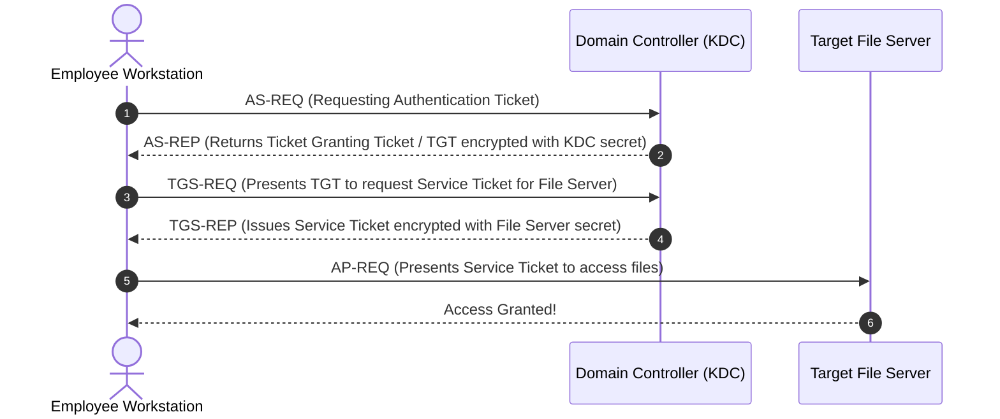

---

### 8.5 Essential Windows CLI and PowerShell Commands

#### Windows Command Prompt (cmd.exe):
```cmd
:: Networking & Interface Configuration
ipconfig /all             :: Display complete IP, MAC, Subnet, Gateway, and DNS servers
route print               :: Display local IP routing table
netstat -ano              :: Display all active network connections and listening ports with PIDs
nslookup target.com       :: Query DNS servers for target domain

:: Process & Service Management
tasklist /v               :: List all running processes with user context and memory usage
taskkill /F /PID 4012     :: Forcefully terminate process with PID 4012

:: Identity & User Accounts
net user                  :: List all local user accounts on the machine
net user hacker P@ss123 /add  :: Add a new local user (requires admin CMD)
net localgroup administrators :: View members of the local Administrators group
whoami /all               :: Print current user SID, group memberships, and security privileges
```

#### Windows PowerShell:
PowerShell is an advanced object-oriented shell and scripting language built on the .NET framework. Commands follow a strict `Verb-Noun` syntax:

```powershell
# ==============================================================================
# POWERSHELL FOR SECURITY ANALYSTS
# ==============================================================================
# Query running processes and filter by high CPU utilization
Get-Process | Where-Object {$_.CPU -gt 10} | Select-Object Name, Id, CPU

# Inspect system services and verify if security tools are running
Get-Service -Name "WinDefend", "MpsSvc"

# Query the Windows Security Event Log for failed logon events (Event ID 4625)
Get-EventLog -LogName Security -InstanceId 4625 -Newest 10

# Test network port connectivity to a remote server without third-party tools
Test-NetConnection -ComputerName 192.168.1.1 -Port 443

# Check and modify PowerShell Script Execution Policy
Get-ExecutionPolicy
Set-ExecutionPolicy -ExecutionPolicy RemoteSigned -Scope CurrentUser
```

---


## 9. Command-Line, Automation, and Scripting Fundamentals

### 9.1 CLI vs. GUI: The Operational Superiority of the Terminal

- **Speed & Scale**: A Graphical User Interface (GUI) requires clicking buttons and dragging windows. Investigating 10,000 separate server log files through a GUI is physically impossible. A command-line script processes them in seconds.
- **Resource Footprint**: GUIs consume extensive GPU and RAM cycles. Enterprise production servers and cloud instances run **headless** (pure command line with no display server installed) to optimize performance and minimize attack surface.
- **Reproducibility & Scripting**: Every CLI command can be saved into a text file and re-executed across thousands of systems simultaneously via automated pipelines.

---

### 9.2 Practical Bash Scripting for Analysts

A **Bash script** is an executable text file containing sequential shell commands.

#### Anatomy of a Security Audit Script:
```bash
#!/bin/bash
# ==============================================================================
# Script Name: audit_failed_logins.sh
# Purpose: Detect potential SSH brute-force attacks on Debian/Ubuntu systems
# ==============================================================================

LOG_FILE="/var/log/auth.log"
THRESHOLD=5

echo "[*] Initiating SSH Brute-Force Log Audit..."

# Check if log file exists
if [ ! -f "$LOG_FILE" ]; then
    echo "[-] Error: Log file $LOG_FILE not found!"
    exit 1
fi

# Extract IPs with failed logins exceeding threshold
echo "[+] Suspicious IP Addresses (Attempts >= $THRESHOLD):"
grep "Failed password" "$LOG_FILE" | awk '{print $11}' | sort | uniq -c | while read count ip; do
    if [ "$count" -ge "$THRESHOLD" ]; then
        echo "    ALERT: IP $ip attempted $count failed logins!"
    fi
done

echo "[*] Audit Complete."
exit 0
```
- Line 1: `#!/bin/bash` is the **Shebang**, telling the operating system kernel which interpreter to use to execute the script.
- Execute permissions must be set: `chmod +x audit_failed_logins.sh`.
- Run the script: `./audit_failed_logins.sh`.

---

### 9.3 Practical Python Scripting for Security

**Python** is the standard programming language for cybersecurity analysts and ethical hackers due to its clean syntax and vast ecosystem of networking and security libraries.

#### Building a Simple TCP Port Scanner from Scratch:
```python
#!/usr/bin/env python3
"""
Simple TCP Port Scanner
Demonstrates basic socket programming and network reconnaissance logic.
"""

import socket
import sys

TARGET_HOST = "127.0.0.1"
PORTS_TO_SCAN = [21, 22, 23, 25, 53, 80, 443, 445, 3389, 8080]

print(f"[*] Commencing TCP Port Scan against target: {TARGET_HOST}")

for port in PORTS_TO_SCAN:
    # Instantiate a socket object: IPv4 (AF_INET), TCP (SOCK_STREAM)
    sock = socket.socket(socket.AF_INET, socket.SOCK_STREAM)
    # Set a 1-second timeout to avoid hanging on filtered ports
    sock.settimeout(1.0)
    
    # Attempt connection (connect_ex returns 0 on success)
    result = sock.connect_ex((TARGET_HOST, port))
    
    if result == 0:
        print(f"[+] Port {port:<5} [OPEN]")
    else:
        print(f"[-] Port {port:<5} [CLOSED/FILTERED]")
        
    sock.close()

print("[*] Scan operation finalized.")
```

---

### 9.4 SQL Relational Querying vs. Linux Pipeline Filtering

Security professionals constantly sift through mountain ranges of data. They use two distinct filtering paradigms:

```mermaid
flowchart TD
    subgraph Structured Relational Data (SQL)
        DB[(Relational DB / SIEM Table)] --> SQL["SQL Engine: Declarative Query<br>SELECT ip, count(*) FROM logs WHERE status=401 GROUP BY ip;"]
    end

    subgraph Unstructured Text Streams (Linux)
        TEXT[Raw Flat Log Files] --> PIPELINE["Bash Pipeline: Imperative Stream<br>cat access.log | grep 401 | awk '{print $1}' | uniq -c"]
    end
```

| Operational Dimension | SQL Relational Filtering | Linux Shell Pipeline Filtering |
| :--- | :--- | :--- |
| **Data Format** | Structured relational tables with typed columns | Unstructured flat text, JSON logs, or CSV files |
| **Execution Style**| Declarative: Specify *what* data you want | Imperative: Chain commands specifying *how* to filter |
| **Tooling** | MySQL, PostgreSQL, SQLite, BigQuery, Splunk (SPL) | `grep`, `awk`, `sed`, `cut`, `sort`, `uniq` |
| **Speed** | Blazing fast for indexed relational databases | Fast for streaming ad-hoc disk files without database imports |

---


## 10. Virtualization and Cloud Computing Fundamentals

### 10.1 Virtualization & Hypervisors (Type 1 vs. Type 2)

#### 1. What is it?
Virtualization is technology that allows multiple isolated operating systems (Virtual Machines or VMs) to run concurrently on a single physical host computer by abstracting hardware resources.

#### 2. Why does it exist?
In traditional architectures, running one operating system per physical server resulted in massive resource waste (servers sitting at 5% CPU utilization), high power bills, and slow disaster recovery. Virtualization delivers density, hardware consolidation, instant provisioning, and sandbox security isolation.

#### 3. How does it work?
A specialized software layer called a **Hypervisor** (or Virtual Machine Monitor - VMM) manages CPU cores, physical memory, storage disks, and network interfaces, carving them into virtual representations for guest operating systems.

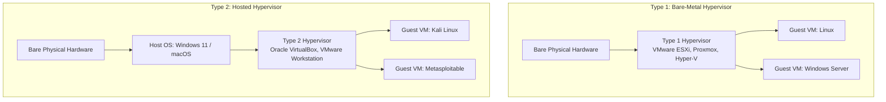

- **Type 1 Hypervisors (Bare-Metal)**: Installs directly onto bare physical server hardware with no intermediate host OS. Extremely fast, enterprise-grade, low latency. Examples: **VMware ESXi**, **Proxmox VE**, **Microsoft Hyper-V**, **KVM**.
- **Type 2 Hypervisors (Hosted)**: Runs as an application inside a conventional desktop operating system (Windows, macOS). Excellent for security research, testing, and student home practice labs. Examples: **Oracle VirtualBox**, **VMware Workstation / Fusion**.

#### VM Networking Modes:
- **Bridged Mode**: The VM's virtual NIC connects directly to the physical network switch. It receives its own unique IP from your home/corporate router, appearing as an independent physical machine on the LAN.
- **NAT Mode**: The VM sits behind an internal virtual router managed by the hypervisor. It shares the host computer's external IP address.
- **Host-Only Mode**: Creates a strictly isolated virtual network connecting the host and guest VMs together with **no route to the Internet**. Ideal for safe malware analysis!

---

### 10.2 Virtual Machines vs. Containers

While Virtual Machines virtualize the **physical hardware**, Containers virtualize the **operating system kernel**.

```mermaid
flowchart LR
    subgraph Virtual Machine Architecture
        HW1[Hardware] --> HYP[Hypervisor]
        HYP --> GUESTOS1[Guest OS + Kernel]
        GUESTOS1 --> APP1[App A]
        HYP --> GUESTOS2[Guest OS + Kernel]
        GUESTOS2 --> APP2[App B]
    end

    subgraph Container Architecture (Docker)
        HW2[Hardware] --> HOSTOS[Host OS + Shared Kernel]
        HOSTOS --> ENGINE[Container Engine / Docker]
        ENGINE --> CONT1[Container A (Binaries + App)]
        ENGINE --> CONT2[Container B (Binaries + App)]
    end
```

- **Containers (Docker, Podman)**: Share the host operating system's single Linux kernel using Linux kernel primitives: **Namespaces** (isolates process trees, networking, and mount points) and **Cgroups** (limits CPU and memory consumption). Containers boot in milliseconds and require negligible disk space.
- **Security Trade-off**: If a container escapes via a Linux kernel exploit, the attacker compromises the host system! Virtual Machines provide a much stronger security boundary because hypervisor escapes are significantly harder to execute.

---

### 10.3 Cloud Computing Models (IaaS, PaaS, SaaS, FaaS)

The National Institute of Standards and Technology (**NIST SP 800-145**) defines cloud computing through:
- **5 Essential Characteristics**: On-demand self-service, Broad network access, Resource pooling, Rapid elasticity, Measured service.
- **4 Deployment Models**:
  - **Public Cloud**: Infrastructure owned and operated by third-party providers (AWS, Azure, Google Cloud), shared via multi-tenancy.
  - **Private Cloud**: Dedicated exclusively to a single organization (on-premises or hosted).
  - **Hybrid Cloud**: Connects private infrastructure with public cloud environments.
  - **Community Cloud**: Shared by multiple organizations with common compliance or mission requirements.

```mermaid
flowchart TD
    subgraph Cloud Service Models (Stack of Responsibility)
        IaaS["Infrastructure as a Service (IaaS)<br>AWS EC2, Azure VMs, Google Compute Engine<br>• Vendor manages: Physical Hardware, Data Center, Hypervisor<br>• Customer manages: OS, Patches, Network Config, Apps, Data"]
        PaaS["Platform as a Service (PaaS)<br>AWS Elastic Beanstalk, Heroku, Google App Engine<br>• Vendor manages: Hardware, OS, Runtimes, Middleware<br>• Customer manages: Application Code, Data"]
        SaaS["Software as a Service (SaaS)<br>Microsoft 365, Google Workspace, Salesforce<br>• Vendor manages: Everything from Hardware up to the App<br>• Customer manages: User Access, Data, Configuration"]
    end
```

- **FaaS (Function as a Service / Serverless)**: Developers write isolated stateless functions (e.g., AWS Lambda, Google Cloud Functions) executed on-demand in response to events (e.g., an image uploaded to an S3 bucket). Customers pay purely for the execution milliseconds.

---

### 10.4 The Shared Responsibility Model & Software-Defined Networking

#### The Shared Responsibility Model:
Security in the cloud is a shared partnership between the Cloud Service Provider (CSP) and the customer:
- **Security OF the Cloud**: The CSP's sole responsibility (physical data centers, perimeter fencing, biological security, power cooling, hypervisor hardware integrity).
- **Security IN the Cloud**: The customer's responsibility (configuring IAM policies, encrypting sensitive data, updating guest operating system patches, establishing firewall rules).

#### Software-Defined Networking (SDN) & Virtual Networks:
Traditional networks configure individual hardware switches manually. **SDN** decouples the **Control Plane** (routing logic and policy decision engine) from the **Data Plane** (the physical forwarding silicon):
- **Virtual Private Cloud (VPC)**: An isolated, private software-defined network boundary carved out inside a public cloud provider.
- **Security Groups**: Virtual **stateful** firewalls operating at the individual Virtual Machine instance interface level.
- **Network Access Control Lists (NACLs)**: Virtual **stateless** subnet-level packet filtering rules.
---


## 11. Introduction to Cybersecurity Core Concepts

### 11.1 The CIA Triad, DAD Triad, and Parkerian Hexad

#### The CIA Triad
The **Confidentiality, Integrity, and Availability (CIA) Triad** is the universally recognized architectural cornerstone of information security:

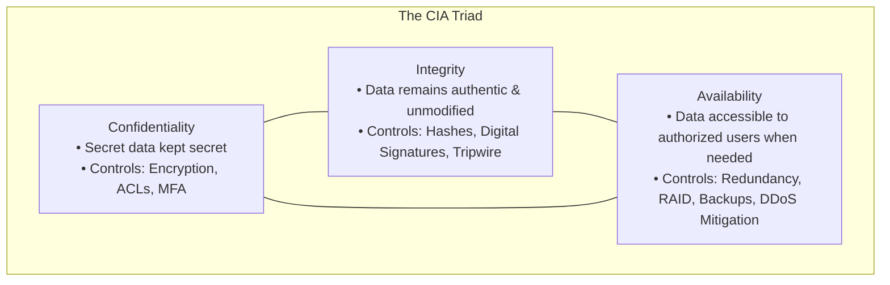

1. **Confidentiality**: Ensuring that sensitive information is inaccessible to unauthorized individuals, entities, or processes.
   - *Threats*: Packet sniffing, eavesdropping, unauthorized credential dumping, shoulder surfing.
   - *Countermeasures*: AES encryption, strict file permissions (chmod/DACLs), multi-factor authentication.
2. **Integrity**: Ensuring that data and systems remain accurate, complete, authentic, and untampered with throughout their lifecycle.
   - *Threats*: Man-in-the-Middle packet tampering, unauthorized database updates, web defacement.
   - *Countermeasures*: Cryptographic hashing (SHA-256), digital signatures, file integrity monitoring (FIM).
3. **Availability**: Ensuring that systems, networks, and applications are reliably accessible to authorized users whenever required.
   - *Threats*: Distributed Denial-of-Service (DDoS) attacks, ransomware encryption, hardware disk crashes, power outages.
   - *Countermeasures*: Load balancers, fault-tolerant server clustering, redundant power supplies (UPS), geographic disaster recovery sites.

#### The DAD Triad (The Inverted Opposites of CIA):
Every cyber incident can be mapped to its corresponding opposite violation in the **DAD Triad**:
- Confidentiality $\leftrightarrow$ **Disclosure** (Unauthorized exposure of private data).
- Integrity $\leftrightarrow$ **Alteration** (Unauthorized modification of trusted information).
- Availability $\leftrightarrow$ **Denial** (Disruption or obstruction of legitimate access).

#### The Parkerian Hexad (Donn B. Parker, 1998):
Expands the classic CIA triad into six distinct, granular security attributes:
1. **Confidentiality**
2. **Integrity**
3. **Availability**
4. **Authenticity**: Verifying the genuine origin of data or identity (e.g., confirming an email was truly signed by the CEO).
5. **Possession / Control**: Physical or logical ownership of data media (e.g., an encrypted backup tape stolen from a truck; confidentiality remains intact because it is encrypted, but possession is lost).
6. **Utility**: The usefulness or usability of data (e.g., losing the decryption key to an encrypted database preserves confidentiality, but utility drops to zero).

---

### 11.2 The Core Security Equations: Assets, Threats, Vulnerabilities, and Risks

To make rational security engineering decisions, analysts must distinguish between four frequently confused concepts:

```mermaid
flowchart LR
    ASSET["1. Asset<br>(Value to Protect)"]
    VULN["2. Vulnerability<br>(Flaw or Weakness)"]
    THREAT["3. Threat & Actor<br>(Potential Danger)"]
    EXPLOIT["4. Exploit<br>(Attack Tool/Code)"]
    RISK["5. Risk<br>(Probability x Impact)"]

    THREAT -->|Discovers & Targets| VULN
    VULN -->|Leveraged by| EXPLOIT
    EXPLOIT -->|Compromises| ASSET
    THREAT & VULN & ASSET --> RISK
```

- **Asset**: Anything of value owned by an organization (e.g., customer databases, proprietary source code, physical servers, brand reputation, human employees).
- **Vulnerability**: A flaw, bug, architectural weakness, or misconfiguration in a system, process, or hardware component (e.g., an unpatched software bug, an open firewall port, a weak default password).
- **Threat**: Any circumstance, event, or entity with the capability to cause harm by exploiting a vulnerability.
- **Threat Actor**: The human individual, criminal syndicate, or nation-state entity driving the threat.
- **Exploit**: A specific software tool, crafted script, or technique used by a threat actor to take advantage of a vulnerability.
- **Risk**: The probability that a threat actor will successfully leverage a vulnerability, multiplied by the financial, operational, or reputational damage inflicted:
  $$\text{Risk} = \text{Threat} \times \text{Vulnerability} \times \text{Impact}$$

---

### 11.3 Attack Surfaces and Attack Vectors

- **Attack Surface**: The total aggregate sum of all potential points, interfaces, and vulnerabilities where an unauthorized attacker can attempt to enter, extract data, or manipulate an environment.
  - *Network attack surface*: Open listening ports, public IP addresses, VPN endpoints.
  - *Software attack surface*: Exposed API endpoints, unvalidated web form input fields, unpatched applications.
  - *Human attack surface*: Employees susceptible to phishing, executive social engineering.
  - *Core Security Goal*: **Minimize the attack surface area!** Turn off unused services, close unnecessary ports, enforce least privilege.
- **Attack Vector**: The specific pathway, delivery method, or vehicle through which an attacker delivers an exploit or gains access (e.g., a spear-phishing email containing a malicious PDF attachment, an unauthenticated public Wi-Fi hotspot, a compromised third-party USB drive).

---


#### Concrete Enterprise Example: The Internal Engineering Wiki
To understand the CIA triad not just as abstract theory, but as tangible operational realities, consider an enterprise's internal corporate engineering wiki containing software architectures, API credentials, and upcoming product release roadmaps:

```
+--------------------------------------------------------------------------------------------------+
|                   THE CIA TRIAD APPLIED: CORPORATE ENGINEERING WIKI                              |
+-------------------+------------------------------------------------------------------------------+
| Security Pillar   | Concrete Breach Scenario & Operational Impact                                |
+-------------------+------------------------------------------------------------------------------+
| Confidentiality   | An unauthorized competitor or malicious actor gains read access to the wiki. |
| Breach            | Impact: Unreleased product designs and trade secrets leak to competitors.     |
|                   | Proprietary competitive advantage is lost overnight, causing market shock.   |
+-------------------+------------------------------------------------------------------------------+
| Integrity         | A disgruntled insider or external threat actor subtly tampers with technical |
| Breach            | specifications for an automotive braking firmware or financial ledger API.   |
|                   | Impact: Engineers follow poisoned schematics. Code compiles with deliberate   |
|                   | security backdoors or critical safety defects, causing downstream disaster.  |
+-------------------+------------------------------------------------------------------------------+
| Availability      | A ransomware group encrypts the database server hosting the wiki, or an      |
| Breach            | operational failure crashes the service right during critical release week.  |
|                   | Impact: 500 developers are locked out from technical documentation.          |
|                   | Deployments freeze, client SLA commitments are breached, costing millions.   |
+-------------------+------------------------------------------------------------------------------+
```

---

#### Personal Data Taxonomy: PII vs. SPII
Information assets are not created equal. Legal frameworks and security standards establish strict hierarchies based on the potential harm caused if information is compromised:
1. **Personally Identifiable Information (PII)**: Any information that can be used to distinguish or trace an individual's identity, either directly or when combined with other public/private information. Examples include: Full legal name, personal email address, street address, telephone number, IP address, and MAC address.
2. **Sensitive Personally Identifiable Information (SPII / Sensitive Personal Data)**: A high-risk subcategory of PII that, if disclosed, poses immediate, catastrophic risks of severe financial harm, identity theft, physical danger, or severe reputational damage to the individual. Examples include:
   - Government identification numbers (Social Security Numbers, Aadhaar numbers, Passport numbers, PAN cards).
   - Biometric identifiers (fingerprints, retinal scans, facial recognition vectors).
   - Financial credentials (credit/debit card numbers with CVV, banking passwords, PINs).
   - Protected Health Information (PHI) and medical treatment histories.
   - Genetic data, sexual orientation, religious, and political affiliations.
*Rule of Thumb*: A leaked email address (PII) results in unsolicited spam; a leaked biometric scan or government ID combined with financial records (SPII) results in permanent identity theft, fraudulent loans, and legal ruin.

---

#### The Four Formal Risk Responses
When an organization identifies a cybersecurity risk (Risk = Threat × Vulnerability × Asset Impact), executive leadership must formally select one of four standard risk response strategies:
1. **Risk Mitigation (Remediation)**: Deploying defensive technical, physical, or administrative controls to reduce the likelihood and/or impact of the risk to an acceptable level.
   - *Example*: Installing an EDR agent, enforcing mandatory MFA across all user accounts, and patching critical web server vulnerabilities within 48 hours.
2. **Risk Transference (Sharing)**: Shifting the financial or operational liability of the risk to a third party.
   - *Example*: Purchasing a \$10,000,000 comprehensive cyber insurance policy to cover legal fees and forensic costs following a breach, or outsourcing payment processing to a PCI-DSS certified gateway like Stripe.
3. **Risk Avoidance**: Completely terminating the activity, system, or business process that introduces the unacceptable risk.
   - *Example*: Prohibiting the use of USB flash drives across the enterprise, refusing to open public Wi-Fi in corporate offices, or decommissioning a legacy unpatchable Windows Server 2003 system rather than keeping it online.
4. **Risk Acceptance**: Acknowledging the existence of the risk and making an informed, documented executive decision to absorb potential consequences without investing in additional controls because the cost of mitigation exceeds the potential loss.
   - *Example*: Accepting the risk of occasional low-level spam emails bypassing filters because aggressive filtering would mistakenly drop legitimate multi-million dollar vendor invoices.

---

#### Aggregate Risk Evaluation: The Likelihood × Impact Matrix
Because security teams operate with finite budgets and limited time, they cannot treat every vulnerability with equal urgency. Organizations quantify aggregate risk along two fundamental axes:
- **Likelihood (Probability)**: How probable is it that a threat actor will discover and successfully exploit this vulnerability? (Evaluated by attack surface visibility, exploit public availability, and threat actor motivation).
- **Impact (Severity / Consequence)**: If exploited, how catastrophic is the fallout to confidentiality, integrity, availability, financial revenue, legal compliance, and human life?

```
+-------------------------------------------------------------------------------+
|                       ENTERPRISE RISK HEAT MATRIX                             |
+-------------------+-------------------+-------------------+-------------------+
| LIKELIHOOD \     | Low Impact        | Medium Impact     | High Impact       |
| IMPACT            | (Minor bug)       | (System degraded) | (Breach/Shutdown) |
+-------------------+-------------------+-------------------+-------------------+
| High Likelihood   | Moderate Risk     | High Risk         | CRITICAL RISK     |
| (Exploit Public)  | (Plan Patch)      | (Urgent Priority) | (EMERGENCY FIX)   |
+-------------------+-------------------+-------------------+-------------------+
| Medium Likelihood | Low Risk          | Moderate Risk     | High Risk         |
| (Complex attack)  | (Routine patch)   | (Plan mitigation) | (Urgent Priority) |
+-------------------+-------------------+-------------------+-------------------+
| Low Likelihood    | Minimal Risk      | Low Risk          | Moderate Risk     |
| (Air-gapped host) | (Accept risk)     | (Monitor status)  | (Compensating ctrl)|
+-------------------+-------------------+-------------------+-------------------+
```


## 12. Malware Fundamentals & Historical Case Studies

### 12.1 Exhaustive Malware Taxonomy

**Malware** (Malicious Software) is an umbrella term encompassing any software intentionally written to damage, disrupt, steal, or gain unauthorized access to computer systems:

```mermaid
flowchart TD
    MALWARE["Malware Strains"]
    MALWARE --> VIRUS["Virus (Attaches to host files; requires human execution)"]
    MALWARE --> WORM["Worm (Self-replicating; network autonomous; no user needed)"]
    MALWARE --> TROJAN["Trojan (Masquerades as legitimate program; creates backdoor)"]
    MALWARE --> RANSOM["Ransomware (Crypto-locking data; extortion demand)"]
    MALWARE --> SPY["Spyware & Keyloggers (Silent reconnaissance & keystroke theft)"]
    MALWARE --> ROOTKIT["Rootkit (Ring 0 kernel hooking; stealth cloaking)"]
    MALWARE --> BOTNET["Botnet Agent (Zombie node in centralized C2 network)"]
    MALWARE --> FILELESS["Fileless / LOLBins (Runs in RAM; abuses PowerShell/WMI)"]
```

1. **Virus**: Malicious code that attaches itself to a legitimate host program or executable file (e.g., `.exe`, `.docx`). It cannot run independently; it relies on human action (double-clicking the infected file) to replicate.
2. **Worm**: A standalone, self-replicating malware program that actively exploits network vulnerabilities to propagate autonomously across local networks and the Internet without any human intervention.
3. **Trojan Horse (Trojan)**: Disguises itself as legitimate, benign, or desirable software (e.g., a free game, an image converter, a system optimizer). When executed, it silently drops a malicious payload or establishes a **Remote Access Trojan (RAT)** backdoor for the attacker.
4. **Ransomware**: Encrypts the victim's documents, databases, and operating system drives using strong asymmetric/symmetric cryptography, demanding cryptocurrency ransoms in exchange for decryption keys.
   - *Double Extortion*: Modern ransomware actors not only encrypt local files but exfiltrate sensitive customer data first, threatening public publication on leak sites if the ransom is unpaid.
5. **Spyware & Keyloggers**: Operates silently in the background, harvesting keystrokes, browser search history, webcam feeds, and login credentials, sending them to remote adversary servers.
6. **Rootkit**: Ultra-stealth malware that embeds itself deeply into the operating system—frequently at the **Kernel (Ring 0)** or Hypervisor level. Rootkits hook core system APIs to conceal their processes, files, and network connections from Task Manager and antivirus software.
7. **Botnets & Zombies**: A collection of compromised devices ("zombies" or "bots") connected to the Internet, remotely orchestrated by a **Command and Control (C2)** server. Used for launching massive DDoS attacks, high-speed credential stuffing, or cryptocurrency mining.
8. **Logic Bomb**: Malicious instructions embedded into an application that lie completely dormant until triggered by a specific event or date (e.g., an employee's account being deleted from Active Directory).
9. **Fileless Malware & Living off the Land (LOLBins)**: Does not write traditional malicious binaries to disk. Instead, it injects malicious scripts directly into volatile RAM, abusing native system management tools like **PowerShell**, **Windows Management Instrumentation (WMI)**, and `certutil.exe` to execute attacks without triggering standard antivirus file scans.

---

### 12.2 Historical Attacks That Shaped Modern Cybersecurity

- **The Brain Virus (1986)**: The world's first IBM PC-compatible virus, created in Pakistan by the Alvi brothers. It infected the boot sector of $360\text{ KB}$ floppy disks to track unauthorized software piracy.
- **The Morris Worm (1988)**: The world's first major Internet worm, written by Cornell graduate student Robert Tappan Morris to gauge the size of the nascent ARPANET. It exploited a buffer overflow flaw in `fingerd` and a debug backdoor in `sendmail`, rapidly crashing an estimated 10% of all computers connected to the Internet.
- **The LoveLetter / ILOVEYOU Worm (2000)**: Originated in the Philippines, spreading worldwide in hours via Microsoft Outlook email attachments titled `LOVE-LETTER-FOR-YOU.TXT.vbs`. It demonstrated the terrifying destructive power of social engineering combined with automated email harvesting.
- **Stuxnet (2010)**: The world's first true nation-state cyber weapon. Specifically engineered to sabotage Iranian nuclear enrichment centrifuges at Natanz. It jumped air-gapped networks via infected USB drives, leveraged four separate zero-day exploits, and physically destroyed uranium centrifuges while reporting normal telemetry to operators.
- **WannaCry (2017)**: A global ransomware epidemic that crippled the UK National Health Service (NHS), FedEx, and thousands of enterprises. It weaponized **EternalBlue**, a leaked NSA exploit targeting a vulnerability in Microsoft's SMBv1 protocol (`MS17-010`), acting as a worm to self-propagate across unpatched enterprise LANs.
- **NotPetya (2017)**: Disguised as ransomware, NotPetya was a state-sponsored wiper weapon deployed against Ukrainian financial and tax software. It utilized EternalBlue and PsExec to paralyze global shipping giants (Maersk) and multinational corporations, inflicting over \$10 billion in worldwide economic damage.

---


## 13. Identity, Authentication, and Access Management (AAA)

### 13.1 The AAA Framework

Enterprise security management relies on the **AAA Framework**:

```mermaid
flowchart LR
    ID["1. Identification<br>('I am Alice')"] --> AUTH["2. Authentication<br>('Prove it with your password/MFA')"]
    AUTH --> AUTHZ["3. Authorization<br>('You are granted Read-Only access to Folder X')"]
    AUTHZ --> ACCT["4. Accounting / Auditing<br>('Log: Alice accessed File.txt at 14:02')"]
```

1. **Identification**: Claiming an identity to a system (e.g., entering username `alice`).
2. **Authentication**: Proving that identity claim with verifiable evidence (e.g., providing Alice's secret password or biometric scan).
3. **Authorization**: Determining what specific resources, directories, databases, and commands the authenticated identity is permitted to access.
4. **Accounting (Auditing)**: Continuously recording system events, user logins, file accesses, and permission modifications in secure audit logs for accountability and non-repudiation.

---

### 13.2 The Five Authentication Factors

To authenticate a user, systems verify one or more of the **Five Core Factors of Authentication**:

| Authentication Factor | Description & Definition | Practical Real-World Examples | Common Vulnerabilities & Attacks |
| :--- | :--- | :--- | :--- |
| **Something You Know** | Knowledge-based information stored in the user's brain. | Passwords, Passphrases, PINs, Security questions | Brute-force guessing, dictionary attacks, phishing, credential stuffing |
| **Something You Have** | Possession of a physical or digital token/device. | Hardware security key (YubiKey), Smart card, Authenticator App (TOTP), SMS OTP | Physical theft, SIM swapping (for SMS), session token theft |
| **Something You Are** | Inherent biological and physical characteristics of the human body. | Fingerprint scans, Facial recognition, Retina/Iris scanning | False Acceptance Rate (FAR), biometric replay, physical spoofing |
| **Somewhere You Are** | Geographic location or network boundary of the user. | GPS coordinates, IP address geofencing, corporate intranet subnet | GPS spoofing, commercial VPN routing, proxy servers |
| **Something You Do** | Behavioral biometrics based on distinctive human action patterns. | Keystroke dynamics (typing cadence), signature analysis, gait detection | Behavioral drift, high complexity of implementation |

---

### 13.3 MFA, Passkeys, and Single Sign-On (SSO)

#### Multi-Factor Authentication (MFA) vs. Two-Step Verification (2SV):
- **True Multi-Factor Authentication (MFA)** requires presenting credentials from **two or more DIFFERENT authentication factors** (e.g., a Password [Something You Know] + a YubiKey hardware token [Something You Have]).
- Entering a password and a PIN is **NOT** MFA; both belong to the exact same factor ("Something You Know"). That is merely Two-Step Verification (2SV).

#### Passkeys & FIDO2 / WebAuthn:
The modern standard replacing vulnerable legacy passwords entirely. Based on public-key cryptography:
- The user's device (phone or security key) generates a cryptographic key pair for each website.
- The **Public Key** is stored on the website's server.
- The **Private Key** never leaves the user's secure hardware chip (TPM / Secure Enclave) and is unlocked locally via biometrics (TouchID/FaceID).
- **Phishing-Resistant**: Because WebAuthn binds the cryptographic challenge to the website's exact TLS domain URL, an attacker's fake phishing site cannot harvest the credential!

#### Single Sign-On (SSO):
- **Concept**: A centralized authentication service allowing a user to log in once with a single set of enterprise credentials and automatically gain access to multiple independent corporate applications (Slack, Google Workspace, Jira, Salesforce) without re-entering passwords.
- **Protocols**:
  - **SAML 2.0 (Security Assertion Markup Language)**: XML-based standard exchanging authentication tokens between an **Identity Provider (IdP)** (e.g., Okta, Microsoft Entra ID) and a **Service Provider (SP)** (e.g., Salesforce).
  - **OAuth 2.0 & OpenID Connect (OIDC)**: Modern JSON-based RESTful protocols. OAuth 2.0 handles *Authorization* (delegating access via scopes and access tokens); OpenID Connect (OIDC) adds an identity layer on top of OAuth for *Authentication* (providing signed JWT ID Tokens).

---

### 13.4 Access Control Models (DAC, MAC, RBAC, ABAC)

Once an identity is authenticated, the system enforces access control policies:

1. **DAC (Discretionary Access Control)**:
   - The owner of the data/file has complete discretion to determine who can read, modify, or execute it. Standard in consumer operating systems (Linux `chmod`, Windows NTFS DACLs).
   - *Weakness*: Inherent security vulnerabilities if careless users grant `chmod 777` (world writable) to sensitive files.
2. **MAC (Mandatory Access Control)**:
   - Access is dictated strictly by the operating system kernel based on military security clearance levels (e.g., Top Secret, Secret, Confidential, Unclassified) and object sensitivity labels. End-users cannot change permissions!
   - *Implementations*: **SELinux** (Security-Enhanced Linux), military operating systems.
3. **RBAC (Role-Based Access Control)**:
   - Permissions are assigned directly to **job roles** (e.g., "HR Representative", "Security Analyst", "Database Admin"), and employees are assigned to roles. When an employee switches departments, their permissions update automatically by changing their role membership. Standard in corporate enterprises.
4. **ABAC (Attribute-Based Access Control)**:
   - Next-generation dynamic access control evaluating multiple contextual attributes simultaneously:
     - *Subject Attributes*: User's department, role, clearance.
     - *Resource Attributes*: Document classification, file owner.
     - *Action Attributes*: Read, write, delete, approve.
     - *Environmental Attributes*: Time of day, current physical location, device health compliance.
     - *Example Rule*: *"Allow Doctors to read patient medical records [Action/Resource] only if connected from a hospital workstation [Environment] during their assigned shift hours [Environment]."*

---


## 14. Cryptography Fundamentals

### 14.1 Kerckhoffs's Principle and Ciphers

#### 1. What is it?
Cryptography is the mathematical science of securing information by transforming readable text into unintelligible secret code.

#### 2. Terminology:
- **Plaintext**: The original, human-readable message (e.g., `"Transfer $10,000 to Account B"`).
- **Ciphertext**: The scrambled, unreadable encrypted data (e.g., `8f7b2a9e01...`).
- **Cipher**: The mathematical algorithm used to encrypt and decrypt information.
- **Key**: A secret string of bits used by the cipher algorithm to scramble or unscramble the text.
- **Cryptanalysis**: The science of analyzing, breaking, and defeating cryptographic ciphers without possessing the secret key.

#### 3. Kerckhoffs's Principle & Shannon's Maxim:
- Formulated in 1883 by Auguste Kerckhoffs and restated by Claude Shannon:
  > *"A cryptographic system should be secure even if everything about the system, except the key, is public knowledge."*
- **Security through Obscurity is a Fallacy**: Attempting to secure a system by keeping the algorithm secret always fails. Modern ciphers (AES, RSA) are 100% open-source and publicly documented; their mathematical security relies entirely on the secrecy and computational hardness of the key!

---

### 14.2 Symmetric vs. Asymmetric Encryption

```mermaid
flowchart TD
    subgraph Symmetric Encryption (Shared Secret)
        P1[Plaintext] --> ENC1["AES Cipher (Shared Key K)"] --> C1[Ciphertext]
        C1 --> DEC1["AES Cipher (Shared Key K)"] --> P1_OUT[Plaintext]
    end

    subgraph Asymmetric Encryption (Public / Private Key Pair)
        P2[Plaintext] --> ENC2["RSA/ECC Cipher (Recipient's PUBLIC Key)"] --> C2[Ciphertext]
        C2 --> DEC2["RSA/ECC Cipher (Recipient's PRIVATE Key)"] --> P2_OUT[Plaintext]
    end
```

| Cryptographic Attribute | Symmetric Encryption | Asymmetric Encryption (Public Key) |
| :--- | :--- | :--- |
| **Key Architecture** | Single shared secret key for both encryption and decryption | Key Pair: **Public Key** (shared openly) + **Private Key** (kept strictly secret) |
| **Computational Speed**| Extremely fast (Hardware-accelerated by modern CPU AES-NI instructions) | Computationally slow and resource-heavy (thousands of times slower) |
| **Key Exchange Problem**| How do two parties share the secret key across an insecure Internet without someone intercepting it? | Solved! Anyone can encrypt with your Public Key; only your Private Key can decrypt. |
| **Standard Algorithms** | **AES** (128, 192, 256 bits), **ChaCha20**, legacy 3DES/DES | **RSA** (2048, 4096 bits), **ECC** (Elliptic Curve Cryptography), **Diffie-Hellman** |
| **Primary Use Cases** | Bulk data encryption (hard drives, database records, active VPN payloads) | Key exchange, digital signatures, identity verification, TLS handshakes |

> **Hybrid Cryptography**: Real-world protocols like **HTTPS (TLS)** combine both! Asymmetric encryption is used during the handshake to verify identity and securely negotiate a shared temporary session key. Once established, the connection switches instantly to ultra-fast Symmetric AES encryption for bulk data transfer.

---

### 14.3 Cryptographic Hash Functions & Rainbow Tables

#### 1. What is it?
A **Cryptographic Hash Function** is a mathematical one-way algorithm that takes an arbitrary block of input data of any size and converts it into a fixed-length string of bits (the **hash**, **digest**, or **fingerprint**).

#### 2. The Four Mandatory Mathematical Properties:
1. **One-Way (Pre-image Resistance)**: Computationally infeasible to reverse engineer the original input from the output hash.
2. **Deterministic**: The exact same input will *always* generate the exact same hash digest.
3. **Avalanche Effect**: Changing even a single bit in the input completely alters the entire output digest.
4. **Collision Resistance**: Infeasible to find two different inputs that produce the exact same hash output.

```mermaid
flowchart LR
    IN1["'Password123'"] --> HASH["SHA-256 Engine"] --> OUT1["ef92b778bafe77..."]
    IN2["'Password124'"] --> HASH --> OUT2["3a8c1f900b12ad..."]
```

#### Hash Algorithms Hierarchy:
- **MD5 (128-bit)**: Broken! Severe collision vulnerabilities. Should never be used for security.
- **SHA-1 (160-bit)**: Broken! Theoretical and practical collision attacks demonstrated. Deprecated.
- **SHA-2 (SHA-256, SHA-512)**: Modern enterprise standard. Highly secure and collision-resistant.
- **SHA-3**: Keccak-based alternative architecture designed by NIST to prevent single-point design failures.

#### Rainbow Tables & The Power of Salting:
- **The Threat**: Attackers pre-compute trillions of hashes for common dictionary words and store them in lookup databases called **Rainbow Tables**. When an attacker dumps a database of unsalted password hashes, they look up the hash and instantly reveal the plaintext password.
- **The Countermeasure: Cryptographic Salting**:
  - A **Salt** is a unique, randomly generated cryptographic string added to each user's password *before* hashing:
    $$\text{Hash} = \text{Algorithm}(\text{Password} + \text{Salt})$$
  - Salting completely defeats pre-computed rainbow tables and ensures that two users with the exact same password ("P@ssword1") end up with completely different hashes in the database!
- **Slow Hashing Algorithms**: Modern password storage relies on computationally intensive, iterative algorithms designed to resist GPU-based cracking: **bcrypt**, **PBKDF2**, and **Argon2** (the winner of the Password Hashing Competition).

---

### 14.4 Digital Signatures and Public Key Infrastructure (PKI)

#### Digital Signatures: Providing Integrity, Authenticity, and Non-Repudiation
A **Digital Signature** is the electronic mathematical equivalent of a handwritten, tamper-evident notarized seal.

```mermaid
sequenceDiagram
    autonumber
    actor Alice as Sender (Alice)
    actor Bob as Receiver (Bob)
    Note over Alice: 1. Calculate Hash of Document<br>2. Encrypt Hash with Alice's PRIVATE Key (Signature created)
    Alice->>Bob: Transmits Document + Digital Signature
    Note over Bob: 1. Calculate Hash of received Document<br>2. Decrypt Signature using Alice's PUBLIC Key<br>3. Compare both Hashes!
    Note over Bob: If Hashes match: Integrity & Authenticity Verified!
```

- **Non-Repudiation**: The sender cannot deny having sent the message, because only their secret private key could have generated that signature.

#### Public Key Infrastructure (PKI):
How do you know that Alice's public key really belongs to Alice, and not to a hacker impersonating her? **PKI** solves this through trusted third parties:
- **Certificate Authority (CA)**: A trusted commercial organization (e.g., DigiCert, Let's Encrypt) that validates identities and issues digitally signed **X.509 Digital Certificates**.
- **Digital Certificate**: An electronic file binding an organization's public key to their legal identity and domain name, signed by the CA's private root key.
- **Certificate Revocation Checking**:
  - **Certificate Revocation List (CRL)**: A published list of revoked certificates downloaded periodically.
  - **OCSP (Online Certificate Status Protocol)**: Real-time query to the CA verifying certificate validity.
  - **OCSP Stapling**: The web server queries the CA directly and "staples" the time-stamped proof to the TLS handshake, reducing browser latency and preserving user privacy.
---


## 15. Security Controls Architecture & Taxonomy

### 15.1 Categories and Functional Types of Controls

A **Security Control** is any safeguard, countermeasure, policy, or technical mechanism implemented to reduce risk, counter vulnerabilities, and enforce the CIA triad.

#### The Three Structural Categories:
1. **Technical / Logical Controls**: Implemented through hardware, software, firmware, and operating system logic.
   - *Examples*: Firewalls, Intrusion Detection Systems (IDS), encryption algorithms, Access Control Lists (ACLs), multi-factor authentication systems.
2. **Managerial / Administrative Controls**: Implemented through organizational policies, governance standards, executive directives, and operational guidelines.
   - *Examples*: Acceptable Use Policies (AUP), employee background checks, security awareness training programs, risk assessments, separation of duties.
3. **Operational / Physical Controls**: Physical devices and operational day-to-day measures that control access to tangible environments and infrastructure.
   - *Examples*: Biometric door locks, security guards, mantrap airlocks, closed-circuit television (CCTV), fire suppression systems, cable locks.

#### The Six Functional Types of Controls:
Controls are also classified by *when* and *how* they interact with a security incident:

```mermaid
flowchart TD
    subgraph Functional Control Types
        PREV["Preventative: Stops incident before occurrence (Firewalls, Biometrics, IPS)"]
        DET["Detective: Identifies incident while occurring or after (SIEM, IDS, CCTV, Audits)"]
        CORR["Corrective: Remediates & fixes damage post-incident (Patches, Backups, Antivirus cleanup)"]
        DETR["Deterrent: Discourages adversaries from attempting attack (Warning banners, Guard dogs)"]
        COMP["Compensating: Temporary alternative when primary control impossible (Air-gap legacy PC)"]
        REC["Recovery: Restores full business capacity after major disaster (Disaster recovery hot sites)"]
    end
```

---

### 15.2 Core Defensive Architectures: Defense-in-Depth and Zero Trust

#### 1. Defense-in-Depth (Layered Defense)
Relying on a single line of defense (such as an exterior firewall) is fatal; once breached, the entire organization falls. **Defense-in-Depth** creates concentric, overlapping rings of security:

```mermaid
flowchart TD
    subgraph Concentric Rings of Defense-in-Depth
        L1["1. Perimeter: External Firewalls, DDoS Scrubbing, Border Routers"]
        L2["2. Network: Internal Segmentation, NIDS, WAF, 802.1X NAC"]
        L3["3. Endpoint: Antivirus, EDR, Host Firewall, OS Hardening, Patching"]
        L4["4. Application: Secure Coding, Input Validation, WAF, Multi-Factor Auth"]
        L5["5. Data: AES Encryption at Rest, DLP, Access Controls, Integrity Hashes"]
    end
    L1 --> L2 --> L3 --> L4 --> L5
```

#### 2. Principle of Least Privilege & Separation of Duties
- **Principle of Least Privilege (PoLP)**: Users, accounts, and computing processes must be granted only the absolute minimum set of privileges, permissions, and access rights necessary to perform their immediate job duties—and for no longer than necessary.
- **Separation of Duties (SoD)**: Critical business and technical processes are divided across multiple individuals to prevent fraud, theft, and abuse (e.g., the employee who writes software code cannot be the same employee who approves its deployment into production).

#### 3. Zero Trust Architecture (ZTA)
Traditional network security operated under a flawed "Castle-and-Moat" paradigm: trust everything inside the corporate intranet, distrust the exterior internet. Once an attacker penetrated the firewall, they moved laterally with impunity.

**Zero Trust** flips this assumption:
> **"Never Trust, Always Verify. Assume Breach."**

Zero Trust (standardized in **NIST SP 800-207**) requires:
1. **Explicit Verification**: Every access request is dynamically authenticated, authorized, and validated based on all available data points (user identity, location, device health, service classification).
2. **Least-Privilege Access**: Limit user access with Just-In-Time (JIT) and Just-Enough-Access (JEA) permissions.
3. **Assume Breach**: Minimize the blast radius by segmenting networks into micro-perimeters, encrypting all end-to-end communications, and monitoring telemetry continuously.

---


### 15.3 Security Audits and Compliance Assessments
A **security audit** is an independent, systematic evaluation of an organization's technical security posture, policies, configurations, and administrative controls:
- **Internal Audits**: Performed by an internal audit department to evaluate control compliance against company policies and identify weaknesses prior to formal external review.
- **External Third-Party Audits**: Conducted by independent, certified auditing firms (e.g., Big Four or certified AICPA assessors) to issue formal compliance attestations (such as SOC 2 Type II or ISO/IEC 27001 certifications).
- **Technical Vulnerability Assessment vs. Compliance Audit**:
  - *Vulnerability Assessment*: Focused strictly on discovering technical software vulnerabilities, unpatched CVEs, and configuration bugs via automated scanners.
  - *Compliance Audit*: Evaluates whether formal written policies exist, whether background checks are performed on employees, whether change control tickets are approved, and whether security training logs are maintained. A system can be free of CVEs but fail a compliance audit due to missing documentation!


## 16. Cyber Law, Regulatory Frameworks, and Compliance (Indian & Global Context)

### 16.1 Why Legal and Regulatory Compliance Matters to Security Analysts
Technical expertise in firewalls, cryptography, and penetration testing is incomplete without a rigorous understanding of the legal frameworks that govern digital operations:
- **Legal Obligations are Sovereign and Non-Negotiable**: An organization can choose whether to adopt NIST CSF or ISO 27001, but compliance with sovereign cyber laws is legally mandatory. Violations result in severe criminal prosecution, executive imprisonment, and devastating corporate fines.
- **Compliance Sets the Minimum Floor, Not the Ceiling**: Regulatory compliance represents the bare legal minimum required to operate legally. A compliant organization can still suffer a catastrophic security breach if it treats compliance as an administrative checkbox rather than genuine threat-informed defense.
- **Incident Response is Bound by Strict Clocks**: Modern cybersecurity laws (such as India's CERT-In directions and the EU GDPR) impose strict, legally binding breach-reporting deadlines. Failure to report within statutory windows creates separate legal liabilities even if the technical breach is mitigated.

---

### 16.2 The Information Technology Act, 2000 (IT Act) & The 2008 Amendment
India's foundational cyber statute is the **Information Technology Act, 2000 (IT Act)**, significantly amended in 2008 to address modern cyber threats, computer crimes, and corporate data handling.

```
+--------------------------------------------------------------------------------------------------+
|                   KEY SECTIONS OF THE INDIAN INFORMATION TECHNOLOGY ACT (IT ACT)                 |
+---------------+-----------------------------------------------+----------------------------------+
| Section       | Legal Subject & Scope                         | Penalties & Cybersecurity Impact |
+---------------+-----------------------------------------------+----------------------------------+
| Section 43    | Civil liability for unauthorized access, data | Civil compensation to victim for |
|               | downloading/copying, malware introduction,    | financial loss and system damage |
|               | system damage, and service disruption.        | caused by unauthorized actions.  |
+---------------+-----------------------------------------------+----------------------------------+
| Section 43A   | Failure of a body corporate to protect        | Civil liability to compensate    |
| (2008 Amend)  | Sensitive Personal Data or Information (SPDI) | affected parties for damages     |
|               | via "reasonable security practices."          | resulting from corporate neglect.|
+---------------+-----------------------------------------------+----------------------------------+
| Section 66    | Criminal penalty for hacking & fraudulent     | Imprisonment up to 3 years, or   |
|               | unauthorized acts described in Section 43.    | fine up to ₹5 lakh, or both.     |
+---------------+-----------------------------------------------+----------------------------------+
| Section 66B   | Dishonestly receiving stolen computer data or | Imprisonment up to 3 years, or   |
|               | communication devices.                        | fine up to ₹1 lakh, or both.     |
+---------------+-----------------------------------------------+----------------------------------+
| Section 66C   | Identity Theft: Fraudulent use of another's   | Imprisonment up to 3 years, and  |
|               | electronic signature, password, or unique ID. | fine up to ₹1 lakh.              |
+---------------+-----------------------------------------------+----------------------------------+
| Section 66D   | Cheating by Personation using computer        | Imprisonment up to 3 years, and  |
|               | resources (The legal hook for Phishing).      | fine up to ₹1 lakh.              |
+---------------+-----------------------------------------------+----------------------------------+
| Section 66E   | Privacy violation: Capturing, transmitting,   | Imprisonment up to 3 years, or   |
|               | or publishing images of private areas.        | fine up to ₹2 lakh, or both.     |
+---------------+-----------------------------------------------+----------------------------------+
| Section 66F   | CYBER TERRORISM: Acts intended to threaten    | PUNISHABLE BY LIFE IMPRISONMENT. |
| (Crucial!)    | national sovereignty, unity, integrity, or    | Non-bailable, high-level federal |
|               | striking terror by attacking critical systems.| offense under Indian law.        |
+---------------+-----------------------------------------------+----------------------------------+
| Section 67,   | Publishing or transmitting obscene material,  | Imprisonment from 3 to 7 years,  |
| 67A, 67B      | sexually explicit content, or child abuse.    | and fines up to ₹10 lakh.        |
+---------------+-----------------------------------------------+----------------------------------+
| Section 69    | Lawful Interception: Government power to issue| Mandatory technical cooperation; |
|               | directions for interception, monitoring, or   | Failure to decrypt punishable by |
|               | decryption for national security grounds.     | up to 7 years imprisonment.      |
+---------------+-----------------------------------------------+----------------------------------+
| Section 70    | Protected Systems & Critical Information      | Imprisonment up to 10 years and  |
|               | Infrastructure (CII). NCIIPC oversight.      | fine for unauthorized access.    |
+---------------+-----------------------------------------------+----------------------------------+
| Section 79    | Safe Harbor for Intermediaries: Shields ISPs, | Immunity contingent upon strict  |
|               | cloud platforms, and social media from third- | adherence to Due Diligence rules |
|               | party user liability.                         | and prompt content takedowns.    |
+---------------+-----------------------------------------------+----------------------------------+
```

---

### 16.3 CERT-In Directions (April 2022): Mandatory Incident Reporting & Log Hygiene
The **Indian Computer Emergency Response Team (CERT-In)** operates under the Ministry of Electronics and Information Technology (MeitY) as India's national nodal agency for cybersecurity incident response.

In April 2022, CERT-In issued legally binding cybersecurity directions with aggressive operational mandates:
1. **Mandatory 6-Hour Incident Reporting Window**:
   - Any service provider, intermediary, data center, body corporate, or government entity must report specified cybersecurity incidents to CERT-In within **6 hours** of noticing or being informed of the incident.
   - *Reportable Incidents (20 Specified Categories)*: Includes ransomware attacks, data breaches, unauthorized access to critical systems, large-scale DDoS attacks, identity theft, malware outbreaks, rogue mobile applications, and compromise of critical network appliances.
   - *Operational Reality*: A 6-hour window demands that security operations centers (SOCs) maintain pre-configured alert triage workflows and pre-approved executive notification channels.
2. **Mandatory 5-Year Log Retention Mandate**:
   - Virtual Private Server (VPS) providers, Virtual Private Network (VPN) service providers, cloud service providers, and data center operators must maintain accurate operational system and access logs within Indian jurisdiction for a rolling period of **5 years**.
3. **Mandatory Network Time Protocol (NTP) Synchronization**:
   - All corporate and enterprise systems must synchronize their system clocks to the official Network Time Protocol (NTP) servers of the **National Informatics Centre (NIC)** or the **National Physical Laboratory (NPL)**, ensuring uniform forensic timelines during investigations.
4. **Know-Your-Customer (KYC) Requirements for Virtual Asset & Cloud Providers**:
   - VPN and cloud providers must maintain verified customer records (identities, IP addresses assigned, contact info) for 5 years after account termination.

---

### 16.4 The Digital Personal Data Protection Act, 2023 (DPDP Act)
Enacted in August 2023, the **Digital Personal Data Protection Act (DPDP Act)** is India's dedicated comprehensive data protection legislation, modernizing India's data governance to rival the European Union's GDPR.

```
+-------------------------------------------------------------------------------+
|                       DPDP ACT (2023) ARCHITECTURAL TAXONOMY                  |
+---------------------------+---------------------------------------------------+
| Statutory Role / Concept  | Definition & Legal Responsibility                 |
+---------------------------+---------------------------------------------------+
| Data Principal            | The individual citizen to whom the personal data  |
|                           | relates (or parents in case of a child).          |
+---------------------------+---------------------------------------------------+
| Data Fiduciary            | The enterprise or entity that determines the      |
|                           | purpose and means of processing personal data.    |
+---------------------------+---------------------------------------------------+
| Significant Data          | Data Fiduciaries designated by the government     |
| Fiduciary (SDF)           | based on high data volume, sensitivity, or risk.  |
|                           | MUST appoint an India-based Data Protection       |
|                           | Officer (DPO) and conduct periodic data audits.   |
+---------------------------+---------------------------------------------------+
| Consent Manager           | An interoperable, registered entity facilitating  |
|                           | giving, managing, and withdrawing consent.        |
+---------------------------+---------------------------------------------------+
| Data Protection Board     | The independent regulatory and adjudicatory body  |
| of India (DPBI)           | empowered to investigate breaches and impose fines.|
+---------------------------+---------------------------------------------------+
```

#### Core Provisions of the DPDP Act 2023:
- **Unambiguous, Informed Consent**: Personal data can only be processed based on clear, itemized consent for specified, lawful purposes (with narrow exceptions for medical emergencies or state benefits).
- **Purpose Limitation & Data Minimization**: Fiduciaries may not collect data beyond what is strictly necessary, nor retain data once the stated purpose has been fulfilled.
- **Reasonable Security Safeguards**: Data Fiduciaries must implement robust technical and organizational safeguards (encryption, access controls, vulnerability audits) to prevent data breaches.
- **Mandatory Breach Notification**: In the event of a personal data breach, the Data Fiduciary must notify both the **Data Protection Board of India (DPBI)** and each affected **Data Principal** without delay.
- **Rights of Data Principals**:
  1. Right to access summary of processed personal data and identities of third parties shared with.
  2. Right to correction of inaccurate data and complete erasure/deletion of personal data.
  3. Right to grievance redressal.
  4. Right to nominate a representative in event of death or incapacity.
- **Severe Financial Penalties**:
  - Failure to implement reasonable security safeguards to prevent personal data breaches: Up to **₹250 Crore** (approximately \$30 million USD).
  - Failure to notify the Board and affected Data Principals of a breach: Up to **₹200 Crore**.
  - Non-compliance with specific obligations regarding children's data: Up to **₹200 Crore**.

---

### 16.5 Sectoral Cybersecurity Regulations in India
In addition to the general baselines established by the IT Act and DPDP Act, India's economic sectors enforce strict independent cybersecurity directives:
1. **Reserve Bank of India (RBI) Cybersecurity Framework for Banks**:
   - Mandates a board-approved Information Security Policy, appointment of a Chief Information Security Officer (CISO), and establishment of a dedicated Cyber Security Operation Center (C-SOC) operating 24/7/365.
   - Enforces immediate preliminary incident reporting to RBI within **2 to 6 hours** of detection, followed by detailed forensic root-cause analysis within 9 days.
2. **Securities and Exchange Board of India (SEBI) CSCRF**:
   - The *Cybersecurity and Cyber Resilience Framework* mandates strict isolation between internal networks and external trading interfaces, mandatory multi-factor authentication, and semi-annual third-party vulnerability assessments and penetration testing (VAPT) for stock exchanges and depositories.
3. **Insurance Regulatory and Development Authority of India (IRDAI)**:
   - Prescribes strict annual external cybersecurity audits, automated data loss prevention (DLP), and air-gapped backup protections for policyholder data.

```
+--------------------------------------------------------------------------------------------------+
|                   MULTI-REGULATORY COMPLIANCE MATRIX: INDIAN ENTERPRISE                          |
+--------------------------------------------------------------------------------------------------+
| Scenario: A Mumbai-headquartered Digital Bank serving both Indian and EU citizens                |
+---------------------+----------------------------------------------------------------------------+
| Regulatory Domain   | Overlapping Statutory Requirements                                         |
+---------------------+----------------------------------------------------------------------------+
| General Cyber Law   | Indian IT Act, 2000 (Sec 43A reasonable practices, Sec 66C credential theft)|
+---------------------+----------------------------------------------------------------------------+
| Privacy & Data Prot | Indian DPDP Act, 2023 (Fiduciary duties, ₹250 cr penalty, DPBI breach notice)|
|                     | EU GDPR (Articles 32-34: 72-hour notification, €20M / 4% global turnover)  |
+---------------------+----------------------------------------------------------------------------+
| National Incident IR| CERT-In 2022 Directions (Strict 6-hour reporting window, 5-year log mandate) |
+---------------------+----------------------------------------------------------------------------+
| Banking Sector      | RBI Cybersecurity Guidelines (Real-time C-SOC, CISO, 2-to-6 hr RBI notice) |
+---------------------+----------------------------------------------------------------------------+
| Voluntary Technical | ISO/IEC 27001:2022 & NIST Cybersecurity Framework (CSF 2.0)                |
+---------------------+----------------------------------------------------------------------------+
```

---

### 16.6 Global Comparative Regulatory Framework: DPDP Act vs. GDPR vs. HIPAA
To contextualize compliance on the international stage, analysts must compare global regulatory requirements:

```
+---------------------+-------------------------------+-------------------------------+-------------------------------+
| Comparative Feature | Indian DPDP Act (2023)        | European Union GDPR (2018)    | United States HIPAA (1996)    |
+---------------------+-------------------------------+-------------------------------+-------------------------------+
| Primary Jurisdiction| India & data processed from   | European Economic Area (EEA)  | United States healthcare      |
| & Scope             | Indian digital commerce       | & global firms targeting EU   | covered entities & associates |
+---------------------+-------------------------------+-------------------------------+-------------------------------+
| Protected Asset     | Digital Personal Data         | Any personal data (PII)       | Protected Health Info (ePHI)  |
+---------------------+-------------------------------+-------------------------------+-------------------------------+
| Target Entity Names | Data Principal / Fiduciary    | Data Subject / Controller     | Patient / Covered Entity      |
+---------------------+-------------------------------+-------------------------------+-------------------------------+
| Statutory Breach    | Without delay (CERT-In:       | Within 72 hours of becoming   | Within 60 days of discovery   |
| Reporting Deadline  | mandatory 6-hour window!)     | aware to supervisory body     | to HHS (if > 500 individuals) |
+---------------------+-------------------------------+-------------------------------+-------------------------------+
| Maximum Statutory   | Up to ₹250 Crore              | Up to €20 Million or 4% of    | Up to $2,000,000+ per year    |
| Financial Penalty   | (Approx. $30 Million USD)     | global annual turnover        | plus federal criminal charges |
+---------------------+-------------------------------+-------------------------------+-------------------------------+
| Mandatory Officer   | Required for Significant      | Required for high-risk /      | Required Privacy Officer &    |
| Requirement         | Data Fiduciaries (India-based)| public monitoring bodies (DPO)| Security Officer              |
+---------------------+-------------------------------+-------------------------------+-------------------------------+
```

---

### 16.7 Ethics and the Legal Boundaries of Defensive Operations
In technical cybersecurity, the boundary between an authorized ethical security test and a federal felony is defined entirely by **explicit authorization**:
- **International Computer Crime Statutes**:
  - *United States*: Computer Fraud and Abuse Act (CFAA, 18 U.S.C. § 1030) prohibits accessing a protected computer without authorization or exceeding authorized access.
  - *United Kingdom*: Computer Misuse Act 1990 penalizes unauthorized access, unauthorized acts with intent to impair computer operations, and making/supplying tools for computer misuse.
  - *India*: IT Act, 2000 (Sections 43, 66, and 66F) criminalizes unauthorized access, data alteration, and cyber terrorism.
- **Rules of Engagement (RoE)**: Before a single port is scanned or packet is transmitted during a penetration test or vulnerability audit, a legally binding contract must be executed defining:
  - Explicit IP address ranges and URLs in scope.
  - Expressly prohibited attack vectors (e.g., DoS, physical intrusion, social engineering of call centers).
  - Defined testing windows and emergency contact procedures.
- **The Myth and Legal Hazard of "Hacking Back" (Active Defense)**:
  - Novice security practitioners often ask: *“If an IP address attacks our server, why can’t we counter-attack and wipe their system?”*
  - **Hacking back is illegal in almost every sovereign nation**. An unauthorized counter-attack violates Section 66 of the IT Act and the CFAA.
  - Attackers almost never attack from their own personal computers; they route attacks through compromised third-party servers, infected university routers, and innocent home IoT devices. Hacking back attacks an innocent third party whose machine was hijacked.
  - If a security team retaliates against a server that turns out to belong to a hospital, critical infrastructure, or a sovereign government agency, the security team faces immediate criminal prosecution.


## 17. Detection, Logging, Network Traffic Analysis, and Incident Response Operations

### 17.1 Logs and Log Management
A **log** is an immutable, timestamped record of an event that occurred within a computing, network, or application system. Almost every digital component generates logs—from operating systems and web servers to network switches, firewalls, and cloud APIs.

#### 1. The Core Purpose: Forensic Reconstruction
In cybersecurity operations, logs serve as the ultimate source of truth. Security analysts approach logs using the classic investigative questions:
- **Who**: The user account, service principal, or process identity initiating the event.
- **What**: The specific action taken (logon, file modification, process creation, connection attempt).
- **Where**: The source IP address, hostname, port, and destination resource affected.
- **When**: The exact timestamp (standardized to UTC with millisecond accuracy).
- **Why / How**: The mechanism or status code (e.g., HTTP 403 Forbidden, Windows Event 4625 bad password).

#### 2. Primary Categories of Security Logs:
1. **Operating System Logs**:
   - **Linux Syslog**: Stored under `/var/log/syslog` (Debian/Ubuntu) or `/var/log/messages` (RHEL/CentOS).
   - **Linux Authentication Logs**: `/var/log/auth.log` or `/var/log/secure` tracking all `sudo` executions, SSH logins, PAM authentication attempts, and password changes.
   - **Windows Event Logs**: Structured binary XML logs divided into System, Application, and Security channels.

```
+--------------------------------------------------------------------------------------------------+
|                   CRITICAL WINDOWS SECURITY EVENT IDS FOR INVESTIGATORS                          |
+---------------+-------------------------------+--------------------------------------------------+
| Event ID      | Event Name                    | Security Significance & Forensic Analysis        |
+---------------+-------------------------------+--------------------------------------------------+
| Event ID 4624 | An account was successfully   | Successful logon. Check 'Logon Type':            |
|               | logged on                     | Type 2: Interactive (physical console keyboard)  |
|               |                               | Type 3: Network (SMB/file share access)          |
|               |                               | Type 10: RemoteInteractive (RDP Remote Desktop)  |
+---------------+-------------------------------+--------------------------------------------------+
| Event ID 4625 | An account failed to log on   | Failed logon. Multiple 4625 events within seconds|
|               |                               | indicates brute-force or credential stuffing.    |
+---------------+-------------------------------+--------------------------------------------------+
| Event ID 4688 | A new process has been created| Process creation. With CLI command-line logging  |
|               |                               | enabled, exposes encoded PowerShell/malware cmds.|
+---------------+-------------------------------+--------------------------------------------------+
| Event ID 4720 | A user account was created    | Account provisioning. Threat actors create local |
|               |                               | backdoor admin accounts for persistence.         |
+---------------+-------------------------------+--------------------------------------------------+
| Event ID 1102 | The audit log was cleared     | Anti-forensics indicator! An attacker is actively|
|               |                               | attempting to destroy their forensic footprint.  |
+---------------+-------------------------------+--------------------------------------------------+
```

2. **Network Device & Firewall Logs**: Record permitted and denied network connections, source/destination IPs, TCP/UDP ports, byte counts, and NAT translations.
3. **Web Server Logs**:
   - Record HTTP requests made to web applications. Follows standard formats such as the **Apache/Nginx Combined Log Format**:
   ```
   192.168.1.105 - admin [11/Nov/2026:22:15:30 +0000] "POST /admin/login.php HTTP/1.1" 200 4520 "https://corp.com/" "Mozilla/5.0 (Windows NT 10.0; Win64; x64)"
   ```
   - Breakdown: Client IP (`192.168.1.105`), Authenticated User (`admin`), Timestamp, HTTP Method & URL (`POST /admin/login.php`), HTTP Status (`200 OK`), Response Bytes (`4520`), Referer, and User-Agent string.
4. **DNS Query Logs**: Record every domain name queried by internal endpoints. Invaluable for detecting malware communicating with Command and Control (C2) domains, Domain Generation Algorithms (DGAs), or DNS tunneling data exfiltration.

#### 3. Standardized Log Formats:
- **Syslog Standard (RFC 3164 / RFC 5424)**: Employs a standardized header with **Facility** (identifies subsystem: kern, user, mail, daemon, auth, local0-7) and **Severity Level (0-7)**:
  - 0: Emergency (System is unusable)
  - 1: Alert (Action must be taken immediately)
  - 2: Critical (Critical conditions)
  - 3: Error (Error conditions)
  - 4: Warning (Warning conditions)
  - 5: Notice (Normal but significant condition)
  - 6: Informational (Informational messages)
  - 7: Debug (Debug-level messages)
- **JSON (JavaScript Object Notation)**: Modern, highly flexible structured format using key-value pairs (`{"timestamp":"2026-11-11T22:15:30Z", "src_ip":"10.0.0.5", "action":"block"}`). Enables frictionless parsing across Elasticsearch, Splunk, and cloud SIEMs.
- **CEF (Common Event Format)** & **LEEF (Log Event Extended Format)**: Standardized formats developed by enterprise vendors (ArcSight and IBM QRadar) to normalize log fields across diverse firewall and endpoint vendors.

#### 4. Practical Log Management Engineering:
- **Volume & Storage Management**: High-volume enterprises generate terabytes of logs daily. Logs are partitioned across storage tiers: **Hot** (fast SSD storage for immediate real-time search), **Warm** (searchable disk for 30-90 days), and **Cold / Archive** (compressed blob storage for multi-year regulatory retention).
- **Log Rotation (`logrotate`)**: Automates the periodic archiving, compression (`.gz`), and scheduled deletion of local log files to prevent hard drive exhaustion.
- **Clock Drift & Network Time Protocol (NTP)**: If servers differ in time by even 2 seconds, correlating an attack progression across web servers, firewalls, and active directory becomes mathematically impossible. Enterprise endpoints must continuously sync against trusted internal NTP strata.
- **Centralized Shipping**: Endpoints must not store logs exclusively locally (where an attacker with root can execute `rm -rf /var/log/*`). Lightweight agents (**Filebeat, Fluentd, syslog-ng**) continuously forward logs over encrypted TLS tunnels to a central SIEM.
- **Integrity & WORM Storage**: High-security environments write logs to **Write Once, Read Many (WORM)** storage and calculate periodic cryptographic SHA-256 hashes across log archives to prove evidentiary integrity in legal proceedings.

---

### 17.2 Network Packet Analysis with tcpdump and Wireshark
While text logs summarize *what* happened, they do not capture the raw packet bytes transmitted across the wire. When an analyst needs to reconstruct an unencrypted file download, dissect a custom malware communication protocol, or analyze an exploit payload, they perform **deep packet inspection (DPI)**.

#### 1. Command-Line Packet Analysis: `tcpdump`
`tcpdump` is the premier lightweight, command-line packet capture tool present natively across virtually all Unix/Linux systems:

```bash
# ==============================================================================
# ESSENTIAL TCPDUMP COMMAND FLAGS AND SYNTAX
# ==============================================================================

# Capture packets on interface eth0, without resolving IP addresses or ports (-nn)
sudo tcpdump -i eth0 -nn

# Capture 100 packets (-c 100) on eth0, printing full packet payloads in Hex & ASCII (-XX)
sudo tcpdump -i eth0 -nn -XX -c 100

# Write raw captured packets directly to a PCAP file for offline analysis (-w)
sudo tcpdump -i eth0 -nn -w capture_incident.pcap

# Read and inspect packets from an existing PCAP file (-r)
sudo tcpdump -nn -r capture_incident.pcap

# Capture with maximum snapshot length (-s 0) to prevent packet truncation
sudo tcpdump -i any -s 0 -w full_payload.pcap
```

#### Berkeley Packet Filter (BPF) Syntax:
BPF syntax allows analysts to filter traffic at the kernel level before user-space processing:
```bash
# Filter by specific host IP
tcpdump -i eth0 host 192.168.1.50

# Filter traffic between two specific subnets
tcpdump -i eth0 net 10.0.0.0/24 and net 172.16.0.0/16

# Filter by port (capture all HTTP and HTTPS traffic)
tcpdump -i eth0 'port 80 or port 443'

# Advanced BPF: Capture only TCP SYN packets (detect port scans)
tcpdump -i eth0 'tcp[tcpflags] & (tcp-syn) != 0 and tcp[tcpflags] & (tcp-ack) == 0'
```

#### 2. Graphical Deep Packet Inspection: Wireshark
Wireshark is the world's most widely used GUI network protocol analyzer, capable of dissecting hundreds of network protocols layer by layer:
- **Capture Filters vs. Display Filters**:
  - *Capture Filters* (BPF syntax, evaluated before packet capture starts; discards non-matching packets immediately to save disk).
  - *Display Filters* (Evaluated after capture against the loaded PCAP; non-destructive, allows dynamic query refinement).
  - *Essential Wireshark Display Filters*:
    - `ip.addr == 192.168.1.100`: Show traffic involving this IP.
    - `tcp.flags.reset == 1`: Show all TCP RST (reset) packets (failed connections or active termination).
    - `http.request.method == "POST"`: Isolate HTTP form submissions, login attempts, and data exfiltration.
    - `dns.flags.response == 0 and dns.qry.name contains "malicious"`: Identify specific DNS queries.
- **Follow TCP Stream**: Right-clicking a packet and selecting *Follow $
ightarrow$ TCP Stream* reassembles all fragmented TCP segments into a human-readable, conversational view showing the exact bidirectional dialogue (client request in red, server response in blue).
- **Protocol Hierarchy & Conversations**: Provides aggregate statistical breakdowns of total network bandwidth by protocol, revealing covert tunnels or unexpected protocol anomalies.
- **Export Objects**: Wireshark can reassemble application-layer streams and extract transferred files (executables, PDFs, images) from HTTP, SMB, or DICOM traffic directly to disk for malware sandboxing.

---

### 17.3 Intrusion Detection & Prevention Systems (IDS/IPS), Suricata, and EDR

#### 1. Detection Methodologies:
- **Signature-Based Detection**: Matches network traffic or file hashes against an explicit database of known attack patterns (e.g., matching a known SQL injection string or known exploit shellcode bytes). Fast, exceptionally reliable, low false-positive rate, but **completely blind to zero-day attacks and novel obfuscation**.
- **Anomaly-Based Detection**: Establishes a baseline of "normal" operational behavior (e.g., average bandwidth, typical working hours, standard outbound connections) and triggers an alert when observed behavior statistically deviates from the baseline. Capable of catching zero-days, but **prone to high false-positive rates** during business spikes.
- **Heuristic / Behavioral Detection**: Uses algorithmic decision rules to identify suspicious *sequences* of actions (e.g., an unprivileged word processing program spawning a command shell, followed immediately by network reconnaissance).

#### 2. Architecture & Placement:
- **HIDS (Host-based IDS)**: Installed directly on an endpoint (e.g., OSSEC, Wazuh); inspects local file integrity, system calls, and local logs.
- **NIDS (Network-based IDS)**: Placed strategically across the network to inspect packets in transit across multiple hosts.
- **Inline Deployment (IPS - Intrusion Prevention System)**: The IPS appliance sits directly in the physical traffic path (cabled inline). It can actively drop malicious packets, terminate TCP connections, and rewrite packets in real-time.
  - *Risk*: Hardware failure creates a network outage unless engineered with **Fail-Open** bypass switches. Can introduce latency.
- **Passive Deployment (IDS - Intrusion Detection System)**: Connects out-of-band via a **Network TAP** (Test Access Point) or **Switch SPAN / Mirror Port**. Receives a duplicate copy of traffic.
  - *Benefit*: Zero latency, cannot cause network downtime. Cannot block packets inline; relies on sending TCP RST packets or triggering firewall API rules.

```
+-------------------------------------------------------------------------------+
|                   INLINE IPS VS. PASSIVE TAP IDS ARCHITECTURE                 |
+-------------------------------------------------------------------------------+
| [INLINE IPS]                                                                  |
| Router --------> [ IPS Appliance (Active Filter) ] --------> Internal Network |
|                      | Drops malicious packets inline                         |
|                                                                               |
| [PASSIVE IDS]                                                                 |
| Router ----------------------------------------------------> Internal Network |
|               | (Traffic Mirror / SPAN Port)                                  |
|               v                                                               |
|        [ IDS Sensor (Passive) ] ------> Generates Alert to SOC / SIEM         |
+-------------------------------------------------------------------------------+
```

#### 3. Suricata Deep Dive:
Suricata is a modern, high-performance, open-source network threat detection engine:
- **Multi-Threaded Architecture**: Unlike legacy single-threaded Snort engines, Suricata natively splits packet processing, protocol decoding, and rule evaluation across multiple CPU cores, allowing line-rate multi-gigabit traffic inspection without dropping packets.
- **Anatomy of a Suricata Rule**:
  ```
  alert tcp $EXTERNAL_NET any -> $HOME_NET 80 (msg:"EXPLOIT-WAR Web Shell Inbound Upload"; content:"eval(base64_decode"; nocase; sid:1000542; rev:1;)
  ```
  - `alert`: Action to take (alert, drop, pass, reject).
  - `tcp`: Protocol.
  - `$EXTERNAL_NET any -> $HOME_NET 80`: Direction, source/destination IP variables, and target port.
  - `msg`: Human-readable alert name displayed in SIEM.
  - `content`: Specific byte string or regex payload to match.
  - `nocase`: Case-insensitive pattern matching.
  - `sid:1000542`: Signature ID (unique identifier).
  - `rev:1`: Revision number.
- **The `eve.json` Unified Output**: Suricata writes alerts, flow records, HTTP transactions, DNS queries, and TLS certificate metadata into a single, high-speed JSON stream (`eve.json`), perfect for ingestion into modern SIEM pipelines.

#### 4. Endpoint Detection and Response (EDR):
Traditional signature-based antivirus (AV) looks for known malicious files sitting passively on disk. Modern adversaries bypass AV using **fileless malware**, executing malicious code directly in volatile RAM, or leveraging built-in administrative tools (**LOLBins - Living off the Land Binaries** like PowerShell, WMI, and `certutil.exe`).
- **EDR Architecture**: A lightweight kernel agent installed across every enterprise workstation and server continuously records low-level system telemetry:
  - Process creation and termination with complete command-line parameters.
  - Parent-child process trees (e.g., spotting `winword.exe` spawning `powershell.exe`, which spawns `whoami.exe`).
  - Network connections initiated by specific process IDs (PIDs).
  - Registry modifications, DLL injections, and driver loads.
- **Real-Time Remediation Capabilities**: When malicious behavior is detected, an analyst can use EDR to:
  1. **Network-Isolate the Endpoint**: Sever all network connectivity to prevent lateral movement while preserving an encrypted management tunnel to the SOC.
  2. **Kill Malicious Process Trees**: Terminate running injected threads instantly.
  3. **Remote Live Response**: Open a secure remote administrative shell to pull RAM dumps, inspect open sockets, and delete persistence registry keys.

---

### 17.4 Security Information and Event Management (SIEM) & SOAR

#### 1. The Core Problem SIEM Solves:
A mid-sized enterprise operates hundreds of servers, thousands of endpoints, dozens of firewalls, and multiple cloud environments, collectively generating **tens of millions of individual log events daily**. A human analyst cannot manually read through millions of raw log entries.

A **SIEM (Security Information and Event Management)** platform acts as the central brain of security operations:
1. **Ingestion & Collection**: Ingests logs from disparate sources via syslog listeners, API pollers, and endpoint forwarding agents.
2. **Parsing & Normalization**: Converts hundreds of proprietary log schemas into a standardized data model (e.g., converting "src", "source_address", "client_ip", and "c-ip" into a single universal field: `source.ip`).
3. **Correlation Engine**: The crowning capability of a SIEM. Correlates seemingly unrelated events across multiple disconnected systems over time using logical correlation rules:
   - *Example Correlation Rule*:
     ```
     IF 5 failed login attempts occur on Windows Domain Controller (Event ID 4625) within 60 seconds
     AND THEN a successful login occurs (Event ID 4624) from an external IP
     AND THEN an outbound connection to an unknown external IP is established by the same host on port 4444 within 5 minutes
     THEN TRIGGER SEVERITY 1 ALERT: "Probable Brute-Force followed by Reverse Shell C2 Connection"
     ```
4. **Dashboards & Compliance Reporting**: Visualizes attack trends, geo-IP maps of ingress traffic, and produces automated audit reports for PCI-DSS, ISO 27001, and SOC 2.

#### 2. Real-World SIEM Challenges:
- **Alert Fatigue**: Poorly tuned correlation rules generate thousands of false-positive alerts daily, desensitizing analysts and causing genuine breaches to be ignored.
- **High Ingestion Costs**: Commercial SIEMs (Splunk, Microsoft Sentinel) frequently charge based on gigabytes ingested per day, forcing organizations to carefully filter unnecessary noise at the log collector level.

#### 3. Security Orchestration, Automation, and Response (SOAR):
While a SIEM *detects* incidents and creates alerts, human analysts must still manually investigate, verify, and execute remediation steps.
A **SOAR (Security Orchestration, Automation, and Response)** platform connects the SIEM to the rest of the IT infrastructure via APIs to automate repetitive investigation and containment tasks through **Playbooks**:

```
+-------------------------------------------------------------------------------+
|                       AUTOMATED SOAR PLAYBOOK WALKTHROUGH                     |
+-------------------------------------------------------------------------------+
| Step 1: SIEM detects suspicious phishing email reported by employee           |
|         v                                                                     |
| Step 2: SOAR automatically parses email, extracting sender IP, URLs, & hashes |
|         v                                                                     |
| Step 3: SOAR queries Threat Intelligence APIs (VirusTotal, AbuseIPDB)         |
|         v                                                                     |
| Step 4: IF URL is classified malicious (>5 vendor detections):                |
|         - Automatically purge email from all corporate user inboxes via M365 API |
|         - Push malicious domain to perimeter firewall blocklist via REST API |
|         - Query EDR to identify if any internal workstation clicked the URL   |
|         - IF clicked: Automatically isolate workstation & force password reset|
|         v                                                                     |
| Step 5: Update Jira security ticket with full timeline and notify SOC on-call |
+-------------------------------------------------------------------------------+
```

---

### 17.5 The Incident Response Lifecycle, Triage, Playbooks, and Teams

#### 1. Indicators of Compromise (IoCs) vs. Indicators of Attack (IoAs):
- **Indicators of Compromise (IoCs)**: Post-incident forensic evidence indicating that an attack has *already occurred* and a breach was established:
  - Known malicious file hashes (MD5, SHA-256).
  - Malicious IP addresses and Command & Control (C2) domain names.
  - Known bad registry persistence keys or dropped filename patterns.
  - *Analogy*: Finding broken glass and missing electronics after a burglary.
- **Indicators of Attack (IoAs)**: Real-time dynamic behaviors demonstrating an attacker's *intent, strategy, and progression through the environment*, regardless of whether they are using known malware:
  - Abnormal execution of `cmd.exe` by a service account that has never executed command lines before.
  - Internal network port scanning initiated from an HR department workstation.
  - Pass-the-Hash / Pass-the-Ticket lateral movement techniques.
  - *Analogy*: Observing a masked individual testing window latches and casing exterior doors.

#### 2. Proactive Threat Hunting:
Threat hunting is the proactive, iterative, analyst-driven searching through networks and endpoints to detect stealthy adversaries that have evaded automated detection tools:
- **Hypothesis-Driven Hunting**: Formulating a threat hypothesis based on new attacker techniques (e.g., *"Adversaries are exploiting recent CVE-2026-XXXX to inject webshells; let us inspect all internal web servers for new `.php` or `.jsp` files created in the last 7 days"*).
- **Intelligence-Driven Hunting**: Ingesting high-fidelity Threat Intelligence feeds (CTI) and searching historic enterprise telemetry for newly published adversary hashes or C2 infrastructure.

#### 3. The Incident Response Lifecycle (NIST SP 800-61 Rev. 2):

```
+-------------------------------------------------------------------------------+
|                    THE NIST INCIDENT RESPONSE LIFECYCLE                       |
+-------------------------------------------------------------------------------+
|   +-----------------------------------------------------------------------+   |
|   | 1. PREPARATION                                                        |   |
|   | Tools, training, playbooks, communication channels, jump kits, baselines|   |
|   +-----------------------------------+-----------------------------------+   |
|                                       |                                       |
|                                       v                                       |
|   +-----------------------------------------------------------------------+   |
|   | 2. DETECTION & ANALYSIS                                               |   |
|   | Alert triage, verifying IoCs, determining breach scope, log forensics |   |
|   +-----------------------------------+-----------------------------------+   |
|                                       |                                       |
|                                       v                                       |
|   +-----------------------------------------------------------------------+   |
|   | 3. CONTAINMENT, ERADICATION & RECOVERY                                |   |
|   | Short/long-term containment, wiping malware, restoring clean backups  |   |
|   +-----------------------------------+-----------------------------------+   |
|                                       |                                       |
|                                       v                                       |
|   +-----------------------------------------------------------------------+   |
|   | 4. POST-INCIDENT ACTIVITY (LESSONS LEARNED)                           |   |
|   | Root-cause analysis, timeline documentation, updating playbooks/rules |   |
|   +-----------------------------------------------------------------------+   |
+-------------------------------------------------------------------------------+
```

- **Phase 1: Preparation**: Establishing the foundational tools, technical playbooks, communication protocols, forensic toolkits, and training before an incident occurs.
- **Phase 2: Detection & Analysis**: Monitoring attack vectors, evaluating alerts, analyzing indicators, and validating whether an event constitutes a true positive security incident while determining its operational scope.
- **Phase 3: Containment, Eradication & Recovery**:
  - *Short-Term Containment*: Limiting immediate damage (e.g., isolating an infected endpoint from the network, disabling compromised user accounts).
  - *Long-Term Containment*: Applying temporary firewall filters, patching vulnerabilities, or routing traffic through clean proxies while maintaining evidence.
  - *Eradication*: Thoroughly removing all traces of malware, deleting attacker-created backdoor accounts, and closing vulnerabilities.
  - *Recovery*: Restoring systems from validated clean backups, verifying normal system operation, enhancing monitoring, and returning systems to production.
- **Phase 4: Post-Incident Activity (Lessons Learned)**: Conducting a formal post-mortem review within two weeks of incident closure. Reviewing what happened, what worked, what failed, how response time can be reduced, and updating playbooks accordingly.

#### 4. Alert Triage & Prioritization Matrix:
Alert triage is the critical gateway process of sorting, evaluating, and prioritizing incoming security alerts:
1. **Verification**: Rule out false positives through context analysis (e.g., verifying whether an automated administrative vulnerability scan caused a spike in port alerts).
2. **Scoping**: Determine the blast radius—how many endpoints, user accounts, and data stores are impacted?
3. **Prioritization**: Categorize severity based on **Business Impact × Urgency**:
   - *Severity 1 (Critical)*: Active ransomware outbreak, database exfiltration of customer SPII, domain controller compromise. (Requires 24/7 immediate mobilization).
   - *Severity 2 (High)*: Single workstation infected with modular trojan, unauthorized privilege escalation on non-critical server.
   - *Severity 3 (Medium)*: Phishing email reported but blocked by gateway, routine malware caught and quarantined by EDR.
   - *Severity 4 (Low / Informational)*: Port scan from external internet blocked by perimeter firewall.

#### 5. Incident Response Playbooks:
A playbook is a formal, step-by-step Standard Operating Procedure (SOP) guiding analysts through the response to a specific attack category:
- **Ransomware Playbook Steps**:
  1. *Immediate Containment*: Physically unplug Ethernet cables and disable Wi-Fi/Bluetooth on all infected hosts. Network-isolate systems via EDR. Do NOT shut down systems if RAM forensics is required.
  2. *Assess Scope*: Identify all encrypted shares and locate Patient Zero (the initial machine of compromise).
  3. *Evaluate Backups*: Verify whether offline or immutable backups remain unencrypted and accessible.
  4. *Remediation & Eradication*: Re-image all infected machines from verified clean gold images. Force enterprise-wide password resets across all Active Directory accounts.
  5. *Legal Notification*: Coordinate with legal counsel regarding mandatory regulatory reporting (CERT-In 6-hour window, DPDP Act, GDPR) and law enforcement liaison.

#### 6. The Incident Response Team (CSIRT / CIRT):
An effective Computer Security Incident Response Team (CSIRT) consists of clearly delineated functional roles:
- **Incident Commander (IR Lead)**: Directs overall response operations, maintains operational authority during crisis, coordinates resources, and makes high-stakes containment decisions (e.g., approving the shutdown of customer-facing services).
- **Lead Technical Investigator / Forensics Analyst**: Drives technical analysis, extracts disk/memory forensics, reverse-engineers malware samples, and traces attacker lateral movement.
- **Scribe / Documentation Lead**: Logs every action, decision, finding, and exact timestamp throughout the incident, preserving a legally admissible audit trail.
- **Communications / Legal / HR Liaison**: Manages communications with executive leadership, board members, external public relations, regulatory authorities, customers, and law enforcement.


## 18. Modern and Applied Cybersecurity: AppSec, Threat Modeling, and CI/CD Pipelines

### 18.1 Cloud Security Architecture & Software-Defined Networking (SDN)

#### 1. The Cloud Paradigm Shift:
Cloud computing transforms computing infrastructure from static, physical hardware into software-defined, API-driven services. In an on-premises data center, security teams control every physical layer—from physical door locks to hypervisors and switches. In the cloud, physical control is ceded to the Cloud Service Provider (CSP like AWS, Microsoft Azure, Google Cloud).

#### 2. The Shared Responsibility Model in Depth:
Security in the cloud is governed by the **Shared Responsibility Model**. The division of responsibility depends fundamentally on the cloud service model:
- **Infrastructure as a Service (IaaS - e.g., AWS EC2, Azure VMs)**:
  - *CSP Responsibility*: Physical data centers, biometric door security, power/cooling, host physical hardware, and hypervisor virtualization layer.
  - *Customer Responsibility*: Guest operating system installation, OS patching, host-based firewalls, middleware, user IAM access management, data encryption, and application software.
- **Platform as a Service (PaaS - e.g., AWS Elastic Beanstalk, Azure App Service)**:
  - *CSP Responsibility*: Physical hardware, hypervisor, host OS, guest OS patching, and runtime environment.
  - *Customer Responsibility*: Application source code, database configurations, user access credentials, and data protection.
- **Software as a Service (SaaS - e.g., Microsoft 365, Google Workspace, Salesforce)**:
  - *CSP Responsibility*: Almost everything—physical data center, hypervisors, operating systems, application code, high availability, and platform patching.
  - *Customer Responsibility*: Data classification, access control (IAM), MFA enforcement, user account lifecycle, and monitoring tenant audit logs.
- *Analogy*:
  - *IaaS* is like leasing an unfurnished apartment: the landlord maintains the building foundation and plumbing, but you supply the furniture, locks, and interior upkeep.
  - *PaaS* is like renting a fully furnished apartment: the landlord maintains the structure, appliances, and furniture; you only bring your clothes and food.
  - *SaaS* is like staying at a full-service hotel: the hotel cleans, cooks, and maintains everything; you are only responsible for locking your room door and managing who you invite inside.

#### 3. Cloud-Specific Hardening Best Practices:
1. **Root Account Isolation & Strict MFA**: Never use root/administrator cloud accounts for daily administration. Lock the root account behind hardware FIDO2 keys and store emergency credentials in a dual-custody physical safe.
2. **Cloud IAM Least Privilege**: Assign zero permissions by default. Use role-based access control (RBAC) and short-lived temporary security tokens (e.g., AWS STS AssumeRole) instead of hardcoded long-lived API access keys.
3. **Storage Bucket Lockdown**: By default, disable all public access to cloud object storage (Amazon S3, Azure Blob, Google Cloud Storage). Enforce server-side encryption via Key Management Service (KMS) with Customer Managed Keys (CMK) and enforce HTTPS-only access via bucket policies.
4. **Comprehensive Audit Telemetry**: Enable cloud-native audit logging across all regions (AWS CloudTrail, Azure Activity Log, GCP Cloud Audit Logs) and forward logs to a centralized, write-protected storage repository.

#### 4. Software-Defined Networking (SDN) & Virtual Networks:
In traditional networks, switches and routers integrate both packet-forwarding hardware and routing decision logic in the same physical box.
In **Software-Defined Networking (SDN)**, these two functions are explicitly decoupled:
- **Control Plane**: The centralized software intelligence that determines routing logic, network paths, and access policies.
- **Data Plane (Forwarding Plane)**: The underlying virtual or physical switches that execute packet forwarding based on instructions from the control plane.

```
+-------------------------------------------------------------------------------+
|                       SOFTWARE-DEFINED NETWORKING (SDN)                       |
+-------------------------------------------------------------------------------+
| [ CONTROL PLANE ]  -> Centralized Software Controller (Policy, Routing Engine)|
|         |                                                                     |
|         v (OpenFlow / API Policy Instructions)                                |
| [  DATA PLANE   ]  -> Virtual Switches, Routers, Forwarding Packets           |
+-------------------------------------------------------------------------------+
```

- **Virtual Private Clouds (VPCs)**: Logically isolated virtual networks within a public cloud tenant. Subnets are divided into **Public Subnets** (connected to an Internet Gateway for web-facing load balancers) and **Private Subnets** (isolated from direct internet ingress, hosting database and application servers).
- **Security Groups vs. Network Access Control Lists (NACLs)**:
  - **Security Groups**: Act as virtual firewalls at the **instance/NIC level**. Crucially, they are **Stateful** (if inbound traffic is allowed, outbound response traffic is automatically allowed, regardless of outbound rules).
  - **Network Access Control Lists (NACLs)**: Act as subnet-level packet filters. Crucially, they are **Stateless** (both inbound and outbound rules must be explicitly configured to allow bidirectional traffic).

---

### 18.2 Application Security, Threat Modeling & CI/CD Pipelines

#### 1. Shift-Left Security & The Secure Software Development Lifecycle (SSDLC):
Historically, software development teams built applications rapidly, handing them off to security teams for a single penetration test right before deployment. This late testing resulted in costly release delays, architectural design flaws that could not be easily patched, and rushed, fragile security band-aids.

The **Shift-Left** philosophy integrates security into every phase of the development lifecycle, from architectural inception through coding, testing, and continuous deployment:

```
+-------------------------------------------------------------------------------+
|                   SECURE SOFTWARE DEVELOPMENT LIFECYCLE (SSDLC)               |
+-------------------+-------------------------------+---------------------------+
| SDLC Phase        | Security Activity             | Key Defensive Tool / Gate |
+-------------------+-------------------------------+---------------------------+
| 1. Requirements   | Security & Compliance Mapping | Regulatory Review (DPDP)  |
+-------------------+-------------------------------+---------------------------+
| 2. Design         | Threat Modeling & Trust Zones | STRIDE Framework, DFDs    |
+-------------------+-------------------------------+---------------------------+
| 3. Coding         | Secure Coding Standards       | IDE Linters, Secret Scans |
+-------------------+-------------------------------+---------------------------+
| 4. Testing & Build| Automated Security Testing    | SAST, SCA, Container Scan |
+-------------------+-------------------------------+---------------------------+
| 5. Staging        | Dynamic Exploitation Testing  | DAST, Penetration Testing |
+-------------------+-------------------------------+---------------------------+
| 6. Production     | Runtime Protection & Auditing | WAF, RASP, Cloud Logging  |
+-------------------+-------------------------------+---------------------------+
```

---

#### 2. Threat Modeling: The STRIDE Framework
**Threat modeling** is a structured, engineering-driven process for identifying potential security threats, vulnerabilities, and threat actors before code is written.

The **STRIDE model**, developed by Microsoft, categorizes all software threats into six fundamental categories, directly mapped to the security properties they violate:

```
+---------------+-------------------------------+-------------------------------+----------------------------------+
| STRIDE Letter | Threat Category               | Property Violated             | Real-World Example & Mitigation  |
+---------------+-------------------------------+-------------------------------+----------------------------------+
| S             | Spoofing                      | Authenticity                  | Attacker impersonates an admin   |
|               |                               |                               | via forged session tokens.       |
|               |                               |                               | Fix: Strong auth, PKI, MFA.      |
+---------------+-------------------------------+-------------------------------+----------------------------------+
| T             | Tampering                     | Integrity                     | Modifying e-commerce order price |
|               |                               |                               | parameter from $500 to $5 in POST|
|               |                               |                               | Fix: Server-side validation, HMAC|
+---------------+-------------------------------+-------------------------------+----------------------------------+
| R             | Repudiation                   | Non-Repudiation               | User transfers funds then denies |
|               |                               |                               | authorizing the transaction.     |
|               |                               |                               | Fix: Cryptographic audit trails. |
+---------------+-------------------------------+-------------------------------+----------------------------------+
| I             | Information Disclosure        | Confidentiality               | Verbose SQL error exposes user   |
|               |                               |                               | passwords and database schema.   |
|               |                               |                               | Fix: Encryption, generic errors. |
+---------------+-------------------------------+-------------------------------+----------------------------------+
| D             | Denial of Service             | Availability                  | Attacker exhausts server CPU with|
|               |                               |                               | massive nested JSON payload.     |
|               |                               |                               | Fix: Rate limiting, input limits.|
+---------------+-------------------------------+-------------------------------+----------------------------------+
| E             | Elevation of Privilege        | Authorization                 | Regular user tampers with JWT to |
|               |                               |                               | grant themselves role="admin".   |
|               |                               |                               | Fix: Server-side RBAC validation.|
+---------------+-------------------------------+-------------------------------+----------------------------------+
```

#### DREAD Scoring Methodology:
Threats identified in STRIDE are prioritized by calculating a numeric score (0 to 10) across five factors:
$$	ext{DREAD Score} = rac{	ext{Damage} + 	ext{Reproducibility} + 	ext{Exploitability} + 	ext{Affected Users} + 	ext{Discoverability}}{5}$$

---

#### 3. CI/CD Security Pipeline Automated Testing Gates:
Modern development deploys code dozens of times per day via Continuous Integration / Continuous Deployment (CI/CD) pipelines (e.g., GitHub Actions, GitLab CI, Jenkins). Security teams embed automated testing gates directly into the pipeline:
1. **SAST (Static Application Security Testing)**:
   - Scans uncompiled source code for vulnerable coding patterns (e.g., SQL concatenations, insecure crypto ciphers, hardcoded buffer overflows) without running the program.
   - *Tools*: SonarQube, Semgrep, Checkmarx.
2. **DAST (Dynamic Application Security Testing)**:
   - Analyzes a running application from the outside by transmitting simulated attack inputs (fuzzing form fields, testing cross-site scripting payloads) against HTTP endpoints.
   - *Tools*: OWASP ZAP, Burp Suite Enterprise.
3. **SCA (Software Composition Analysis)**:
   - Modern software consists of up to 80-90% third-party open-source libraries (npm, PyPI, Maven). SCA scans the application dependency tree against vulnerability databases (CVEs) to spot known vulnerable third-party components (e.g., Log4j).
   - *Tools*: Snyk, Dependabot, OWASP Dependency-Check.
4. **Secret Scanning**:
   - Automated git pre-commit hooks and pipeline linters that scan commits for accidentally committed private keys, AWS access secrets, or database passwords (e.g., Trufflehog, Gitleaks), blocking the commit before it reaches a remote repository.

---

### 18.3 The Analyst's Toolkit, Scripting, and Automation

#### 1. Why Programming and Scripting are Essential:
While commercial security tools offer user-friendly dashboards, real-world security investigations frequently require manipulating data across non-standard formats, pulling telemetry from multiple APIs, or filtering through hundreds of gigabytes of text files. Analysts who cannot script are constrained by the pre-built buttons of commercial vendors.

#### 2. Practical Bash Log Parsing Pipelines:
Security analysts rely heavily on high-speed Linux command pipelines to parse raw server logs in seconds:

```bash
# ==============================================================================
# REAL-WORLD BASH PIPELINE FOR INCIDENT INVESTIGATION
# ==============================================================================

# Parse an Nginx access log, extract client IP addresses (column 1),
# count occurrences, sort by frequency, and display top 10 attacking IPs:
awk '{print $1}' /var/log/nginx/access.log | sort | uniq -c | sort -nr | head -n 10

# Find all HTTP POST requests returning a 200 OK status code, indicating
# successful form submissions or potential webshell interaction:
grep 'POST' /var/log/nginx/access.log | grep ' 200 ' | awk '{print $1, $4, $7}'

# Extract all failed SSH authentication attempts from auth.log with timestamps:
grep "Failed password" /var/log/auth.log | awk '{print $1, $2, $3, $11}' | sort | uniq -c
```

#### 3. Practical Python Security Automation Script:
Python is the undisputed language of security automation due to its rich ecosystem of networking and API libraries. Below is a practical, production-ready script for automated threat intelligence enrichment:

```python
#!/usr/bin/env python3
# Script Name: threat_intel_lookup.py
# Purpose: Query VirusTotal API to check IP reputation and detect malicious C2 servers.

import sys
import json
import urllib.request
import urllib.error

API_KEY = "YOUR_VIRUSTOTAL_API_KEY_HERE"

def check_ip_reputation(ip_address):
    url = f"https://www.virustotal.com/api/v3/ip_addresses/{ip_address}"
    req = urllib.request.Request(url)
    req.add_header("x-apikey", API_KEY)
    
    try:
        with urllib.request.urlopen(req) as response:
            data = json.loads(response.read().decode())
            stats = data['data']['attributes']['last_analysis_stats']
            
            print(f"[+] Intelligence Report for: {ip_address}")
            print(f"    - Malicious Detections : {stats.get('malicious', 0)}")
            print(f"    - Suspicious Detections: {stats.get('suspicious', 0)}")
            print(f"    - Harmless / Clean     : {stats.get('harmless', 0)}")
            
            if stats.get('malicious', 0) > 3:
                print("    [!] ALERT: IP is classified as a KNOWN MALICIOUS THREAT ACTOR!")
            else:
                print("    [*] IP reputation is clean or unconfirmed.")
                
    except urllib.error.HTTPError as e:
        print(f"[-] HTTP Error querying threat intelligence API: {e.code}")

if __name__ == "__main__":
    if len(sys.argv) < 2:
        print(f"Usage: python3 {sys.argv[0]} <IP_ADDRESS>")
        sys.exit(1)
    check_ip_reputation(sys.argv[1])
```

---

### 18.4 Penetration Testing, OSINT, and Security Audits

#### 1. Penetration Testing Methodology:
A **penetration test (pen test)** is an authorized, simulated cyber attack against an organization's computer systems, networks, or applications to evaluate security defenses:
1. **Scoping & Rules of Engagement (RoE)**: Legally binding agreements defining boundaries, target IP blocks, prohibited attack vectors, and testing time windows.
2. **Reconnaissance (Passive & Active)**: Gathering intelligence on the target organization without and with active probing.
3. **Vulnerability Assessment & Scanning**: Probing target surfaces for known software bugs and misconfigurations.
4. **Exploitation**: Safely demonstrating risk by gaining unauthorized access or privilege without disrupting business operations.
5. **Post-Exploitation & Lateral Movement**: Determining what sensitive data is accessible and demonstrating how an attacker could move through internal trust boundaries.
6. **Reporting & Debrief**: Delivering a comprehensive technical report and executive briefing outlining vulnerabilities, business risk, and prioritized remediation steps.

#### 2. Open-Source Intelligence (OSINT):
OSINT involves collecting and analyzing publicly available information to assess the target's exposed attack surface:
- **DNS Interrogation & Certificate Transparency**: Querying DNS records (`dig`, `nslookup`) and public SSL/TLS certificate transparency logs (`crt.sh`) to uncover unadvertised staging, dev, and admin subdomains.
- **Search Engine Reconnaissance (Google Dorking)**: Utilizing advanced search operators to uncover exposed administrative portals, publicly indexed confidential PDFs, and backup configuration files.
- **Internet Infrastructure Search Engines**:
  - **Shodan / Censys**: Search engines that scan the entire IPv4 address space continuously, indexing exposed service banners, open IoT webcams, industrial control systems, and unauthenticated databases.
- **Defensive OSINT**: Security teams turn OSINT inward against their own enterprise to discover forgotten legacy servers, exposed cloud storage buckets, and leaked employee credentials before external adversaries exploit them.

---

### 18.5 Business Continuity, Disaster Recovery, and The Data Lifecycle

#### 1. Business Continuity Planning (BCP) vs. Disaster Recovery (DR):
- **Business Continuity Plan (BCP)**: The overarching strategic document defining how the *entire organization* continues essential operational functions during and immediately after a catastrophic disaster (e.g., alternate office facilities, manual paper accounting workflows, executive succession).
- **Disaster Recovery Plan (DRP)**: The specific, technical subset of BCP focused on restoring IT infrastructure, database systems, networks, and data back to an operational state following an outage or cyber attack.

#### 2. The Complete Data Lifecycle:
Data moves through six distinct phases, each requiring tailored defensive controls:
1. **Create / Ingestion**: Generation or acquisition of new data. (Controls: Input validation, data classification labeling).
2. **Store**: Persisting data to disks, databases, or cloud storage. (Controls: Encryption-at-rest via AES-256, access control lists).
3. **Use**: Processing data in active applications. (Controls: RAM protection, least privilege, session limits).
4. **Share**: Transmitting data to internal peers or external partners. (Controls: Encryption-in-transit via TLS 1.3, Data Loss Prevention / DLP inspection).
5. **Archive**: Long-term storage of inactive data for compliance. (Controls: Immutable WORM storage, air-gapping, retention policies).
6. **Destroy**: Permanent, irrecoverable data elimination. (Controls: Cryptographic erasure, multi-pass overwriting DoD 5220.22-M, physical magnetic degaussing, disk shredding).

#### 3. A Day in the Life of a Security Operations Center (SOC) Analyst:
- **Tier 1 (Triage Analyst)**: Continuously monitors the SIEM alert queue. Validates alerts, filters false positives, scopes initial blast radius, and escalates true positive incidents within minutes.
- **Tier 2 (Incident Responder / Forensics Lead)**: Takes ownership of escalated incidents. Conducts deep packet analysis, pulls memory/disk images, reverse-engineers suspicious scripts, and executes containment playbooks.
- **Tier 3 (Threat Hunter & Security Engineer)**: Conducts proactive threat hunting across endpoint telemetry, authors custom Suricata and SIEM correlation rules, tests new detection engineering capabilities, and coordinates with Red Teams.


## 19. Endpoint, Mobile, and Organizational Security

### 19.1 Endpoint Security, Next-Gen Antivirus, Host-Based Firewalls & System Hardening

#### 1. Why Endpoints are the Primary Cyber Battleground:
An **endpoint** is any physical or virtual computing device connected to a network that serves as an interface for human users or network services—including employee laptops, desktop workstations, virtual desktop infrastructure (VDI), and production servers.

Endpoints represent the most actively targeted component of the entire enterprise attack surface:
- An endpoint is where a spear-phishing email is actually opened and read.
- It is where malicious macro-enabled attachments or drive-by downloads execute code.
- It is where human employees plug in untrusted USB flash drives, connect to unencrypted public airport Wi-Fi, and browse the web.
- If an adversary compromises an endpoint, they gain an initial foothold to harvest cached domain credentials, dump LSASS memory, and move laterally across the internal corporate network.

#### 2. The Evolution of Endpoint Protection:
- **Legacy Antivirus (AV)**: Relies on static signature matching against databases of known virus hashes. Ineffective against modern threats because adversaries easily alter hashes through polymorphing or packing.
- **Next-Generation Antivirus (NGAV)**: Incorporates machine learning models, heuristic file analysis, and behavioral execution sandboxing. Inspects what a file *does* when executed in an isolated hypervisor rather than simply matching its static hash.
- **Endpoint Detection and Response (EDR)**: Focuses on real-time continuous behavioral telemetry, process-tree monitoring, kernel-level hooking, network isolation, and automated remediation.

#### 3. Host-Based Firewalls:
While perimeter firewalls guard the boundary between the internal corporate network and the public internet, a **host-based firewall** runs as software directly on an individual operating system:
- **Why Host-Based Firewalls are Mandatory**:
  - *Internal Lateral Movement Defense*: If an attacker compromises Workstation A on VLAN 10, the perimeter firewall never sees traffic passing from Workstation A to Workstation B on the same local subnet switch. Only a host-based firewall on Workstation B can drop the attacker's unauthorized SMB or RDP connection!
  - *Roaming Laptop Protection*: When an employee takes a corporate laptop home or to a public coffee shop, perimeter corporate firewalls provide zero protection. The host-based firewall remains the laptop's frontline defense.
- **Key Host-Based Firewall Implementations**:
  - **Windows Defender Firewall with Advanced Security**: Configured via Group Policy Objects (GPOs); enforces stateful inbound and outbound filtering rules based on executables, TCP/UDP ports, IP subnets, and IPsec connection security rules.
  - **Linux Netfilter / iptables / nftables & UFW**: Kernel-level packet filtering for Linux servers:
    ```bash
    # Set default drop policies
    sudo ufw default deny incoming
    sudo ufw default allow outgoing
    # Allow incoming SSH strictly from corporate management jump box
    sudo ufw allow from 10.0.5.50 to any port 22 proto tcp
    sudo ufw enable
    ```

#### 4. Operating System and Application Hardening:
**Hardening** is the systematic process of securing a system by reducing its attack surface area—eliminating unnecessary vulnerabilities and locking down configurations:
1. **Adopting Industry Benchmarks (CIS Benchmarks)**: Hardening systems according to consensus-based Center for Internet Security (CIS) standards (e.g., CIS Windows Server Benchmark, CIS Ubuntu Linux Benchmark).
2. **Disabling Legacy & Unnecessary Protocols**:
   - Disabling **SMBv1** (prevents EternalBlue and WannaCry propagation).
   - Disabling **LLMNR** (Link-Local Multicast Name Resolution) and **NetBIOS-NS** (prevents Responder credential poisoning attacks).
   - Closing unneeded network services (FTP, Telnet, SNMPv1/v2).
3. **Application Whitelisting / Control**:
   - Implementing **Microsoft AppLocker** or **Windows Defender Application Control (WDAC)**. Enforces strict rules permitting only cryptographically signed, administrator-approved binaries from running, completely neutralizing unauthorized executables downloaded by users.
4. **Attack Surface Reduction (ASR) Rules**: Built-in OS rules that block common attack techniques (e.g., blocking Microsoft Office applications from creating child processes like `cmd.exe` or `powershell.exe`).

---

### 19.2 Mobile Device Security

#### 1. The Mobile Paradigm:
Modern smartphones and tablets (iOS and Android) carry vast amounts of corporate email, proprietary files, and multi-factor authentication tokens, while operating in hostile physical environments (loss, theft, public Wi-Fi).

#### 2. Mobile Operating System Security Architectures:
Mobile operating systems were designed with security models materially superior to legacy desktop operating systems:
- **Application Sandboxing**:
  - On traditional desktop operating systems, any program run by a user inherits that user's full permissions (e.g., an executable can read documents across the entire user profile).
  - On iOS and Android, every application executes in its own isolated sandbox.
  - In Android, each installed application is assigned a unique Linux User ID (`UID`); Linux kernel file permissions prevent Application A from reading data stored in Application B's directory.
  - In iOS, apps run within tightly restricted containers with no direct access to filesystem roots or other applications.
- **Hardware-Backed Cryptographic Security**:
  - **Apple Secure Enclave**: A dedicated, physically isolated coprocessor fabricated directly into the Apple silicon chip. It manages biometric authentication (Face ID, Touch ID) and stores cryptographic keys. Even if the main iOS kernel is fully compromised, the Secure Enclave's memory cannot be read.
  - **Android Hardware-Backed Keystore / StrongBox**: Utilizes a Trusted Execution Environment (TEE) or dedicated secure hardware module to ensure cryptographic keys never reside in general application processor memory.
- **Curated App Store Vetting**:
  - Operating system vendors subject submitted applications to automated static analysis and manual security reviews before distribution, preventing the rampant malware distribution common to open web downloads.

#### 3. Mobile Threat Vectors:
- **Sideloading & Third-Party App Stores**: Bypassing curated app stores to install unvetted applications (`.apk` or enterprise-signed `.ipa` files). Sideloading is the primary vector for mobile spyware and trojans.
- **Rooting (Android) & Jailbreaking (iOS)**: Exploiting kernel vulnerabilities to bypass OS access controls and gain root privileges. While technical users do this for customization, it completely destroys application sandboxing, disables hardware security guarantees, and exposes banking and corporate data to any malicious app.
- **Smishing (SMS Phishing)**: Phishing lures delivered via SMS or mobile messaging apps (WhatsApp, Telegram) with shortened URLs impersonating banks or delivery services.
- **Rogue Base Stations (IMSI Catchers / Stingrays)**: Fake cellular towers that force nearby phones to downgrade encryption standards (e.g., forcing 4G/5G down to unencrypted 2G) to intercept calls and SMS authentication codes.

#### 4. Enterprise Mobility Management (MDM / MAM / BYOD):
Organizations manage mobile risk through specialized management platforms:
- **Mobile Device Management (MDM)**: Complete administrative control over the physical device (e.g., Microsoft Intune, VMware Workspace ONE). Enforces mandatory device encryption, PIN complexity, OS update schedules, disables camera/USB if required, and executes **remote factory wipe** if lost or stolen.
- **Mobile Application Management (MAM)**: Controls corporate *applications* and data rather than the physical phone. Encapsulates corporate email and documents in an encrypted corporate container. Prevents copying text from corporate apps into personal apps (e.g., blocking copy-paste from corporate Outlook to personal WhatsApp).
- **BYOD (Bring Your Own Device) Policy**: Governs employees using personal smartphones for work. Strikes a balance between corporate data security and employee personal privacy through containerization, ensuring the company can wipe corporate data (**Selective / Enterprise Wipe**) without deleting the employee's personal family photos or personal messages.

---

### 19.3 Wi-Fi Best Practices, Backups & Disaster Recovery

#### 1. Enterprise Wi-Fi Security Best Practices:
Wireless networks broadcast radio frequency signals beyond physical corporate walls, requiring strict technical hardening:
- **Mandate WPA3-Enterprise**: Always deploy WPA3-Enterprise utilizing **802.1X authentication** and **EAP-TLS**. Each employee authenticates using their own unique cryptographic certificate or domain credentials backed by RADIUS; shared pre-shared keys (PSKs) must be strictly forbidden in corporate environments.
- **Complete Guest Network Isolation**: Isolate visitor Wi-Fi onto a dedicated, firewalled VLAN. Enforce client isolation so guest devices cannot probe or communicate with one another, and block all routing from the guest VLAN into the internal corporate network.
- **Disable WPS & UPnP**: Ensure **Wi-Fi Protected Setup (WPS)** and **Universal Plug and Play (UPnP)** are permanently disabled across all wireless access points (WAPs) to prevent automated PIN-cracking and unauthorized port forwarding.
- **Rogue AP Detection (WIPS)**: Deploy Wireless Intrusion Prevention Systems (WIPS) that continuously scan the airwaves to detect and neutralize unauthorized "Evil Twin" access points or unauthorized employee personal hotspots plugged into corporate wall jacks.

---

#### 2. Backup Fundamentals & The 3-2-1 Rule:
A **backup** is a secure, separate copy of operational data preserved specifically to restore business functions following catastrophic hardware failure, accidental deletion, or ransomware encryption.

#### The Gold Standard: The 3-2-1 Backup Rule:
To guarantee survivability against any disaster, organizations adhere strictly to the **3-2-1 Rule**:
- **3 Copies of Data**: Maintain at least three copies of critical business data (1 primary production copy + 2 separate backup copies).
- **2 Different Storage Media**: Store backups on at least two physically distinct types of storage media (e.g., local high-speed NAS disk array + magnetic tape or cloud object storage) to eliminate media-specific hardware failure modes.
- **1 Copy Offsite & Immutable**: Keep at least one copy in a physically separated offsite geographic location (e.g., secondary data center or cloud). Crucially, this offsite copy must be **Immutable (WORM - Write Once, Read Many) or Air-Gapped**—preventing ransomware that compromises administrative credentials from deleting or encrypting backup archives!

```
+-------------------------------------------------------------------------------+
|                           THE 3-2-1 BACKUP RULE                               |
+-------------------------------------------------------------------------------+
|  [ PRIMARY DATA ] --------> Production Database / High-Speed Storage           |
|         |                                                                     |
|         +-----------------> [ BACKUP COPY 1 ] -> Local NAS (Media Type A)     |
|         |                                                                     |
|         +-----------------> [ BACKUP COPY 2 ] -> Cloud / Tape (Media Type B)  |
|                                                  * OFFSITE                    |
|                                                  * IMMUTABLE / AIR-GAPPED     |
+-------------------------------------------------------------------------------+
```

#### Backup Types Comparison:
1. **Full Backup**: A complete copy of every selected file and database.
   - *Advantage*: Fastest, simplest restoration (requires only the single full backup archive).
   - *Disadvantage*: Slowest to create, consumes maximum storage bandwidth and capacity.
2. **Differential Backup**: Backs up all data that has changed *since the last full backup*.
   - *Advantage*: Faster than full backups.
   - *Restoration*: Requires the last full backup + the single latest differential backup archive.
3. **Incremental Backup**: Backs up only data that has changed *since the last backup of any kind* (full or incremental).
   - *Advantage*: Fastest backup time, consumes minimum daily storage.
   - *Restoration*: Slowest restoration (requires the last full backup + EVERY sequential daily incremental backup archive in exact order).

---

#### 3. Disaster Recovery Metrics & Site Architectures:
When a disaster strikes, recovery planning is governed by two critical engineering metrics:
- **Recovery Point Objective (RPO)**: The maximum acceptable amount of data loss measured backward in time from the moment of disruption.
  - *Example*: If a bank's transactional database has an RPO of 15 minutes, database transactions must be backed up or replicated continuously so that no more than 15 minutes of financial records are lost during an outage.
- **Recovery Time Objective (RTO)**: The maximum acceptable duration of system downtime before business operations must be fully restored.
  - *Example*: If an e-commerce platform has an RTO of 2 hours, the disaster recovery team must bring web servers, databases, and payment processing back online within 120 minutes of failure.
- **MTBF (Mean Time Between Failures)**: The average operational lifespan of a hardware component before it fails.
- **MTTR (Mean Time to Repair)**: The average time required to repair or replace a failed hardware component.

```
+-------------------------------------------------------------------------------+
|                         RPO VS. RTO TIMELINE DIAGRAM                          |
+-------------------------------------------------------------------------------+
|  <--- [ RPO: Maximum Data Loss ] --- | --- [ RTO: Maximum System Downtime ] ->|
|  Last Clean Backup                   DISASTER                     Systems Restored |
|  Recorded                            OCCURS                       to Production    |
+-------------------------------------------------------------------------------+
```

#### Disaster Recovery Site Architectures:
- **Hot Site**: A fully redundant, duplicate mirror data center equipped with identical hardware, power, connectivity, and continuous live data replication.
  - *RTO / RPO*: Near-zero (instant automated failover).
  - *Cost*: Extremely expensive (requires maintaining dual production infrastructure).
- **Warm Site**: A secondary facility with pre-installed server hardware, power, and network connectivity, but data must be restored from recent backups before operations resume.
  - *RTO*: Several hours to a day.
  - *Cost*: Moderate.
- **Cold Site**: An empty physical facility providing basic space, power, and raised floors, but zero computing equipment pre-installed.
  - *RTO*: Days to weeks (requires purchasing and shipping hardware).
  - *Cost*: Lowest.

---

### 19.4 Organizational Security Policies & Third-Party Risk Management

#### 1. The Hierarchy of Governance Documentation:
Technical security controls are ineffective without clear, formal organizational policies governing human behavior and administrative procedures:

```
+-------------------------------------------------------------------------------+
|                   SECURITY GOVERNANCE DOCUMENT HIERARCHY                      |
+-------------------+-----------------------------------------------------------+
| Document Level    | Mandatory Nature & Definition                             |
+-------------------+-----------------------------------------------------------+
| 1. Policies       | HIGH-LEVEL, MANDATORY executive directives issued by the  |
|                   | Board/CEO establishing organizational security vision.    |
+-------------------+-----------------------------------------------------------+
| 2. Standards      | MANDATORY, specific technical rules, hardware/software    |
|                   | requirements (e.g., "All passwords must be >=16 chars").  |
+-------------------+-----------------------------------------------------------+
| 3. Baselines      | MANDATORY minimum security configurations applied across  |
|                   | systems (e.g., CIS Level 1 OS Hardening Baseline).       |
+-------------------+-----------------------------------------------------------+
| 4. Guidelines     | DISCRETIONARY, strongly recommended best practices and    |
|                   | flexible advice for users and administrators.             |
+-------------------+-----------------------------------------------------------+
| 5. Procedures     | MANDATORY, detailed step-by-step Standard Operating       |
|                   | Procedures (SOPs) for executing specific tasks.           |
+-------------------+-----------------------------------------------------------+
```

#### 2. Essential Organizational Policies:
- **Acceptable Use Policy (AUP)**: The foundational contract signed by all employees defining what they may and may not do using company-owned computers, networks, and email. Expressly prohibits illegal activities, unauthorized software installation, and personal business operations.
- **Clean Desk & Clear Screen Policy**: Requires employees to lock their computer screens (e.g., `Windows + L`) whenever stepping away from their desk, and lock physical confidential documents in filing cabinets to prevent shoulder surfing and physical theft.
- **Remote Work / Telecommuting Policy**: Defines mandatory security controls for employees working from home (mandating corporate VPN use, prohibiting family members from using corporate laptops, and requiring physical privacy during client calls).
- **Data Classification & Handling Policy**: Establishes strict data labeling levels (Public, Internal, Confidential, Restricted/Secret) and dictates specific encryption, transmission, and destruction methods for each classification level.

---

#### 3. Third-Party and Supply-Chain Risk Management:
No modern enterprise builds all its software or infrastructure in-house. Organizations rely on third-party SaaS platforms, cloud providers, open-source libraries, and external vendors. Each vendor represents an extension of the enterprise's attack surface that sits outside its direct administrative control.

- **Vendor Risk Assessment**: Before onboarding an external vendor, the security team evaluates their security posture through standardized questionnaires (SIG, CAIQ) and reviews independent third-party audit reports:
  - **SOC 2 Type I Report**: Assesses vendor security controls at a single specific point in time.
  - **SOC 2 Type II Report**: Assesses the operational effectiveness of vendor security controls over a sustained evaluation period (typically 6 to 12 months)—the gold standard for SaaS vendor evaluation.
- **Software Bill of Materials (SBOM)**: A formal, machine-readable inventory of all software components, third-party libraries, and modules contained within an application. SBOMs allow security teams to instantly identify whether an enterprise application is affected when a zero-day vulnerability (such as Log4Shell) is disclosed in an open-source library.
- **Mitigating Open-Source Supply-Chain Attacks**:
  - *Typosquatting*: Malicious packages uploaded to public repositories (npm, PyPI) with names nearly identical to popular libraries (e.g., `reqeusts` instead of `requests`).
  - *Dependency Confusion*: Attacker registers an external public package with the identical name of an internal private corporate package, tricking automated build tools into downloading the malicious public package.
  - *Mitigation*: Enforce private artifact caching proxies (Nexus, Artifactory) with package signing and automated SCA vulnerability scanning.


## 20. Introductory Security Tools & Building a Home Practice Lab

### 20.1 The Entry-Level Analyst's Toolkit

Every aspiring security analyst and ethical hacker must become proficient with five core tools:

1. **Wireshark**: The world's foremost graphical network packet analyzer. Captures frames from network interfaces in real time and decodes protocols down to individual bit fields.
2. **tcpdump**: A high-performance command-line packet sniffer native to Linux. Indispensable for capturing traffic on remote headless cloud servers.
3. **Nmap (Network Mapper)**: The industry standard open-source utility for network discovery, port scanning, service version detection, and operating system fingerprinting.
4. **Wazuh / Splunk**: Modern Security Information and Event Management (**SIEM**) platforms. Collects, normalizes, and correlates log events across thousands of endpoints to detect intrusions.
5. **Burp Suite**: The premier web application security testing proxy. Sits between the browser and web servers to intercept, modify, and replay HTTP/HTTPS traffic.

---

### 20.2 Building an Ethical, Isolated Virtual Lab

To practice commands, vulnerability analysis, and penetration testing safely, you must build an **isolated home laboratory**:

```mermaid
flowchart TD
    subgraph Host Computer (Windows / macOS / Linux)
        HYP["Type 2 Hypervisor: Oracle VirtualBox / VMware Workstation"]
        
        subgraph Isolated Host-Only Network (No Internet Access: 192.168.56.0/24)
            KALI["Attacker VM: Kali Linux<br>• IP: 192.168.56.10<br>• Loaded with nmap, hydra, metasploit, wireshark"]
            TARGET1["Target VM 1: Metasploitable 2<br>• IP: 192.168.56.20<br>• Intentionally vulnerable Linux server"]
            TARGET2["Target VM 2: OWASP Juice Shop<br>• IP: 192.168.56.30<br>• Vulnerable modern web application"]
        end
        
        HYP --> KALI
        HYP --> TARGET1
        HYP --> TARGET2
    end
```

#### Step-by-Step Lab Setup:
1. Download and install **Oracle VirtualBox** (free, open source).
2. In VirtualBox Preferences, create a new **Host-Only Network** (e.g., `vboxnet0` with subnet `192.168.56.0/24`). Ensure DHCP is enabled or assign static IPs.
3. Download the official **Kali Linux** VirtualBox image from `kali.org`. Set its network adapter to **Host-Only Adapter**.
4. Download the **Metasploitable 2** virtual machine image. Set its network adapter to the exact same **Host-Only Adapter**.
5. Power on both VMs. Verify they can `ping` each other. Because the Host-Only network is disconnected from your home router, any exploits or scan traffic remain completely contained!

#### The Iron Rule of Cybersecurity Ethics:
> **Authorization is Everything**.  
> The difference between an ethical security professional and a cybercriminal facing prison time is **explicit, written authorization**. Under laws such as the United States **Computer Fraud and Abuse Act (CFAA)**, scanning, probing, or attacking any system, network, or server that you do not personally own or have documented legal permission to assess is a federal felony. Practice exclusively inside your own local virtual lab or on authorized capture-the-flag (CTF) platforms like HackTheBox and TryHackMe.

---


## 21. Defensive Security vs. Offensive Security: Certification Roadmaps

### 21.1 Blue Team vs. Red Team vs. Purple Team

```mermaid
flowchart LR
    BLUE["Blue Team (Defenders)<br>• SOC Analysts<br>• Incident Responders<br>• Threat Hunters<br>• Sysadmins & Engineers"]
    PURPLE["Purple Team<br>(Collaborative loop:<br>Tests defenses, validates alerts,<br>improves detection engineering)"]
    RED["Red Team (Attackers)<br>• Ethical Hackers<br>• Penetration Testers<br>• Red Team Operators<br>• Vulnerability Researchers"]

    BLUE <--> PURPLE
    PURPLE <--> RED
```

- **Blue Team (Defensive Security)**: Focuses on securing systems, monitoring logs in SIEMs, hunting threats, responding to breaches, analyzing malware, and hardening architectures.
- **Red Team (Offensive Security)**: Emulates real-world adversary tactics, techniques, and procedures (TTPs) to identify vulnerabilities, bypass physical and technical controls, and test an organization's defensive readiness.
- **Purple Team**: Not a permanent team, but a collaborative operational exercise where Red and Blue teams work side-by-side. The Red team executes specific attack techniques while the Blue team verifies whether their detection rules and SIEM alerts triggered properly.

---

### 21.2 The Cyber Kill Chain & MITRE ATT&CK

#### The Lockheed Martin Cyber Kill Chain:
Models the linear stages an advanced adversary must complete to achieve their objectives:
1. **Reconnaissance**: Gathering intelligence on the target (OSINT, scanning).
2. **Weaponization**: Coupling an exploit with a malicious payload (e.g., generating an infected PDF).
3. **Delivery**: Transmitting the weapon to the target (phishing email, compromised website).
4. **Exploitation**: Triggering the exploit code on the victim system.
5. **Installation**: Installing malware, backdoors, or web shells on the target.
6. **Command & Control (C2)**: Establishing an encrypted remote control channel back to the attacker.
7. **Actions on Objectives**: Achieving final goals (data exfiltration, ransomware encryption, destruction).

#### The MITRE ATT&CK Framework:
A comprehensive, globally accessible knowledge base of real-world adversary tactics and techniques based on actual observed attacks. Organized into matrices across Tactics (the attacker's technical goals, such as *Initial Access*, *Privilege Escalation*, *Lateral Movement*) and Techniques (the specific methods used, like *Pass-the-Hash* or *Scheduled Tasks*).

---

### 21.3 CompTIA Security+ vs. EC-Council CEH Comparative Analysis

Both certifications are globally respected industry benchmarks, but they approach cybersecurity from completely different philosophical angles:

| Dimension | CompTIA Security+ (SY0-801) | EC-Council CEH v13 (AI-Enhanced) |
| :--- | :--- | :--- |
| **Primary Perspective** | **Defensive (Blue Team)** & Enterprise Architecture | **Offensive (Red Team)** & Adversary Tradecraft |
| **Core Focus Areas** | Security operations, risk management, compliance, IAM, incident response, network hardening | Reconnaissance, scanning, system exploitation, malware creation, web app hacking, sniffing, evasion |
| **Hands-On Skills** | Log analysis, firewall rule syntax, identity protocols, forensic investigations | Nmap scanning, Metasploit exploitation, Wireshark sniffing, Burp Suite testing, SQL injection |
| **Exam Format** | Up to 90 questions; 90 minutes; MCQs + Performance-Based Questions (PBQs) | 125 MCQs (Theory 312-50, 4 hours) + Optional 6-hour Practical Exam (CEH Master) |
| **Passing Standard** | Score of 750 / 900 (~83%) | Variable scoring (typically 70% – 85% depending on question difficulty bank) |
| **Target Job Roles** | SOC Analyst Tier 1, Junior Security Engineer, Systems Administrator, Compliance Officer | Junior Penetration Tester, Vulnerability Analyst, Ethical Hacker, Threat Intelligence Analyst |
| **Complementary Value**| Provides the architectural and compliance foundations of *how to defend* systems. | Provides the adversarial technical insight of *how attackers think and strike*. |

---


## 22. Master Cybersecurity Glossary of Key Terms

This master glossary synthesizes core technical terminology, regulatory definitions, and operational concepts across foundational cybersecurity, systems engineering, network defense, threat intelligence, and compliance. Defined concisely for rapid analyst lookup with cross-module context.

- **3-2-1 backup rule**: A guideline to keep at least three copies of important data, on at least two different media types, with at least one copy stored off-site. (Ch. 33)
### --- A ---

- **Acceptable Use Policy (AUP)**: A policy defining what employees may and may not do with an organization's systems, network, and devices. (Ch. 34)
- **Access control**: The set of mechanisms that determine who is permitted to view or use a resource. (Ch. 1, 18)
- **Adware**: Advertising-supported software; becomes a security concern when installed deceptively or used to track users without consent. (Ch. 14)
- **Anomaly-based detection**: A detection technique that flags activity deviating from an established baseline of normal behavior. (Ch. 23)
- **APT (Advanced Persistent Threat)**: A well-resourced, typically state-affiliated threat actor that prioritizes long-term, undetected access over a fast, smash-and-grab attack. (Ch. 3)
- **ARP (Address Resolution Protocol)**: Resolves a known IP address to its corresponding MAC address on a local network. (Ch. 11)
- **ARP spoofing**: Sending falsified ARP messages to redirect traffic intended for another device to the attacker instead. (Ch. 16)
- **ARPANET**: The U.S. government-funded research network from the late 1960s widely regarded as the internet's technical predecessor. (Ch. 4)
- **Asset**: Anything an organization considers valuable enough to protect, digital or physical. (Ch. 1)
- **Asymmetric encryption**: Encryption using a mathematically linked public/private key pair, where data encrypted with the public key can only be decrypted with the private key. (Ch. 19)
- **Attack surface**: The complete set of potential entry points a threat actor could exploit. (Ch. 2, 3)
- **Authentication**: Verifying that a claimed identity is genuine. (Ch. 20)
- **Authorization**: Determining what an authenticated identity is permitted to do. (Ch. 20)
- **Availability**: The CIA triad principle that data and systems are accessible to authorized users when needed. (Ch. 1)
### --- B ---

- **Backdoor**: A hidden, undocumented method of bypassing normal authentication to access a system. (Ch. 16)
- **Baseline**: A documented reference point describing normal, expected behavior, used to detect deviations. (Ch. 9)
- **BEC (Business Email Compromise)**: A phishing variant impersonating a trusted figure to request a fraudulent transfer or disclosure. (Ch. 15)
- **Biometrics**: Authentication based on a unique physical characteristic, such as a fingerprint or facial scan. (Ch. 20)
- **BIOS / UEFI**: Firmware chips that run initial hardware checks and load the bootloader when a computer starts. (Ch. 6)
- **Bootkit**: Malware that installs itself at the boot stage, before the OS and its defenses start running. (Ch. 6)
- **Bootloader**: Software that loads the operating system after firmware initialization completes. (Ch. 6)
- **Botnet**: A network of malware-compromised devices under a single attacker's remote control. (Ch. 14)
- **Brute force attack**: A trial-and-error attempt to guess private information, most often a password. (Ch. 17)
- **BYOD (Bring Your Own Device)**: An organizational policy allowing employees to use personally owned devices to access company systems and data. (Ch. 32)
### --- C ---

- **CEF (Common Event Format)**: A standardized log format designed for cross-vendor security event sharing. (Ch. 21)
- **CERT-In (Indian Computer Emergency Response Team)**: India's national nodal agency for cybersecurity incident response, empowered to issue legally binding directions, including mandatory incident reporting timelines. (Ch. 5)
- **CI/CD (Continuous Integration/Continuous Delivery or Deployment)**: An automated pipeline that tests and releases software, often multiple times a day. (Ch. 27)
- **CIA triad**: Confidentiality, integrity, and availability: the three core goals nearly all security work serves. (Ch. 1)
- **CIDR (Classless Inter-Domain Routing)**: Notation describing a subnet's size and address range. (Ch. 12)
- **Cipher**: An algorithm that performs encryption. (Ch. 19)
- **Cloud computing**: Using remote servers and services hosted on the internet rather than local, owned hardware. (Ch. 13)
- **Command-line interface (CLI)**: A text-based interface for interacting with a computer via typed commands. (Ch. 8)
- **Compliance**: The ongoing process of meeting internal standards and external regulations. (Ch. 2)
- **Confidentiality**: The CIA triad principle that only authorized parties can access given data. (Ch. 1)
- **Containerization (mobile)**: A technique that creates a logically separate, encrypted work environment on a personal device, isolating organizational data and apps from personal ones. (Ch. 32)
- **Credential stuffing**: Using credentials leaked from one breach to attempt login at unrelated services, exploiting password reuse. (Ch. 17)
- **CSIRT (Computer Security Incident Response Team)**: A specialized team trained in incident management and response. (Ch. 25)
- **CVE (Common Vulnerabilities and Exposures)**: A publicly maintained catalog assigning standardized identifiers to known vulnerabilities. (Ch. 18)
- **Cyberspace**: The global, interconnected network of digital infrastructure, data, and processes, considered as a whole rather than any single physical location. (Ch. 4)
### --- D ---

- **Data fiduciary / data principal**: Under India's DPDP Act, the organization responsible for processing personal data (fiduciary) and the individual to whom that data relates (principal). (Ch. 5)
- **Default-allow / default-deny**: The two possible policies a firewall applies to traffic that matches no explicit rule: permitting it by default, or blocking it by default. (Ch. 13)
- **Defense in depth**: The principle of layering multiple, different security controls so the failure of one doesn't leave an asset fully exposed. (Ch. 2)
- **Denial of service (DoS/DDoS)**: An attack that floods a target with traffic or requests to make it unavailable to legitimate users. (Ch. 16)
- **Dependency**: A supplemental software component required for another piece of software to run. (Ch. 7)
- **Dictionary attack**: A brute-force variant using a list of common or previously leaked passwords rather than random guesses. (Ch. 17)
- **Differential backup**: A backup that copies all data changed since the last full backup. (Ch. 33)
- **Digital Personal Data Protection Act, 2023 (DPDP Act)**: India's dedicated data-protection law governing the collection, processing, and storage of personal data. (Ch. 5)
- **Digital signature**: A cryptographic mechanism combining hashing and asymmetric encryption to verify a message's origin and integrity. (Ch. 19)
- **DMZ (Demilitarized Zone)**: A network segment hosting public-facing systems, isolated from the fully internal network. (Ch. 12)
- **DNS (Domain Name System)**: The protocol and system that translates domain names into IP addresses. (Ch. 12)
- **DNS root servers**: A small number of globally distributed servers sitting at the top of the DNS lookup hierarchy, directing queries toward the correct top-level domain's servers. (Ch. 4)
### --- E ---

- **EDR (Endpoint Detection and Response)**: A tool that monitors endpoint behavior in depth and supports direct investigation and response. (Ch. 23)
- **Encapsulation**: Wrapping data packets inside another encrypted layer, as VPNs do. (Ch. 13)
- **Encryption**: Converting readable data into an unreadable, encoded form using a cipher and key. (Ch. 19)
- **Endpoint**: Any device connected to a network, such as a laptop or server. (Ch. 23)
### --- F ---

- **False positive**: An alert that flags legitimate activity as a threat. (Ch. 23)
- **Fileless malware**: Malware that avoids writing to disk, instead operating in memory or abusing legitimate system tools. (Ch. 14)
- **Firewall**: A device or software that monitors and filters traffic entering or leaving a network based on defined rules. (Ch. 13)
- **Full backup**: A backup that copies an entire dataset from scratch each time it runs. (Ch. 33)
### --- H ---

- **Hacktivist**: A threat actor motivated by political or ideological goals rather than financial gain. (Ch. 3)
- **Hardening**: Proactively reducing a system's attack surface to make attacks harder to succeed. (Ch. 17)
- **Hash function**: A one-way cryptographic function producing a fixed-size digest from any input, used to verify integrity. (Ch. 19)
- **HIDS (Host-based Intrusion Detection System)**: An IDS agent installed on and monitoring a single device. (Ch. 23)
- **HTTP / HTTPS**: The protocol for transferring web content, and its encrypted version using TLS. (Ch. 12)
- **Hub**: A basic network device that broadcasts received data to every connected device. (Ch. 9)
- **Hypervisor**: Software that creates and manages virtual machines. (Ch. 6)
### --- I ---

- **IAM (Identity and Access Management)**: The processes and technologies used to verify identity and manage access to resources. (Ch. 20)
- **ICANN (Internet Corporation for Assigned Names and Numbers)**: The organization that coordinates global allocation of domain names and IP address space. (Ch. 4)
- **ICMP (Internet Control Message Protocol)**: A protocol used for network diagnostics and error reporting, exploited in several DoS variants. (Ch. 12, 14)
- **IETF (Internet Engineering Task Force)**: The body that develops and maintains many of the internet's open technical standards. (Ch. 4)
- **Immutable backup**: A backup technically protected from modification or deletion, even by an account with broad administrative access. (Ch. 33)
- **Incident response (IR)**: The organized process of identifying, containing, and recovering from a security incident. (Ch. 25)
- **Incremental backup**: A backup that copies only data changed since the most recent backup of any kind. (Ch. 33)
- **Indicator of attack (IoA)**: Observed behavioral evidence of an ongoing attack in progress. (Ch. 25)
- **Indicator of compromise (IoC)**: Observable evidence that a security incident has already occurred. (Ch. 25)
- **Information Technology Act, 2000 (IT Act)**: India's foundational cyber law, giving legal recognition to electronic records and defining cyber offences and penalties. (Ch. 5)
- **Insider threat**: A current or former employee, contractor, or partner who poses a security risk, whether malicious or accidental. (Ch. 3)
- **Integrity**: The CIA triad principle that data is accurate, complete, and unaltered. (Ch. 1)
- **IP address**: A unique numerical identifier assigned to a device on a network. (Ch. 11)
- **IPS (Intrusion Prevention System)**: A system that detects and automatically blocks identified threats. (Ch. 23)
- **IPSec**: A mature, widely supported VPN protocol suite. (Ch. 13)
- **IPv4 / IPv6**: The two versions of the Internet Protocol addressing scheme in current use. (Ch. 11)
- **ISO/IEC 27001**: An internationally recognized framework for information security management. (Ch. 2)
### --- J ---

- **Jailbreaking / rooting**: Removing a mobile device's manufacturer-imposed restrictions to gain deeper control, at the cost of undermining its sandboxing and standard update mechanisms. (Ch. 32)
- **JSON (JavaScript Object Notation)**: A lightweight, key-value based data and log format. (Ch. 21)
### --- K ---

- **Kernel**: The core operating system component that manages hardware and mediates every program's requests to use it. (Ch. 6)
- **Key length**: The size of a cryptographic key, which determines the computational difficulty of brute-forcing it. (Ch. 19)
### --- L ---

- **LAN (Local Area Network)**: A network covering a small geographic area, such as a home or office. (Ch. 9)
- **Least privilege**: The principle that a user or system should be granted only the minimum access needed to perform its function. (Ch. 1)
- **Log**: A record of an event that occurred within a system. (Ch. 21)
### --- M ---

- **MAC address**: A permanent, hardware-based identifier assigned to a device's network interface. (Ch. 11)
- **Malware**: Software deliberately designed to harm devices, steal data, or disrupt operations. (Ch. 14)
- **MDM (Mobile Device Management)**: Software that lets an organization centrally enforce security policy across a fleet of mobile devices. (Ch. 32)
- **MFA (Multi-Factor Authentication)**: Authentication requiring evidence from more than one factor category. (Ch. 20)
- **Multi-stakeholder governance**: The model by which the internet is coordinated through a mix of technical bodies, industry, academia, and governments, rather than by any single controlling authority. (Ch. 4)
### --- N ---

- **NAT (Network Address Translation)**: The process of translating private IP addresses to a shared public IP address for internet-bound traffic. (Ch. 11)
- **NIDS (Network-based Intrusion Detection System)**: An IDS that monitors traffic across the network rather than a single device. (Ch. 23)
- **NIST CSF / RMF**: The NIST Cybersecurity Framework and Risk Management Framework, two widely used structures for organizing security and risk practices. (Ch. 2)
- **Non-repudiation**: The property that the authenticity of a message or action cannot later be credibly denied. (Ch. 19)
### --- O ---

- **On-path attack**: An attack in which a malicious actor positions themselves between two communicating parties to observe or alter their traffic. (Ch. 16)
- **OSI model**: A seven-layer conceptual model describing how network communication is organized. (Ch. 10)
- **OSINT (Open-Source Intelligence)**: Gathering and analyzing publicly available information to produce actionable intelligence. (Ch. 28)
- **OWASP**: The Open Worldwide Application Security Project, a nonprofit focused on improving software security, publisher of the OWASP Top 10. (Ch. 17)
### --- P ---

- **Package / package manager**: A bundled unit of installable software, and the tool that installs, updates, and removes it along with its dependencies. (Ch. 7)
- **Packet**: A discrete unit of data transmitted across a network, consisting of a header, payload, and footer. (Ch. 11)
- **Packet capture (p-cap)**: A saved file containing intercepted network packets for later analysis. (Ch. 22)
- **Packet sniffing**: Capturing and inspecting data packets traveling across a network. (Ch. 16, 20)
- **Patch**: A targeted software update that fixes a specific problem, often a security vulnerability. (Ch. 7, 16)
- **PCI DSS**: The Payment Card Industry Data Security Standard, governing organizations that handle credit card data. (Ch. 2)
- **Penetration test (pen test)**: An authorized, simulated attack used to determine what damage a real attacker could accomplish. (Ch. 28)
- **PHI (Protected Health Information)**: Health-related information about an individual, protected under HIPAA. (Ch. 2)
- **Phishing**: Using digital communication to trick people into revealing sensitive data or installing malware. (Ch. 15)
- **PII / SPII**: Personally identifiable information, and the narrower, higher-sensitivity subset requiring stricter handling. (Ch. 1)
- **PKI (Public Key Infrastructure)**: The technology and policy framework for managing public/private key pairs. (Ch. 19)
- **Playbook**: A predefined, documented set of steps for responding to a specific type of security event. (Ch. 25)
- **Port**: A numbered software channel that directs network data to the correct application on a device. (Ch. 11)
- **Privilege escalation**: Exploiting a flaw or misconfiguration to gain a higher level of system access than originally granted. (Ch. 6, 5)
- **Promiscuous mode**: A network interface setting that accepts all traffic it physically receives, not just traffic addressed to it. (Ch. 16)
- **Proxy server (forward/reverse)**: A server that forwards requests on behalf of clients (forward) or on behalf of internal servers (reverse). (Ch. 12)
### --- R ---

- **Ransomware**: Malware that encrypts a victim's data and demands payment for its release. (Ch. 14)
- **Recovery Point Objective (RPO)**: The maximum acceptable amount of data loss in a disaster, measured in time. (Ch. 33)
- **Recovery Time Objective (RTO)**: The maximum acceptable length of time a system may remain down before it must be restored. (Ch. 33)
- **Replay attack**: Capturing a legitimate data exchange and later resending it to fraudulently repeat the original action. (Ch. 16)
- **Risk**: The potential for loss or damage arising from a threat exploiting a vulnerability. (Ch. 1)
- **Risk response**: An organization's chosen approach to a risk: acceptance, avoidance, transference, or mitigation. (Ch. 1)
- **Root**: The Linux administrative account with unrestricted system access. (Ch. 7)
- **Rootkit / Bootkit**: See Bootkit; malware designed to hide deep within a system and evade normal detection.
- **Router**: A device that connects multiple different networks and directs traffic between them. (Ch. 9)
### --- S ---

- **Salt**: Random data added to a password before hashing, so identical passwords produce different stored hashes. (Ch. 19)
- **Sandbox**: An isolated environment used to safely run and observe untrusted or suspicious code. (Ch. 6)
- **Sandboxing (mobile application)**: Running each mobile app in its own isolated environment with restricted default access to the rest of the device. (Ch. 32)
- **Section 43A / 66 / 69 (IT Act)**: Specific provisions of India's IT Act addressing, respectively, security-practice liability for personal data, criminal cyber offences, and government interception powers. (Ch. 5)
- **Security audit**: A structured review of an organization's security controls, policies, and procedures against a set of expectations. (Ch. 2, 26)
- **Security control**: A specific safeguard (administrative, technical, or physical) put in place to reduce a specific risk. (Ch. 2)
- **Security framework**: A structured set of guidelines organizations use to build and evaluate a security program. (Ch. 2)
- **Security posture**: An organization's overall ability to defend its assets and adapt to changing threats. (Ch. 1)
- **Separation of duties**: Splitting sensitive tasks across multiple people so no single person can misuse a system alone. (Ch. 2)
- **Shared responsibility model**: The division of security obligations between a cloud provider and its customer. (Ch. 13, 24)
- **Shell**: A command-line interpreter that translates user commands into instructions the kernel can act on. (Ch. 7)
- **SIEM (Security Information and Event Management)**: A platform that collects, correlates, and analyzes log data across an organization. (Ch. 24)
- **Signature-based detection**: A detection technique that matches observed activity against a library of known attack patterns. (Ch. 23)
- **Site resilience**: Maintaining a secondary operational site to take over if the primary site becomes unavailable. (Ch. 29)
- **SOAR (Security Orchestration, Automation, and Response)**: A platform that automates repeatable response actions once a threat is identified. (Ch. 24)
- **SOC (Security Operations Center)**: A dedicated team responsible for continuous monitoring, detection, and initial incident response. (Ch. 25)
- **Social engineering**: Manipulation techniques exploiting human psychology to gain private information, access, or valuables. (Ch. 15)
- **Software inventory**: A documented, current list of every third-party application, library, and service in use across an organization. (Ch. 34)
- **Spoofing**: Falsifying identifying information to impersonate a trusted entity. (Ch. 16)
- **Spyware**: Malware that covertly collects information about a user without consent. (Ch. 14)
- **SQL (Structured Query Language)**: The standard language for querying and manipulating data in a database. (Ch. 8)
- **SQL injection**: An attack that manipulates unsanitized user input to alter the logic of a database query. (Ch. 17)
- **SSH (Secure Shell)**: A protocol providing encrypted remote access to a computer's command line. (Ch. 12)
- **SSO (Single Sign-On)**: Technology allowing a user to authenticate once and access multiple connected systems. (Ch. 20)
- **Subnetting**: Dividing one large network into smaller, organized sub-networks. (Ch. 12)
- **Supply-chain attack**: An attack that targets a trusted third-party component, vendor, or process rather than the ultimate target directly. (Ch. 3, 25)
- **Switch**: A network device that forwards data only to its intended recipient, based on learned device addresses. (Ch. 9)
- **Symmetric encryption**: Encryption using a single shared secret key for both encrypting and decrypting data. (Ch. 19)
- **Syslog**: A simple, widely used standard for system and network device logging. (Ch. 21)
### --- T ---

- **TCP / UDP**: The two main transport-layer protocols: connection-oriented and reliable (TCP), or connectionless and lightweight (UDP). (Ch. 10, 9)
- **TCP/IP model**: A four-layer conceptual model describing how data is organized and transmitted across the internet. (Ch. 10)
- **Threat**: Anything with the potential to cause harm to an asset. (Ch. 1)
- **Threat actor**: Any person or group that presents a security risk. (Ch. 3)
- **Threat hunting**: The proactive, human-driven search for threats not yet flagged by automated detection. (Ch. 25)
- **Threat modeling**: The structured process of identifying assets, vulnerabilities, and realistic exploitation paths during system design. (Ch. 27)
- **TLS (Transport Layer Security)**: The modern cryptographic protocol underlying HTTPS. (Ch. 12)
- **Trojan**: Malware disguised as legitimate software to trick a user into installing it. (Ch. 14)
- **TTL (Time to Live)**: A packet header field limiting how many network hops a packet may traverse before being discarded. (Ch. 22)
- **TTPs (Tactics, Techniques, and Procedures)**: An attacker's fundamental methodology and behavioral patterns, harder to change than a disposable indicator like an IP address. (Ch. 25)
### --- V ---

- **Vendor risk assessment**: Evaluating a third party's own security practices before adopting its software or service. (Ch. 34)
- **Virtual machine (VM)**: A software-based emulation of a complete computer, isolated from the physical host and other VMs. (Ch. 6)
- **Virtualization**: Using software to create virtual representations of physical computing resources. (Ch. 6)
- **Virus**: Malware that attaches to legitimate files and requires user action to activate and spread. (Ch. 14)
- **Vishing / Smishing**: Phishing conducted over voice calls or text messages, respectively. (Ch. 15)
- **VM escape**: An exploit allowing malicious code to break out of a virtual machine and affect the underlying host or other VMs. (Ch. 6, 24)
- **VPN (Virtual Private Network)**: A service that creates an encrypted tunnel between a device and a VPN server. (Ch. 13)
- **Vulnerability**: A weakness that a threat could exploit. (Ch. 1)
- **Vulnerability assessment**: An internal review process identifying weaknesses in an organization's security systems, without exploiting them. (Ch. 18)
- **Vulnerability scanner**: Software that automatically compares systems against known vulnerability databases. (Ch. 18)
### --- W ---

- **WAN (Wide Area Network)**: A network spanning a large geographic area. (Ch. 9)
- **Watering hole attack**: An attack that compromises a website known to be visited by a target group, rather than targeting individuals directly. (Ch. 15)
- **Whaling**: Spear phishing specifically targeting high-value individuals such as company executives. (Ch. 15)
- **Wi-Fi (IEEE 802.11)**: A family of standards defining wireless local network communication. (Ch. 12)
- **World Wide Web**: An application built on top of the internet, consisting of interlinked documents retrieved via HTTP and displayed through a browser; invented by Tim Berners-Lee in 1989. (Ch. 4)
- **Worm**: Self-replicating malware that spreads across a network without requiring user action. (Ch. 14)
- **WPA / WPA2 / WPA3**: Successive generations of wireless security protocols, each improving on the encryption weaknesses of its predecessor (and of the original WEP standard). (Ch. 12)
### --- Z ---

- **Zero trust**: A security model that assumes no user or device should be inherently trusted, inside or outside the network, and requires continuous verification for every access request rather than a one-time perimeter check.
- **Zero-day**: A vulnerability being actively exploited before the vendor is aware of it or has released a patch. (Ch. 18)

## 23. Foundations Master Review & Practice Knowledge Checks

Test your understanding of the foundational principles covered in this document with these 20 comprehensive review questions.

#### Question 1
An IT administrator configures a network interface and accidentally sets the subnet mask to `255.255.255.224` on an IP of `192.168.1.130`. What is the broadcast address for this specific subnet?
- A) `192.168.1.127`
- B) `192.168.1.159`
- C) `192.168.1.255`
- D) `192.168.1.191`
> **Correct Answer**: **B**  
> **Explanation**: The subnet mask `255.255.255.224` corresponds to a `/27` network. The host bits remaining are $32 - 27 = 5$. The block size is $2^5 = 32$. The subnet boundaries are multiples of 32: $0, 32, 64, 96, 128, 160...$ The IP `192.168.1.130` falls in the subnet starting at `192.168.1.128`. The next subnet starts at `192.168.1.160`. Therefore, the broadcast address for this subnet is the last address before the next subnet: `192.168.1.159`. `A` is the broadcast of the previous subnet; `C` is a `/24` broadcast; `D` is the broadcast of the subsequent subnet.

#### Question 2
Which OSI layer is responsible for translating data between ASCII text and an encrypted TLS stream?
- A) Layer 7 (Application)
- B) Layer 6 (Presentation)
- C) Layer 5 (Session)
- D) Layer 4 (Transport)
> **Correct Answer**: **B**  
> **Explanation**: Layer 6 (Presentation) handles data formatting, compression, syntax translation, and encryption/decryption (TLS/SSL). Layer 7 provides user APIs; Layer 5 manages session establishment; Layer 4 manages host-to-host segment transport.

#### Question 3
An employee connects a rogue laptop to an office Ethernet wall jack. If the office uses an unmanaged hub instead of a modern switch, what security vulnerability is immediately introduced?
- A) The laptop automatically gains domain administrator privileges in Active Directory.
- B) The laptop can passively sniff all data packets traveling to and from all other computers on the hub.
- C) The hub automatically encrypts all traffic using DES.
- D) The laptop triggers a kernel panic on all neighboring machines.
> **Correct Answer**: **B**  
> **Explanation**: Hubs operate at Layer 1 and blindly repeat all incoming electrical signals out every other port. All connected devices share a single collision and broadcast domain. An attacker simply places their NIC into promiscuous mode to sniff all cleartext network traffic. Switches isolate traffic by forwarding frames only to the designated port.

#### Question 4
Which Linux file contains the cryptographic password hashes and salt values of local user accounts, and what are its standard permissions?
- A) `/etc/passwd`, world-readable (`644`)
- B) `/etc/shadow`, readable only by root (`640` or `600`)
- C) `/var/log/auth.log`, world-writable (`777`)
- D) `/etc/sudoers`, readable by all members of the wheel group
> **Correct Answer**: **B**  
> **Explanation**: `/etc/shadow` stores salted password hashes and password expiration policies, restricted strictly to the root superuser. `/etc/passwd` is world-readable but only stores account metadata (usernames, UIDs, shells), not modern password hashes.

#### Question 5
During an incident investigation, an analyst discovers a file named `report.docx:malware.exe` on an infected Windows NTFS drive. What Windows feature was abused by the adversary?
- A) Volume Shadow Copies
- B) Alternate Data Streams (ADS)
- C) Master Boot Record hooking
- D) BitLocker encryption headers
> **Correct Answer**: **B**  
> **Explanation**: NTFS Alternate Data Streams (ADS) permit files to contain multiple streams of data. Attackers append malicious executables to legitimate files using the `:` delimiter. Windows Explorer displays the normal file size and name of `report.docx`, hiding `malware.exe` from casual inspection.

#### Question 6
What is the mathematical equation that defines Information Security Risk?
- A) $\text{Risk} = \text{Asset} + \text{Vulnerability}$
- B) $\text{Risk} = \text{Threat} \times \text{Vulnerability} \times \text{Impact}$
- C) $\text{Risk} = \text{Threat} \div \text{Control Cost}$
- D) $\text{Risk} = \text{Vulnerability} \times \text{Exploit Speed}$
> **Correct Answer**: **B**  
> **Explanation**: Risk represents the probability of a threat source exploiting an existing vulnerability multiplied by the resulting operational or financial impact on the asset.

#### Question 7
A web application uses a single shared secret key to both encrypt customer files on disk and decrypt them when requested by users. Which cryptographic category does this system utilize?
- A) Asymmetric Cryptography
- B) Symmetric Cryptography
- C) Hashing
- D) Elliptic Curve Digital Signature Algorithm (ECDSA)
> **Correct Answer**: **B**  
> **Explanation**: Symmetric cryptography uses the exact same shared key for both encryption and decryption (e.g., AES). Asymmetric cryptography requires a public/private key pair. Hashing is a one-way irreversible function.

#### Question 8
Why is an SMS-based One-Time Passcode (OTP) considered significantly less secure than a hardware security key (such as a YubiKey)?
- A) SMS uses 1024-bit RSA encryption which has been broken.
- B) SMS is vulnerable to SIM-swapping attacks, SS7 cellular interception, and phishing proxies.
- C) Hardware tokens do not comply with the CIA triad.
- D) SMS requires physical possession of the target's laptop.
> **Correct Answer**: **B**  
> **Explanation**: Threat actors can bribe or trick mobile carriers into transferring a victim's phone number to an attacker-controlled SIM card (SIM swapping), or intercept cellular traffic via SS7 vulnerabilities. Furthermore, users can be tricked into typing SMS codes into reverse-proxy phishing pages. FIDO2 hardware keys are physically bound to the exact domain URL, providing hardware-level phishing resistance.

#### Question 9
Which Linux command pipeline will search the `/var/log/syslog` file for the word "error", extract the fifth whitespace-delimited column, and display only unique occurrences?
- A) `grep "error" /var/log/syslog | awk '{print $5}' | sort -u`
- B) `cat /var/log/syslog > grep "error" | cut -c 5`
- C) `find /var/log/syslog -name "error" | uniq -c`
- D) `sed 's/error/5/g' /var/log/syslog | sort`
> **Correct Answer**: **A**  
> **Explanation**: `grep "error"` filters lines containing the pattern; `awk '{print $5}'` prints the fifth column; `sort -u` sorts and removes duplicates. Option B uses an invalid syntax; Option C searches filenames rather than file text.

#### Question 10
Which protocol operates on UDP port 53 and is responsible for translating human-readable domain names into IP addresses?
- A) DHCP
- B) DNS
- C) NTP
- D) SNMP
> **Correct Answer**: **B**  
> **Explanation**: DNS (Domain Name System) operates on UDP port 53 for standard lookups. DHCP uses UDP 67/68; NTP uses UDP 123; SNMP uses UDP 161/162.

#### Question 11
What is the primary operational distinction between a Type 1 and a Type 2 Hypervisor?
- A) Type 1 hypervisors only support Linux guest operating systems.
- B) Type 1 hypervisors install directly on bare physical server hardware, while Type 2 hypervisors run inside a host operating system.
- C) Type 2 hypervisors provide hardware-level cryptographic acceleration while Type 1 does not.
- D) Type 1 hypervisors cannot utilize virtual networking.
> **Correct Answer**: **B**  
> **Explanation**: Type 1 (bare-metal) runs directly on the hardware for enterprise speed and low latency (e.g., ESXi). Type 2 runs as an application inside a host OS (e.g., VirtualBox).

#### Question 12
An organization's web server is hit with a massive flood of TCP SYN packets from spoofed external IP addresses. The server's memory fills up and it crashes because it is waiting for ACK replies that never arrive. Which type of attack occurred?
- A) Smurf Attack
- B) Ping of Death
- C) SYN Flood Attack
- D) SQL Injection
> **Correct Answer**: **C**  
> **Explanation**: A TCP SYN Flood exploits the 3-way handshake by flooding the server with SYN requests and withholding the final ACK, exhausting the server's connection backlog queue. A Smurf attack uses ICMP broadcast amplification; Ping of Death sends malformed oversized ICMP packets.

#### Question 13
Which access control model relies on security labels, mandatory clearances (e.g., Secret, Top Secret), and prevents individual file owners from modifying access rules?
- A) Discretionary Access Control (DAC)
- B) Role-Based Access Control (RBAC)
- C) Mandatory Access Control (MAC)
- D) Attribute-Based Access Control (ABAC)
> **Correct Answer**: **C**  
> **Explanation**: Mandatory Access Control (MAC) is enforced strictly by the operating system kernel based on clearance levels. DAC allows owners to set permissions; RBAC uses job roles; ABAC evaluates dynamic attributes.

#### Question 14
Which malware strain embeds itself at Ring 0 or within the hypervisor and actively hooks operating system system calls to conceal its presence from security software?
- A) Logic Bomb
- B) Macro Virus
- C) Rootkit
- D) Adware
> **Correct Answer**: **C**  
> **Explanation**: Rootkits operate at the kernel or hypervisor level to modify OS syscall tables, hiding their processes and files from Task Manager and antivirus utilities.

#### Question 15
What security benefit does adding a unique cryptographic "Salt" provide before hashing a user's password?
- A) It encrypts the hash so that it can be decrypted back to plaintext by administrators.
- B) It prevents attackers from using pre-computed Rainbow Tables to instantly crack dumped password hashes.
- C) It compresses the password to speed up network transmission.
- D) It enforces two-factor authentication automatically.
> **Correct Answer**: **B**  
> **Explanation**: Salting appends random unique characters to each password prior to hashing, rendering pre-computed lookup databases (Rainbow Tables) useless and ensuring identical passwords produce completely different hashes. Hashes can never be decrypted.

#### Question 16
What occurs during the DORA process when a client computer connects to an Ethernet network?
- A) It registers its DNS records with the root nameservers.
- B) It dynamically discovers and leases an IP address configuration from a DHCP server.
- C) It performs an asymmetric key exchange with the default gateway.
- D) It drops all incoming ARP requests.
> **Correct Answer**: **B**  
> **Explanation**: DORA stands for Discover, Offer, Request, Acknowledge—the four-step lifecycle of the Dynamic Host Configuration Protocol (DHCP).

#### Question 17
A cybersecurity policy requires that every employee who requests access to financial databases must be physically located within the corporate headquarters building during normal business hours. Which authentication and authorization concept does this policy demonstrate?
- A) Something You Have
- B) Somewhere You Are (Contextual / ABAC Attribute)
- C) Discretionary Access Control
- D) Non-Repudiation
> **Correct Answer**: **B**  
> **Explanation**: Physical location represents the "Somewhere You Are" factor and serves as an environmental attribute within Attribute-Based Access Control (ABAC).

#### Question 18
Which well-known port is used by Microsoft Server Message Block (SMB) for direct TCP/IP file sharing, and was famously targeted by the WannaCry ransomware worm?
- A) Port 22
- B) Port 80
- C) Port 445
- D) Port 3389
> **Correct Answer**: **C**  
> **Explanation**: Port 445 is used for SMB over TCP/IP, famously exploited by the NSA EternalBlue exploit weaponized by WannaCry and NotPetya. Port 22 is SSH; Port 80 is HTTP; Port 3389 is RDP.

#### Question 19
In a Public Key Infrastructure (PKI), which entity's digital signature validates the authenticity of an issued X.509 server certificate?
- A) The Certificate Authority (CA)
- B) The Web Browser manufacturer
- C) The Domain Name Registrar
- D) The Internet Service Provider (ISP)
> **Correct Answer**: **A**  
> **Explanation**: The Certificate Authority (CA) validates the domain owner's identity and digitally signs the certificate using the CA's trusted private root key.

#### Question 20
An ethical hacker executes an attack simulation. They harvest publicly available DNS records, search Google Dorks for exposed files, and inspect executive LinkedIn profiles without ever sending a packet directly to the victim company's network. Which phase and category of reconnaissance did they conduct?
- A) Active Reconnaissance
- B) Passive Reconnaissance / OSINT
- C) Social Engineering Exploitation
- D) Privilege Escalation
> **Correct Answer**: **B**  
> **Explanation**: Passive Reconnaissance (Open Source Intelligence / OSINT) gathers intelligence from secondary sources, public archives, and search engines without directly interacting with or sending traffic to the target's servers. Active reconnaissance directly scans target ports.

---
*End of File: `00-Cybersecurity-Foundations.md`.*  
*Proceed to [01-CompTIA-Security-Plus.md](01-CompTIA-Security-Plus.md) for the complete defensive security curriculum, or [02-CEH.md](02-CEH.md) for the ethical hacking curriculum.*


---

#### Question 21
An analyst discovers that a critical web application was modified to execute malicious database queries. During the post-incident review, the engineering team notes that developers concatenated raw user input directly into SQL strings rather than using parameterized queries. When mapping this security flaw to the STRIDE threat modeling framework, which primary threat category and security property were violated?
- **A)** Spoofing, violating Authenticity
- **B)** Tampering, violating Integrity
- **C)** Repudiation, violating Non-Repudiation
- **D)** Elevation of Privilege, violating Availability

**Answer**: **B**  
**Detailed Technical Rationale**: In the STRIDE threat modeling framework, **Tampering** represents the unauthorized modification of data, code, or parameters, directly violating **Integrity**. Injecting unauthorized SQL commands alters the structure of the database query, allowing an attacker to tamper with database contents. (If the question asked about an attacker gaining administrator privileges via SQLi, that secondary effect would be Elevation of Privilege, but the root code vulnerability itself represents input tampering violating data and logic integrity).

---

#### Question 22
A security operations center (SOC) in Bengaluru detects a catastrophic ransomware attack encrypting production customer databases at 02:00 AM IST on a Tuesday. The targeted company is a major Indian cloud services provider. Under the CERT-In cybersecurity directions of April 2022, what is the mandatory regulatory timeline by which the company must officially report this incident to CERT-In?
- **A)** Within 72 hours of incident confirmation
- **B)** Within 24 hours of identifying Patient Zero
- **C)** Within 6 hours of noticing or being notified of the incident
- **D)** Within 30 calendar days along with a final forensic audit

**Answer**: **C**  
**Detailed Technical Rationale**: Under the landmark CERT-In cybersecurity directions issued in April 2022, all service providers, intermediaries, data centers, body corporates, and government entities must report specified cybersecurity incidents (including ransomware attacks, data breaches, and unauthorized access to critical systems) to CERT-In within **6 hours** of noticing or being informed of the incident. This is significantly stricter than the EU GDPR's 72-hour window.

---

#### Question 23
Under the Indian Digital Personal Data Protection Act, 2023 (DPDP Act), a healthcare app that collects and processes health records fails to implement basic encryption and access controls, resulting in the public exposure of 500,000 patient records. What is the maximum statutory financial penalty that the Data Protection Board of India (DPBI) can impose for failure to implement reasonable security safeguards?
- **A)** ₹5 Lakh under Section 66 of the IT Act
- **B)** Up to ₹250 Crore
- **C)** €20 Million or 4% of global annual turnover
- **D)** Unlimited criminal restitution with no financial ceiling

**Answer**: **B**  
**Detailed Technical Rationale**: Under the DPDP Act, 2023, the Schedule specifies that failure by a Data Fiduciary to implement reasonable security safeguards to prevent personal data breaches is subject to a maximum financial penalty of up to **₹250 Crore** (approximately \$30 million USD).

---

#### Question 24
During a digital forensic investigation of a compromised Windows domain controller, an analyst searches the Windows Security Event Log. They observe Event ID 1102 followed immediately by Event ID 4720. What critical actions do these event IDs indicate?
- **A)** A successful remote desktop login occurred, followed by an automated system shutdown.
- **B)** The audit log was cleared (anti-forensics), followed immediately by the creation of a new user account (persistence).
- **C)** A password was changed, followed by a failed kerberos ticket renewal.
- **D)** An account was locked out due to brute force, followed by an automated unlock.

**Answer**: **B**  
**Detailed Technical Rationale**: In Windows Security Event Logs, **Event ID 1102** specifically records: *"The audit log was cleared."* This is a massive high-severity red flag indicating an adversary attempting to destroy forensic evidence. **Event ID 4720** indicates: *"A user account was created."* In this scenario, the threat actor cleared the audit log to hide their intrusion traces and then provisioned a backdoor user account for persistent administrative access.

---

#### Question 25
A security engineer wants to capture only TCP packets on interface `eth0` where the SYN flag is set and the ACK flag is cleared, in order to log inbound port-scanning activity without capturing established sessions. Which Berkeley Packet Filter (BPF) syntax correctly accomplishes this?
- **A)** `tcpdump -i eth0 'tcp[13] == 2'` or `'tcp[tcpflags] & (tcp-syn) != 0 and tcp[tcpflags] & (tcp-ack) == 0'`
- **B)** `tcpdump -i eth0 'port 80 and udp'`
- **C)** `tcpdump -i eth0 'ip.addr == syn and not ack'`
- **D)** `tcpdump -i eth0 --flags --syn-only`

**Answer**: **A**  
**Detailed Technical Rationale**: In the TCP header, the flags byte is offset 13. The SYN flag corresponds to the 2nd bit (value `0x02` or decimal `2`). The BPF expression `'tcp[tcpflags] & (tcp-syn) != 0 and tcp[tcpflags] & (tcp-ack) == 0'` (or `'tcp[13] & 2 != 0 and tcp[13] & 16 == 0'`) filters strictly for SYN packets (connection establishment requests) while ignoring packets with the ACK flag set (established connections or SYN-ACK responses).

---

#### Question 26
Why is an Intrusion Prevention System (IPS) deployed inline with network traffic considered a potential availability hazard, and what architectural mechanism mitigates this risk?
- **A)** Inline IPS cannot inspect encrypted TLS traffic; mitigated by disabling HTTPS across all servers.
- **B)** If the IPS hardware crashes or experiences a power failure, the physical circuit breaks and all network traffic drops; mitigated by deploying a Fail-Open bypass switch.
- **C)** Inline IPS drops packets out-of-band; mitigated by using switch SPAN ports.
- **D)** Inline IPS requires manual approval for every packet; mitigated by using signature databases.

**Answer**: **B**  
**Detailed Technical Rationale**: Because an IPS is placed physically *inline* (in series) between network segments, every packet must flow through its physical hardware and software inspection engine. If the appliance crashes, freezes under high load, or loses power, it acts as a physical break in the cable, halting all network traffic (**Fail-Closed**). To preserve network availability, enterprise IPS appliances are paired with optical or copper **Fail-Open bypass switches**, which physically bridge the circuit to maintain traffic flow during hardware failure.

---

#### Question 27
An organization implements the 3-2-1 backup rule for its enterprise financial database. Which of the following implementations fully satisfies all requirements of this rule?
- **A)** 3 copies stored on three separate folders on the same local physical hard drive.
- **B)** 3 copies stored across 2 different storage media types (local high-speed NVMe NAS array and magnetic tape), with at least 1 copy stored in an offsite, air-gapped or immutable cloud vault.
- **C)** 1 primary copy and 2 daily differential backups stored on the same cloud provider in the same availability zone.
- **D)** 3 live virtual machines running in the same rack connected to the same switch.

**Answer**: **B**  
**Detailed Technical Rationale**: The **3-2-1 Backup Rule** mandates:
1. **3 Copies of Data**: (1 primary production copy + 2 backup copies).
2. **2 Different Storage Media**: (e.g., local disk array + magnetic tape or cloud storage to protect against media-specific hardware defects).
3. **1 Copy Offsite & Immutable / Air-Gapped**: (stored in a physically separate geographic location, protected against ransomware encryption via WORM immutability or physical air-gapping).

---

#### Question 28
An attacker compromises a developer's workstation and discovers an unencrypted `.env` file containing AWS IAM access keys (`AKIA...`). The attacker uses these keys to call the AWS STS API, creates a new administrator role, and disables AWS CloudTrail logging. Under the Cloud Shared Responsibility Model for IaaS, who was responsible for securing those access keys and configuring IAM least privilege?
- **A)** The Cloud Service Provider (CSP, e.g., AWS), because they own the physical cloud infrastructure.
- **B)** The Customer Organization, because credential management, IAM policies, and application secret security reside strictly within the customer's domain of responsibility.
- **C)** The Internet Assigned Numbers Authority (IANA), because they assign the IP address space.
- **D)** The hardware manufacturer who fabricated the CPU of the developer's workstation.

**Answer**: **B**  
**Detailed Technical Rationale**: Under the Cloud Shared Responsibility Model for Infrastructure as a Service (IaaS), the Cloud Service Provider is responsible for the "Security OF the Cloud" (physical hardware, hypervisor, facilities). The customer is entirely responsible for the "Security IN the Cloud"—including guest operating systems, application source code, data encryption, credential hygiene, and Identity and Access Management (IAM) permissions. Leaving secrets in cleartext and granting excessive IAM privileges is 100% a customer responsibility failure.

---

#### Question 29
A multinational bank operates branches in Mumbai and London. An employee in Mumbai sends a spear-phishing email impersonating the IT support desk to trick employees into divulging their Active Directory passwords. Under the Indian Information Technology Act (IT Act, 2000), which specific section addresses "cheating by personation using a computer resource"?
- **A)** Section 43A
- **B)** Section 66D
- **C)** Section 69
- **D)** Section 70

**Answer**: **B**  
**Detailed Technical Rationale**: **Section 66D** of the Information Technology Act, 2000 explicitly criminalizes: *"Cheating by personation by using computer resource."* It prescribes imprisonment for up to three years and a fine of up to one lakh rupees. This is the primary criminal statutory provision used in India to prosecute phishing attacks and fraudulent online impersonation.

---

#### Question 30
What is the fundamental architectural difference between Mobile Application Management (MAM) and Mobile Device Management (MDM) in an enterprise Bring Your Own Device (BYOD) deployment?
- **A)** MDM manages only Apple devices, whereas MAM manages only Android devices.
- **B)** MDM has total administrative control over the entire physical phone (enabling full factory wipe), whereas MAM controls and encrypts only corporate applications and data containers (enabling selective enterprise wipe without touching personal photos or messages).
- **C)** MAM requires rooting the mobile device, whereas MDM disables cellular data.
- **D)** MDM operates at the cloud layer, whereas MAM is a physical hardware chip inside the phone.

**Answer**: **B**  
**Detailed Technical Rationale**: In a BYOD deployment, employees own the physical hardware. **MDM (Mobile Device Management)** enrolls the entire device under corporate administrative control, allowing the enterprise to inspect hardware settings, enforce device-wide passcodes, and trigger a complete factory wipe (deleting both business and personal data). **MAM (Mobile Application Management)** controls only specific corporate applications (Outlook, Teams, OneDrive) by encapsulating them within an encrypted sandbox. MAM allows the organization to execute a **Selective / Enterprise Wipe** (erasing corporate emails and documents when an employee resigns) while preserving all personal photos, personal apps, and private data untouched.
